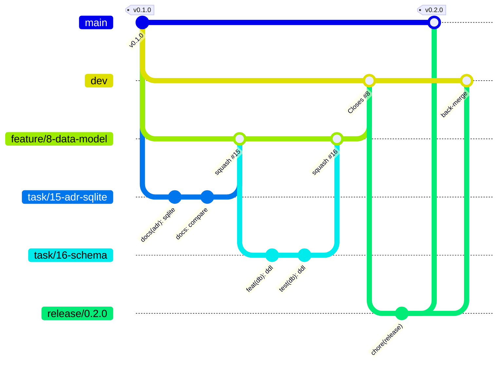
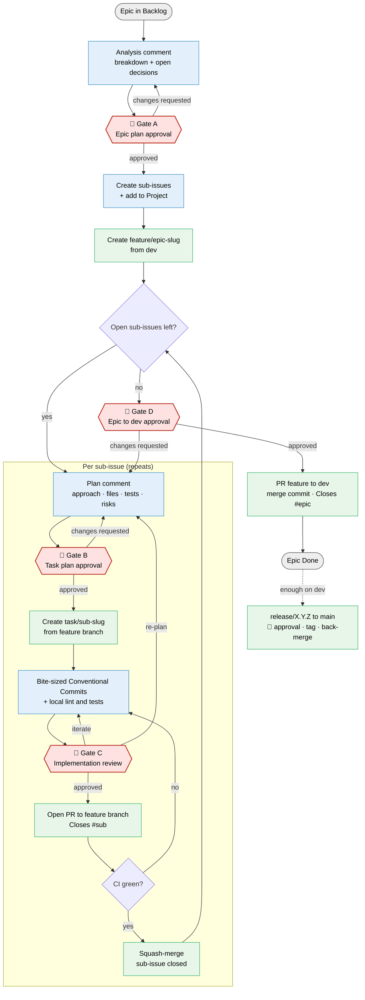
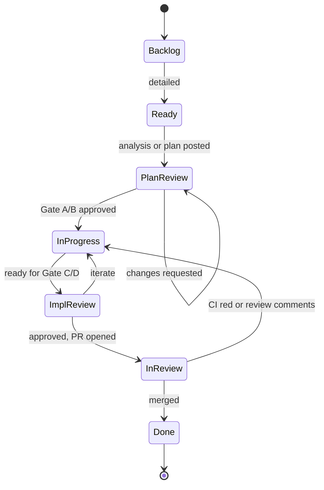

# Contributing

This repo follows an issue-driven gitflow with human approval gates. Claude Code sessions run it through the global `wf-*` skills from the private `claude-workflow` repo; humans follow the same rules by hand. The machine-readable configuration is in [`.github/workflow.yml`](.github/workflow.yml).

## Principles

1. **No work without an issue.** Every epic is a detailed macro issue; its work is split into native GitHub sub-issues.
2. **The owner decides.** Plans and implementations stop at human gates 🛑 A–D, and approvals are recorded on the issue.
3. **Small, verifiable steps.** Bite-sized Conventional Commits, and every PR is linked to the issue it closes.
4. **Everything is traced** on the [Project board](https://github.com/users/AleFire99/projects/3): analyses, plans, reviews and status handoffs are issue comments.
5. **Docs move with code.** Markdown and mermaid diagrams are updated in the same PR, and decisions are recorded as ADRs in [`docs/adr/`](docs/adr/README.md).
6. **Python means uv only.** Never use pip, venv, poetry or pipenv.

## Branches

| Branch | From | Into | Merge |
| --- | --- | --- | --- |
| `main` | — | — | Production. Only `release/*` and `hotfix/*` PRs land here, and each merge is tagged `vX.Y.Z`. |
| `dev` | `main` | — | Integration. Only `feature/*`, `release/*` and `hotfix/*` PRs land here. |
| `feature/<epic#>-<slug>` | `dev` | `dev` | Merge commit (Gate D) |
| `task/<sub#>-<slug>` | parent feature branch | parent feature branch | Squash; the PR title becomes the commit |
| `release/X.Y.Z` | `dev` | `main`, then back-merged to `dev` | Merge commit |
| `hotfix/<#>-<slug>` | `main` | `main` and `dev` | Merge commit |

Task branches use `task/`, not a nested `feature/<epic>/<task>` name, because Git cannot hold both `feature/x` and `feature/x/y` as refs. `main` and `dev` are protected by GitHub rulesets: a PR is required, the required checks must be green, and force-pushes and deletion are blocked. Locally, the `git-guard` hook blocks commits and pushes on them.

**Merging into `dev`:**

- If a feature branch is built from squashed `task/` PRs, merge it with a **merge commit**, so `dev` keeps one commit per sub-issue.
- If a feature branch holds raw working commits (no `task/` branches, as with the bootstrap epic or small standalone work), **squash** it, and list the changes per sub-issue in the PR body.
- `Closes #n` only auto-closes issues on merges into `main`, the default branch. After merging into `feature/*` or `dev`, close the issues explicitly.



## Lifecycle and human gates

One agent chat usually handles one epic. The agent analyses and plans, the owner approves at each gate, and only then is the work done and merged.



| Gate | When | What the owner sees | Board column |
| --- | --- | --- | --- |
| 🛑 A | after the epic analysis | current state, proposed sub-issues, open decisions | Plan Review |
| 🛑 B | after a task plan | approach, files, commit steps, test plan, risks | Plan Review |
| 🛑 C | implementation done, **before the PR is opened** | commits, diff stat, check results, acceptance criteria with evidence, reviewer findings | Impl Review |
| 🛑 D | before a feature→`dev` merge or any PR into `main` | sub-issue summary, changelog, breaking changes | Impl Review |

How a gate works:

1. The agent posts the artefact as an issue comment ending with a 🛑 block, adds the `status:awaiting-approval` label and moves the card.
2. It stops and asks the owner in chat.
3. The decision is recorded as a comment: ✅ approved or 🔁 changes requested. The owner can also comment `/approve <gate>` or `/changes <text>` on GitHub.

An approval covers one gate on one issue for one iteration. It is never assumed and never carried over.

### Board status



## Who does what

| Role | Responsibilities |
| --- | --- |
| Owner (human) | Decides at gates A–D, accepts ADRs, triggers releases |
| Orchestrator (the Opus chat) | Talks to the owner, writes briefs, reviews and verifies subagent output, records gates and status on GitHub |
| `wf-*` subagents | Haiku: `wf-explorer`, `wf-gh-clerk`, `wf-ci-doctor`. Sonnet: `wf-analyst`, `wf-implementer`, `wf-test-writer`, `wf-reviewer`, `wf-docs-writer`. They do bounded work from self-contained briefs and never cross a gate. |

Each analysis, plan or review comment notes which agents produced it.

## Issues

Use the issue forms: **Epic**, **Task** (always has a parent epic), **Bug** and **Spike** (research that ends in an ADR). Labels:

- `type:*`: epic, task, bug, spike, docs, ci
- `area:*`: scraper, translation, db, images, docs, infra
- `priority:P0`–`P3`
- `status:*`: blocked, needs-info, awaiting-approval

### Milestones

A milestone is a release target named `vX.Y.Z`; its description gives the release theme. An epic and all its sub-issues share the epic's milestone (`wf-subissue add` copies it), standalone bugs and spikes get the milestone of the release that will ship them, and an issue without a milestone is unscheduled. Milestones group work by *when it ships*; epics group it by topic. The owner decides which milestone an epic targets.

## Commits

[Conventional Commits](https://www.conventionalcommits.org/), checked by commitlint in CI and by a pre-commit `commit-msg` hook:

```text
feat(scraper): parse reduction symbols from batspi card pages

Explain *why* when it is not obvious.

Refs #10
```

Types: `feat` `fix` `docs` `refactor` `test` `ci` `chore` `build` `perf` `style` `revert` `data`. Make one logical change per commit, and keep every commit green.

## Pull requests

- The title is a Conventional Commit. It becomes the squash commit.
- The body follows the template and must contain `Closes #<n>` and a link to the Gate C (or D) approval.
- `pr-lint` enforces which branch may target which base: `task/*` → `feature/*`; `feature/*`, `release/*`, `hotfix/*` and `dependabot/*` → `dev`; only `release/*` or `hotfix/*` → `main`.
- Required checks: `lint-test`, `docs`, `pr-lint`, `commitlint`.

## Local setup

```bash
uv sync                                    # creates .venv from uv.lock
uv run pre-commit install --hook-type pre-commit --hook-type commit-msg
uv run pre-commit run --all-files          # ruff, uv-lock, markdownlint, whitespace, …
uv run pytest
uv run bsdb --help                         # dev loop: run the CLI from the working tree
```

Add dependencies with `uv add <pkg>` (or `uv add --dev <pkg>` for dev tools) and commit `uv.lock`.

## Adding a glossary entry

Glossaries are CSV files in `data/glossary/` (see [ADR 0008](docs/adr/0008-normalization-and-translation.md)).

1. Pick the file: `colors`, `symbols`, `card_types`, `rarities`, `variants`, `product_types`, `keywords` or `families`.
2. Add one row. `jp` must be exactly what the parser emits. Do not pad with spaces.
3. Keep rows sorted by `code` (families: by `code`, then `jp`). Do not duplicate a `jp` or a `code`.
4. Fill `en` for closed kinds. Mark a guessed English name in `notes` as `provisional`.
5. Legacy English family names go in `family_legacy_en.csv`. Fill `jp` with a name that exists in `families.csv`.
6. Run `uv run pytest tests/test_glossary.py tests/test_glossary_seed.py`. The loader lists every violation as `<file>:<line>: <rule>`.

## Releases

SemVer, and a schema-breaking change bumps the major version. Cut `release/X.Y.Z` from `dev`, generate the CHANGELOG with `uvx git-cliff --tag vX.Y.Z`, pass Gate D, merge into `main`, tag it, publish a GitHub Release (the built database is attached as an asset), then back-merge into `dev`. The release's scope is its milestone: open issues in it are finished or moved before Gate D, and the release closes the milestone.
