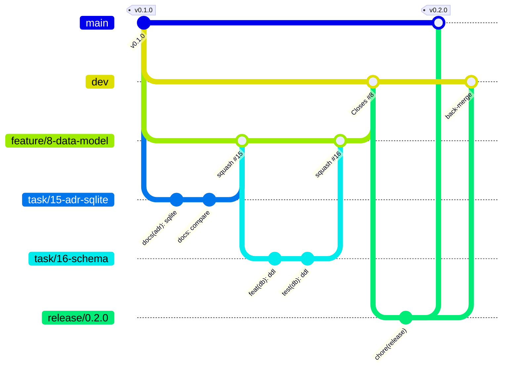
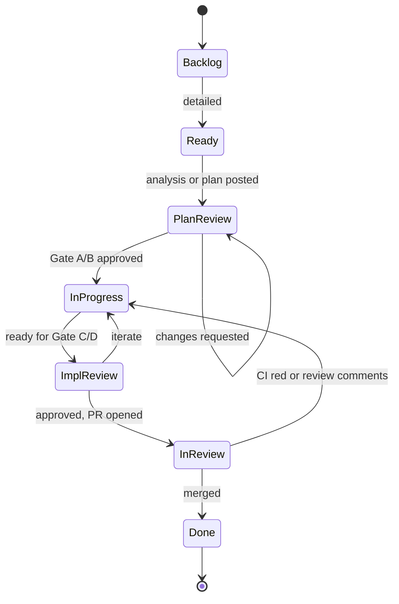

# Contributing

This repo follows an issue-driven gitflow with human approval gates. Claude Code sessions run it through the global `wf-*` skills from the private `claude-workflow` repo; humans follow the same rules by hand. The machine-readable configuration is in [`.github/workflow.yml`](.github/workflow.yml).

## Principles

1. **No work without an issue.** Every epic is a detailed macro issue; its work is split into native GitHub sub-issues.
2. **The owner decides.** Plans and implementations stop at human gates 🛑 A–D, and approvals are recorded on the issue.
3. **Small, verifiable steps.** Bite-sized Conventional Commits, and every PR is linked to the issue it closes.
4. **Everything is traced** on the [Project board](https://github.com/users/AleFire99/projects/3): analyses, plans, reviews and status handoffs are issue comments.
5. **Docs move with code.** Markdown and mermaid diagrams are updated in the same PR, and decisions are recorded as ADRs in [`docs/adr/`](docs/adr/README.md).
6. **Python means uv only.** Never use pip, venv, poetry or pipenv.

## Branches

| Branch | From | Into | Merge |
| --- | --- | --- | --- |
| `main` | — | — | Production. Only `release/*` and `hotfix/*` PRs land here, and each merge is tagged `vX.Y.Z`. |
| `dev` | `main` | — | Integration. Only `feature/*`, `release/*` and `hotfix/*` PRs land here. |
| `feature/<epic#>-<slug>` | `dev` | `dev` | Merge commit (Gate D) |
| `task/<sub#>-<slug>` | parent feature branch | parent feature branch | Squash; the PR title becomes the commit |
| `release/X.Y.Z` | `dev` | `main`, then back-merged to `dev` | Merge commit |
| `hotfix/<#>-<slug>` | `main` | `main` and `dev` | Merge commit |

Task branches use `task/`, not a nested `feature/<epic>/<task>` name, because Git cannot hold both `feature/x` and `feature/x/y` as refs. `main` and `dev` are protected by GitHub rulesets: a PR is required, the required checks must be green, and force-pushes and deletion are blocked. Locally, the `git-guard` hook blocks commits and pushes on them.

**Merging into `dev`:**

- If a feature branch is built from squashed `task/` PRs, merge it with a **merge commit**, so `dev` keeps one commit per sub-issue.
- If a feature branch holds raw working commits (no `task/` branches, as with the bootstrap epic or small standalone work), **squash** it, and list the changes per sub-issue in the PR body.
- `Closes #n` only auto-closes issues on merges into `main`, the default branch. After merging into `feature/*` or `dev`, close the issues explicitly.



## Lifecycle and human gates

One agent chat usually handles one epic. The agent analyses and plans, the owner approves at each gate, and only then is the work done and merged.


| Gate | When | What the owner sees | Board column |
| --- | --- | --- | --- |
| 🛑 A | after the epic analysis | current state, proposed sub-issues, open decisions | Plan Review |
| 🛑 B | after a task plan | approach, files, commit steps, test plan, risks | Plan Review |
| 🛑 C | implementation done, **before the PR is opened** | commits, diff stat, check results, acceptance criteria with evidence, reviewer findings | Impl Review |
| 🛑 D | before a feature→`dev` merge or any PR into `main` | sub-issue summary, changelog, breaking changes | Impl Review |

How a gate works:

1. The agent posts the artefact as an issue comment ending with a 🛑 block, adds the `status:awaiting-approval` label and moves the card.
2. It stops and asks the owner in chat.
3. The decision is recorded as a comment: ✅ approved or 🔁 changes requested. The owner can also comment `/approve <gate>` or `/changes <text>` on GitHub.

An approval covers one gate on one issue for one iteration. It is never assumed and never carried over.

### Board status



## Who does what

| Role | Responsibilities |
| --- | --- |
| Owner (human) | Decides at gates A–D, accepts ADRs, triggers releases |
| Orchestrator (the Opus chat) | Talks to the owner, writes briefs, reviews and verifies subagent output, records gates and status on GitHub |
| `wf-*` subagents | Haiku: `wf-explorer`, `wf-gh-clerk`, `wf-ci-doctor`. Sonnet: `wf-analyst`, `wf-implementer`, `wf-test-writer`, `wf-reviewer`, `wf-docs-writer`. They do bounded work from self-contained briefs and never cross a gate. |

Each analysis, plan or review comment notes which agents produced it.

## Issues

Use the issue forms: **Epic**, **Task** (always has a parent epic), **Bug** and **Spike** (research that ends in an ADR). Labels:

- `type:*`: epic, task, bug, spike, docs, ci
- `area:*`: scraper, translation, db, images, docs, infra
- `priority:P0`–`P3`
- `status:*`: blocked, needs-info, awaiting-approval

### Milestones

A milestone is a release target named `vX.Y.Z`; its description gives the release theme. An epic and all its sub-issues share the epic's milestone (`wf-subissue add` copies it), standalone bugs and spikes get the milestone of the release that will ship them, and an issue without a milestone is unscheduled. Milestones group work by *when it ships*; epics group it by topic. The owner decides which milestone an epic targets.

## Commits

[Conventional Commits](https://www.conventionalcommits.org/), checked by commitlint in CI and by a pre-commit `commit-msg` hook:

```text
feat(scraper): parse reduction symbols from batspi card pages

Explain *why* when it is not obvious.

Refs #10
```

Types: `feat` `fix` `docs` `refactor` `test` `ci` `chore` `build` `perf` `style` `revert` `data`. Make one logical change per commit, and keep every commit green.

## Pull requests

- The title is a Conventional Commit. It becomes the squash commit.
- The body follows the template and must contain `Closes #<n>` and a link to the Gate C (or D) approval.
- `pr-lint` enforces which branch may target which base: `task/*` → `feature/*`; `feature/*`, `release/*`, `hotfix/*` and `dependabot/*` → `dev`; only `release/*` or `hotfix/*` → `main`.
- Required checks: `lint-test`, `db-build` (the fixture database build, see [build.md](docs/architecture/build.md#in-ci)), `docs`, `pr-lint`, `commitlint`.

## Local setup

```bash
uv sync                                    # creates .venv from uv.lock
uv run pre-commit install --hook-type pre-commit --hook-type commit-msg
uv run pre-commit run --all-files          # ruff, uv-lock, markdownlint, whitespace, …
uv run pytest
uv run bsdb --help                         # dev loop: run the CLI from the working tree
```

Add dependencies with `uv add <pkg>` (or `uv add --dev <pkg>` for dev tools) and commit `uv.lock`.

## Adding a glossary entry

Glossaries are CSV files in `data/glossary/` (see [ADR 0008](docs/adr/0008-normalization-and-translation.md)).

1. Pick the file: `colors`, `symbols`, `card_types`, `rarities`, `variants`, `product_types`, `timings`, `card_classes`, `product_code_prefixes`, `product_name_keywords`, `keywords` or `families`.
2. Add one row. `jp` must be exactly what the parser emits. Do not pad with spaces.
3. Keep rows sorted by `code` (families: by `code`, then `jp`). Do not duplicate a `jp` or a `code`.
4. Fill `en` for closed kinds. Mark a guessed English name in `notes` as `provisional`. A name taken from the fandom wiki carries `notes` = `fandom: <title>`.
5. Legacy English family names go in `family_legacy_en.csv`. Fill `jp` with a name that exists in `families.csv`.
6. Run `uv run pytest tests/test_glossary.py tests/test_glossary_seed.py`. The loader lists every violation as `<file>:<line>: <rule>`.

Family and keyword codes are lowercase ASCII slugs, unique and sorted. Use the romaji of the Japanese name when it is known (`kijuu`, `gattai_chu`). Otherwise use a slug of the English name (`a_laws`, `aeon_arcana`). Existing codes are never renamed. `product_code_prefixes.csv` (`prefix,code,notes`) maps a product-code prefix to a `product_types` code: prefixes are unique and sorted, and the code must exist in `product_types.csv`. The longest matching prefix wins ([normalization](docs/architecture/normalization.md#rules)). `product_name_keywords.csv` (`keyword,code,notes`) types products that have no product code (or no matching prefix) by a substring of the Japanese product name: keywords are unique and sorted, the code must exist in `product_types.csv`, matching is NFKC and the **longest** keyword wins. Check a new keyword against the real product names first (`bsdb glossary review` lists the untyped ones in *Untyped products*), and add a longer keyword when a short one mistypes a product.

**Timings and card classes** ([ADR 0012](docs/adr/0012-english-text-term-protection-and-provenance.md), #155). `timings.csv` has one row per timing string: the `timing_jp` values and the timing-like `『…』` spans that only occur inside effect text (`notes` = `in-text only`; 21 come from the review and `『ブロックできない』` was added by hand, because the review's suffix filter does not list it). `jp` and `en` both keep the source `『』`. The English follows one pattern: `『When this Spirit is summoned』`, `『When this Spirit attacks or blocks』` (a slash list reads `A or B`, three items `A, B or C`; a subject list `Spirit or Ultimate`), `『When this Spirit is destroyed by your opponent』`, `『During your Attack Step』`, `『During either player's Attack Step』`, `『At the start of your opponent's Main Step』`, `『After you activate a Burst』`, `『While attacking』`. Use the vocabulary of `keywords.csv` (Advent, Manifest, Rebirth, Soul Burst, Mirage), capitalise Spirit, Brave, Ultimate, Nexus, Mirage, Burst and the step names, and keep the rest in sentence case. The code is the ASCII slug of the English. `card_classes.csv` maps `card_class_jp` (`契約` is Contract, `トークン` is Token) and is separate from `card_types`. Both kinds are **closed**: `en` is required and the file needs at least one row. A new timing must be curated before it can be looked up; mark a doubtful English as `provisional`.

### Curating with the review command

1. Run `bsdb scrape` and `bsdb normalize`, so `data/normalized/` is current.
2. Run `uv run bsdb glossary review --legacy-db <path to the v0.1.0 battle_spirits.db> [--out DIR]`. The output is `data/review/review.md`, `families.csv`, `keywords.csv`, `family_legacy_en.csv`, `timings.csv` and `card_classes.csv`. Nothing in `data/glossary/` changes.
3. Read `review.md` (families, keywords, timings, card classes, `no_split` candidates, product-code prefixes, untyped products, slug conflicts, legacy pairs). Agree the names with the owner.
4. Copy `families.csv` and `family_legacy_en.csv` together into `data/glossary/`. Fill missing codes and English names by hand, then re-sort `families.csv` and `keywords.csv` by `code` (the loader requires it).
5. Run the tests above and `bsdb normalize --strict`, then regenerate the goldens with `uv run python tests/tools/regen_normalized_goldens.py`.

## Reading the normalize report

`bsdb normalize` writes `data/normalized/_report.md` (and the same data as `_report.json`) next to the pages.

- **Unmapped, closed**: a colour, symbol, card type, rarity, variant or product type with no glossary row. The page is not written. Add the row to the right CSV. Timings and card classes are closed kinds too; once normalize looks them up (#157) a missing one is reported the same way.
- **Unmapped, warnings**: a family or keyword with no glossary row. `--strict` fails on these. Add the row.
- **Uncurated**: a row exists but its `code` is empty. Not an error; fill the code (see the review command above).
- **Translation**: per category (families, names, products), how many texts came from the glossary or batspi, and how many are `machine`, `pending` or `failed`, and `chars_to_translate`, the Japanese characters still to send to the engine. `pending` means no key, over the `--max-chars` budget or the null engine; `failed` means the engine errored. Both are retried on the next run.

Strict mode (`bsdb normalize --strict`) is checked in CI by `tests/test_normalize_strict.py`, with no translation model.

## Building the database

`uv run bsdb build [--out PATH] [--built-at ISO8601] [--strict]` writes a fresh SQLite file from `data/normalized/` and the glossary (no network; the raw-HTML cache is only read for page hashes). It prints the rows per table and a quality summary and writes `<db-stem>.build_report.json` and `.md` next to the database; quality errors (and warnings with `--strict`) fail the build and keep the old file. See [build](docs/architecture/build.md) for the rules, the severities and the report.

**Adding a quality rule.**

A rule is a read-only SQL query in `src/bs_database/build/quality/rules.py` (`RULES`): one row per violation, first column a short example, a stable `ORDER BY`. Pick the next free id of the severity range (`Q0xx` error, `Q03x` warning, `Q05x` info), measure it on the full data first (`uv run python` with `run_rules` on a built database), and add a failing case to `FAILING` in `tests/test_quality_rules.py` (a mutation of the clean data set in `tests/quality_support.py`); a meta-test fails when an id has none. A new loader warning kind needs an entry in `LOADER_KINDS` (`quality/loader.py`). Then regenerate the count golden and document the rule in the catalogue of [build](docs/architecture/build.md#quality-rules). After a change to the build, regenerate the count golden with `uv run python tests/tools/regen_build_goldens.py` and review the diff. To compare a build with the v0.1.0 database run `uv run python tests/tools/parity_report.py <legacy.db> <new.db> --out report.md`; it regenerates the body of [parity-v0.1.0](docs/data-model/parity-v0.1.0.md) below its hand-written header. A schema change is an edit of `src/bs_database/schema.sql` ([ADR 0011](docs/adr/0011-schema-sql-source-of-truth-without-migrations.md)) together with `docs/data-model/target-schema.md`; `tests/test_schema_sql.py` checks that they agree.

## Releases

SemVer, and a schema-breaking change bumps the major version. Cut `release/X.Y.Z` from `dev`, generate the CHANGELOG with `uvx git-cliff --tag vX.Y.Z`, pass Gate D, merge into `main`, tag it, publish a GitHub Release (the built database is attached as an asset), then back-merge into `dev`. The release's scope is its milestone: open issues in it are finished or moved before Gate D, and the release closes the milestone.
