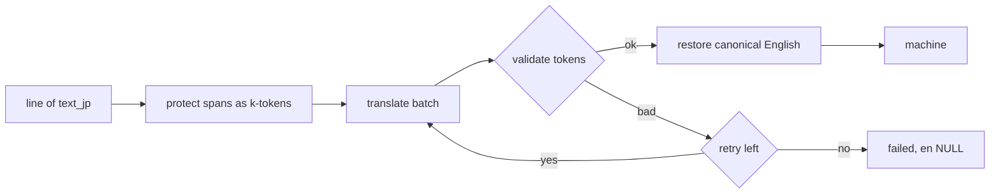

# 0012. English text, term protection and provenance

- Status: Accepted
- Date: 2026-11-28

## Context

Effects, headers, flavor text and conditions exist in Japanese only. The normalizer copies the Japanese and leaves English empty (`text_en` NULL, status `pending`). Names, families and products are already machine-translated ([ADR 0008](0008-normalization-and-translation.md)). Epic [#147](https://github.com/AleFire99/BS_Database/issues/147) adds English for the rest.

Raw machine translation (MT) damages the terms the game depends on. In a first test on 11 texts, `「…」` names were re-romanised differently from the name glossary, `【一騎打】` became "single ride", and `系統：` came out as "System", "Strains" and "Lineage". The terms must be protected before MT and restored after it.

Two limits of the current code also matter:

- `build/cards.py` `_english()` (lines 41-50) keeps one source/status pair per card, taken from the name first, then the flavor. A machine flavor next to a reviewed name would be mislabelled.
- `build/effects.py` (line 62) writes `timing_en` as `None`.

[ADR 0005](0005-text-first-effects-and-translations.md) fixes one `en_source_id`/`en_status_id` pair per row and says that a row cannot give two texts different sources. Changing that for `cards` amends it.

The spike [#153](https://github.com/AleFire99/BS_Database/issues/153) (`tests/tools/mt_spike.py`) measured segmentation and placeholder styles on 353 stratified samples (221 effect texts including the 20 longest, 50 flavor texts, 82 summon conditions; seed 147; 213 with protected spans) with the `quickmt-ja-en` engine.

## Decision drivers

- Keywords, family names and card names must come out as the glossaries say, not as MT guesses.
- A bad result must never be stored as text (ADR 0005): it is `failed` with a NULL English field.
- Provenance must be true: glossary text and machine text must not share one label.
- Cached results must stay valid when the protection rules change.
- The release must stay within [ADR 0006](0006-scraping-and-redistribution-policy.md).
- CI must not need the model.

## Options considered

### Segmentation

| Option | Evidence from the spike | Verdict |
| --- | --- | --- |
| Whole text in one call | Sentences dropped in about 10% of texts, even unmasked. On the 20 longest texts survival fell to 31% (`<k0/>`) and 8% (`⟦K0⟧`), with repetition loops. Slower on long texts (0.307 s raw). | Rejected |
| **Per line** (split on `\n`, one batch, rejoin) | No dropped sentences (0%). Survival 98% with `<k0/>`; 100% and 92% on the 20 longest. About 2x faster on long texts (0.156 s raw). | Chosen |

### Placeholder style

| Style | Mode | Survived | Lost | Garbled | Verdict |
| --- | --- | --- | --- | --- | --- |
| `⟦K0⟧` | line | 97% | 3% | 2% | Rejected |
| **`<k0/>`** | line | 98% | 1% | 0% | Chosen |
| `K0K` | whole only | 96% | 3% | 1% | Not measured per line; fallback |
| `[0]` | whole only | 84% | 13% | 5% | Rejected |

Whole-text results for `⟦K0⟧` and `<k0/>` were 91% survived. `K0K` and `[0]` were only run in whole mode.

### Provenance granularity

1. One pair per row everywhere (ADR 0005 as is): simple, but mislabels `cards`.
2. Per-field pairs everywhere: exact, but adds columns to many tables for no gain where a row has one text.
3. **One pair per row for effects and conditions; a separate pair for the card flavor.** Only `cards` mixes a reviewed name with a machine flavor.

## Decision

Option 3 for provenance, per-line segmentation and `<k0/>` placeholders. The contract is below. The implementation is left to [#156](https://github.com/AleFire99/BS_Database/issues/156), the glossary to [#155](https://github.com/AleFire99/BS_Database/issues/155) and the schema to [#158](https://github.com/AleFire99/BS_Database/issues/158).

1. **Segmentation.** Split the text on `\n`, translate all lines as one batch, rejoin with `\n`.
2. **Placeholders.** Each protected span becomes `<k0/>`, numbered per line. Restore tolerates the quotes the model puts around a token, but only symmetric pairs, so a real `'` is kept. A line is valid when the multiset of tokens equals the multiset sent and no marker residue remains. Order is not checked.
3. **Protected classes.** Each maps to its canonical English from the glossary:
   - `【…】` keywords and type marks
   - `《…》` keyword brackets (the spike saw `《契約煌臨》` become "Contract Glowing")
   - `〔…〕` qualifiers
   - `『…』` timings inside text
   - `「…」` names and families
   - `系統：`
   - runs of symbol glyphs
4. **`「…」` rendering.** The family glossary English if the span is a family; otherwise the card name map English if it exists; otherwise the romanised Japanese kept in quotes. MT does not decide this.
5. **Failure.** A lost, duplicated, foreign or garbled token, or a line that hits the decoding limit (256 in `translate/quickmt.py`; the spike found no truncation per line at 256), fails the line. One retry per failed line is allowed (detail in #156). If it still fails, the whole field is `failed` with `*_en` NULL, never partial text.
6. **Cache and engine name.** The engine name carries a protection version: `quickmt-ja-en+prot1`. Any change to protection rules or segmentation bumps it, so protected and unprotected entries never share a cache key.
7. **Provenance.** Effects and conditions keep one source/status pair per row. `cards` gets its own flavor source/status, split from the name.
8. **Field scope.**
   - MT (`machine` / `machine`): effect text, flavor, fusion and summon conditions.
   - Glossary (`manual` / `reviewed`): timings, headers, `card_class`.
   - Deferred: overclock conditions, flavor notes, printing and level notes.
9. **Quality bar.** A stratified sample of N=200 is read by the owner. At least 85% must be understandable and rule-correct, and under 2% of fields may be `failed`. Below that, the release still ships as `machine` with a published defect list.
10. **Redistribution.** Per ADR 0006 the release may carry the Japanese and English card text from batspi.com with the attribution text of [policy.md §4](../sources/policy.md#4-redistribution-and-attribution), the fan-project notice and the takedown route. That text already says "English text is machine-translated unless marked otherwise". Machine English is a derived text of the same content and follows these terms. No new hosting and no change to ADR 0006. Images stay excluded.
11. **CI.** No model in CI. Goldens use the fake or `NullTranslator`; the real run is a documented manual step.

Per-line flow:

## Consequences

- Positive:
  - Terms come out as the glossaries say, and results are reproducible from the cache.
  - Failures are visible as a status, not as damaged text.
  - A full run is estimated at about 30 minutes on CPU for about 39k unique strings.
  - Provenance is true for `cards`.
- Negative:
  - The spike measured about 2% lost or garbled lines in some styles; with `<k0/>` about 1% lost. The 2% `failed` bar is met only if the retry works (#156).
  - Protection does not fix semantic errors (word order, `以下` read as "less than"). Those are `machine` status and are measured by the sample ([#161](https://github.com/AleFire99/BS_Database/issues/161)).
  - Changing `cards` is a schema change: `schema.sql` is rewritten and `user_version` bumped ([ADR 0011](0011-schema-sql-source-of-truth-without-migrations.md)), so consumers re-pin.
  - Every rule change bumps the engine name and invalidates cached results.
- Follow-up work: [#155](https://github.com/AleFire99/BS_Database/issues/155) (glossary), [#156](https://github.com/AleFire99/BS_Database/issues/156) (protection layer), [#158](https://github.com/AleFire99/BS_Database/issues/158) (schema), [#162](https://github.com/AleFire99/BS_Database/issues/162) (architecture docs).

## Amendments

Recorded with the implementation of [#156](https://github.com/AleFire99/BS_Database/issues/156), at the owner's Gate B decision of 2026-11-28. They clarify decisions 3 and 5; nothing else changes.

- **Retry (decision 5).** "One retry per failed line" means: split the failed line after each `。` and translate the sentences as one second batch, numbering the placeholders again per sentence. Decoding is deterministic, so repeating the same input would give the same output. A line with a single sentence fails at once. If any sentence still fails, the whole field is `failed`.
- **Rendering (decision 3).** The canonical English keeps the source brackets (`【Duel】`, `《…》`, `〔…〕`, `『…』`, `「…」`). A span the glossaries do not know keeps its Japanese inside the brackets; the field does not fail, and the translator logs how many spans were unresolved. `系統：` becomes `Family:` and a run of symbol glyphs becomes the glyphs' English joined by spaces.
- **Romanisation (decision 4).** Names missing from the family glossary and the card name map are romanised with `pykakasi`, an optional dependency of the `mt` group (GPL-3.0-or-later, to be handled by the release epic [#14](https://github.com/AleFire99/BS_Database/issues/14)).

## Links

- Issue: [#154](https://github.com/AleFire99/BS_Database/issues/154), epic [#147](https://github.com/AleFire99/BS_Database/issues/147)
- Spike: [#153](https://github.com/AleFire99/BS_Database/issues/153), `tests/tools/mt_spike.py`
- Amends [0005](0005-text-first-effects-and-translations.md); builds on [0006](0006-scraping-and-redistribution-policy.md) and [0008](0008-normalization-and-translation.md).
