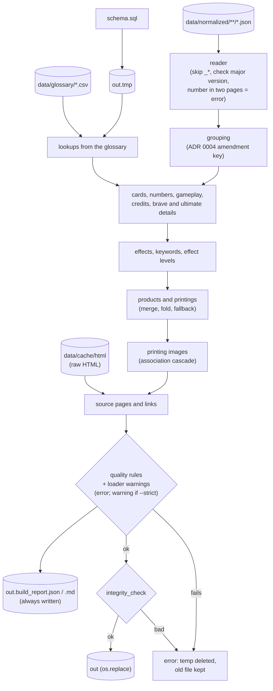

# Database build (`bsdb build`)

The build ([#120](https://github.com/AleFire99/BS_Database/issues/120), epic [#12](https://github.com/AleFire99/BS_Database/issues/12), [ADR 0011](../adr/0011-schema-sql-source-of-truth-without-migrations.md)) turns the normalized card pages of `data/normalized/` into one SQLite file with the 34 tables of [schema.sql](../../src/bs_database/schema.sql) ([target-schema.md](../data-model/target-schema.md)). It uses only the standard library `sqlite3`; SQLAlchemy and the legacy loader were removed.

```bash
uv run bsdb build [--out PATH] [--built-at ISO8601] [--data-version TAG] [--strict]
```

- `--out` is the database file (default `BSDB_DB_PATH`, `data/battle_spirits.db`). The build always writes a **fresh** file and replaces the old one; it never appends.
- `--built-at` fixes `schema_meta.built_at`, so two builds of the same data are byte-identical.
- `--data-version` sets `schema_meta.data_version`, the release tag of the data (default `dev`; a release passes `vX.Y.Z`).
- It reads `BSDB_NORMALIZED_DIR`, `BSDB_GLOSSARY_DIR` and, for the page hashes, `BSDB_CACHE_DIR`. It makes no network request.
- `--strict` also fails the build on quality warnings (info never fails).
- It prints the rows per table, the image association levels and a quality summary, and writes the [build report](#build-report) next to the database.
- Exit code 0 on success (warnings and info do not change it), 1 when the build fails: no normalized pages, invalid glossary, a page of another schema major version, a number in two pages, a quality error (a rule of severity `error`, including a foreign key violation, rule Q001), or a quality warning under `--strict`. The old output file is then untouched.

## Flow



`build_database` (in `src/bs_database/build/builder.py`) does these steps: write to `<out>.tmp`, run `schema.sql`, set `foreign_keys=ON`, insert everything in **one transaction**, run the quality rules and map the loader warnings to findings (still inside the transaction, read-only), commit, run `integrity_check`, then `os.replace` onto the output. A failing finding raises `BuildQualityError` before the commit. On any error the temp file is deleted and the old output stays.

| Module (`bs_database.build`) | Role |
| --- | --- |
| `reader` | Read the documents, sorted by url; checks |
| `grouping` | Card grouping key and `CardGroup` |
| `lookups` | Fill the lookup tables from the glossary, constant `effect_kinds` |
| `cards`, `effects` | Card, gameplay, credits, details; effects, keywords, levels |
| `products` | Products, printings, illustrator rule |
| `images` | Image association cascade, source pages and links |
| `diagnostics` | `BuildWarnings` (counted, with examples), `BuildError` |
| `quality` | Rule registry (`rules`), `run_rules`, loader warning severities (`loader`), the report (`report`); see [Quality rules](#quality-rules) |

## Determinism

Ids are assigned in Python from sorted keys, never from the order of the input: lookups by `code`, cards by their first number, card numbers by number, products by key, printings by `(number, product, variant)`, effects in page order per card, source pages by url. Two builds of the same data differ only in `schema_meta.built_at`; the tests also check that reading the documents in reverse order gives the same bytes.

## Rules

| Area | Rule |
| --- | --- |
| Reading | `schema_version` major must be 1. A number in two documents, or one url twice, is an error. `_report.*` files are skipped. |
| Cards | Several numbers share one card only when the hash of `name_jp`, gameplay, effects (position, levels, header, text), conditions and flavor is equal ([ADR 0004 amendment](../adr/0004-card-printing-identity.md#amendment-2026-11-21-63)). Merged entries must share the name. English names, credits and images are not in the key; the member with the smallest number supplies them. |
| Card English | One `(en_source, en_status)` pair per card (ADR 0005): the pair of the name when `name_en` exists, else the pair of the flavor; no English text gives `pending` (or `failed`). |
| `cards.block_icon` | The icon of the first printing that has one (numbers sorted, page order); a card whose printings show different icons is counted as `block_icon_conflict` (follow-up [#131](https://github.com/AleFire99/BS_Database/issues/131) moves the icon to printings). |
| Colors, families | One row per distinct code; a value without a code is skipped with a warning. |
| Symbols | One row per symbol: a symbol twice on a card (`神(青)神(白)`) gives one row with the counts summed and `variant_jp`, `color_jp` joined with `・` in page order. Reductions use the coded parts only. |
| Levels | One row per level; a repeated level keeps the first. `cores` NULL for a conditional level (`<C2>`) is loaded as is. |
| Credits | `card_credits` of the first member: concept credits first with `role_jp = コンセプト`, then the other credits in page order. |
| Brave / ultimate | `brave_details` (conditions joined by a line break, fusion bonus) and `ultimate_details` (summon condition) for cards of that type. |
| Effect kind | `keyword_line` form gives `keyword_block`; label `メイン` gives `main`, `フラッシュ` gives `flash`; a header starting `【セット中】` gives `set_active`; a `header` with levels gives `level` with a timing and `constant` without; everything else `other`. `effect_kinds` is a constant of the code. On the full data 6,719 effects (about 20%) are `other` and have no `card_effect_levels` rows, including 48 whose text starts with a level such as `Lv1-2『召喚時』`; the normalizer does not parse that prefix yet ([#133](https://github.com/AleFire99/BS_Database/issues/133)). |
| Effect keywords, levels | A keyword without a code is skipped; a keyword twice in one effect keeps the first; a level not on the card is skipped (all with a warning). |
| Product key | The code; else a name used with exactly one code elsewhere takes that code (`product_name_folded`); else the name. |
| Product merge | Name: most frequent (tie: sorted first). Type: most frequent non-null. Release date: earliest non-null. English name: most frequent. A product with no type at all gets `other` (`product_without_type`). `series` stays NULL. |
| Printing key | `(number, product, variant)`. The first row in `(url, page)` order wins, nulls are filled from later rows, a conflicting rarity keeps the first (`printing_rarity_conflict`). A printing of a number without an entry is skipped. |
| Illustrator | No name: NULL. One name: that name. Several: the one whose note matches the product, variant, note or detail text of the printing; else the only one without a note; else all names joined with ` / `. |
| Images | Each image goes to a printing of its number by a cascade: L0 the number has one printing; L1 the caption names one printing's product; L2 several printings of that product, the variant word of the caption (`シークレット`, `パラレル`, `フルアート`) picks one; L3 no product match, the variant word alone picks a unique printing; L4 first printing of the product (`normal` first); L5 first printing of the number (`normal` first). Several images of one printing and size get `position` 1, 2, ... in page order. |
| Source pages | One row per document: `fetched_at` from the provenance, `parser_version` is the parsed schema version, `content_sha256` is the sha256 of the cached raw HTML (`RawCache`) or, when it is missing, of the normalized document (`source_page_without_raw_html`). Links to cards and products. |
| `schema_meta` | One row ([ADR 0003](../adr/0003-naming-and-schema-versioning.md), [#121](https://github.com/AleFire99/BS_Database/issues/121)): `schema_version` from `PRAGMA user_version` (`major*10000+minor*100+patch`; 0.1.0 until the first release); `data_version` from `--data-version`; `built_at` ISO 8601 UTC with `Z`; `source_snapshot` = `batspi <first>..<last fetched date>; <N> pages; normalized <schema>` from the documents' provenance; `generator` = the `bs_database` package version. |

## Data with no column (dropped)

The normalized documents hold values that the schema has no column for. They are not loaded; follow-up [#130](https://github.com/AleFire99/BS_Database/issues/130) proposes additive columns.

- `reduction.plain` (10,407 entries), the variant and colour of reduction parts
- `deck_limit` (85)
- the overclock values and `overclock_condition_jp` (517)
- `flavor_note_jp` (19)
- printing `detail_jp`, `note_jp` and `section` (used only to match illustrators and images), `product_href`
- the credits of the other members of a merged card
- `differences` of a page

Concept credits are loaded (`card_credits`, role `コンセプト`).

## Quality rules

[#122](https://github.com/AleFire99/BS_Database/issues/122). A finding has a severity:

| Severity | Effect |
| --- | --- |
| `error` | Fails the build (exit 1, old database kept). |
| `warning` | Reported; fails the build only with `--strict`. |
| `info` | Reported, never fails, not even with `--strict`. |

There are two sources. **Rules** (`bs_database.build.quality.rules`, ids `Q0xx` errors, `Q03x` warnings, `Q05x` info) are read-only SQL queries on the finished database; each returns one row per violation, and the runner counts the rows and keeps three examples. **Loader warnings** (`bs_database.build.quality.loader`) are the repairs the loaders count while inserting; each kind has a severity in `LOADER_KINDS`, and a test fails if a kind used in `build/*.py` is not mapped. "Full" is the count on the full local data (13,480 pages, 2026-11-22); the fixtures have no error.

| Id | Severity | What | Full |
| --- | --- | --- | ---: |
| Q001 | error | A foreign key points to a missing row (`PRAGMA foreign_key_check`) | 0 |
| Q002 | error | A card has no card number | 0 |
| Q003 | error | A card number has no printing | 0 |
| Q004 | error | A card has a blank Japanese name | 0 |
| Q005 | error | An effect has blank text | 0 |
| Q006 | error | A product has a blank Japanese name ([#138](https://github.com/AleFire99/BS_Database/issues/138), a printing of P14-32) | 1 |
| Q007 | error | A card has no levels, or a magic card has some | 0 |
| Q008 | error | A brave or ultimate card lacks its details row, or another card has one | 0 |
| Q009 | error | A card that is not magic has no colour | 0 |
| Q010 | error | A card or product has no source page | 0 |
| Q011 | error | An effect is linked to a level of another card | 0 |
| Q012 | error | The effect positions of a card do not run 1..n | 0 |
| Q013 | error | A `level` or `constant` effect is linked to no level | 0 |
| Q014 | error | Cost outside 0..50 (real maximum 30) | 0 |
| Q015 | error | Level outside 1..10 (real maximum 6) | 0 |
| Q016 | error | Cores outside 0..30 (real maximum 20) | 0 |
| Q017 | error | Battle points outside 1..999,999 (real 290..530,000) | 0 |
| Q018 | error | A symbol or reduction count outside 1..9, or more than 9 symbols on a card | 0 |
| Q019 | error | A release date is not `YYYY-MM-DD`, a fetch time is not ISO 8601, or `built_at` is not UTC with `Z` | 0 |
| Q020 | error | English text with a `pending` or `failed` status (ADR 0005) | 0 |
| Q021 | error | A `machine` or `reviewed` status without English text | 0 |
| Q022 | error | English text without a source, or a source without English text | 0 |
| Q023 | error | Two products without a code share a name (`UNIQUE(code)` allows it) | 0 |
| Q030 | warning | A card has no English name | 0 |
| Q031 | warning | A product (with a name) has no English name | 0 |
| Q032 | warning | A family has no English name | 0 |
| Q033 | warning | A family is used by no card | 0 |
| Q034 | warning | A keyword is used by no effect | 0 |
| Q036 | warning | A spirit level has no battle points | 2 |
| Q037 | warning | The cores of a card decrease at a higher level | 0 |
| Q038 | warning | A source page is linked to no card and no product | 0 |
| Q039 | warning | The levels of a card have a gap | 0 |
| Q050 | info | An effect has no English text yet (ADR 0005, text first) | 34,977 |
| Q051 | info | An `other` effect starts with `Lv` (not parsed, [#133](https://github.com/AleFire99/BS_Database/issues/133)) | 48 |
| Q052 | info | A symbol colour is not one of the card colours | 35 |
| Q053 | info | A printing has no image | 6,492 |
| Q054 | info | A card has no image on any printing | 23 |
| Q055 | info | A spirit, brave or ultimate card has no effects | 365 |

Q035 is not used. Rules that were rejected: keys that `UNIQUE` already covers, "a number belongs to two cards" (the schema makes it impossible), reduction above cost (155 real cards), product date ranges.

Loader warning kinds (the key is the finding id; "Full" is the count on the full data):

| Kind | Severity | Meaning | Full |
| --- | --- | --- | ---: |
| `color_unmapped`, `symbol_unmapped` | error | A closed-lookup value without a glossary code was skipped | 0 |
| `family_unmapped`, `keyword_unmapped` | warning | A family or keyword without a glossary code was skipped | 0 |
| `level_duplicate`, `effect_position_invalid`, `keyword_duplicate` | warning | A repeated level, effect position or keyword, first kept | 0 |
| `effect_level_missing` | warning | An effect level that is not a level of the card, skipped | 1 |
| `product_name_conflict`, `product_type_conflict` | warning | A product with several names or types, the rule picked one | 4, 1 |
| `product_without_type` | warning | A product with no type, set to `other` | 82 |
| `printing_rarity_conflict` | warning | Two different rarities for one printing | 1 |
| `printing_number_unknown` | warning | A printing of a number with no card entry, skipped | 0 |
| `image_without_printing` | warning | An image of a number without printings, skipped | 0 |
| `source_page_without_raw_html` | warning | The raw HTML was not in the cache; the hash is of the normalized document | 0 |
| `block_icon_conflict` | info | A card whose printings have different block icons ([#131](https://github.com/AleFire99/BS_Database/issues/131)) | 1,352 |
| `image_fallback_first_of_product` (L4), `image_fallback_first_of_number` (L5) | info | Weak image association | 3, 1,662 |
| `printing_duplicate_merged` | info | Duplicate printing rows merged | 186 |
| `product_name_folded` | info | A name-only row joined a product by its code | 69 |
| `symbol_merged` | info | The same symbol twice on a card, merged | 2 |

Today the full build fails with exactly one error, Q006, until #138 is fixed.

## Build report

Every build writes `<db-stem>.build_report.json` and `<db-stem>.build_report.md` next to the output database (`battle_spirits.build_report.json` for `battle_spirits.db`), also when it fails on quality findings (then there is no new database). Both are deterministic: no timestamp, findings sorted by severity then id, atomic writes.

JSON (`schema_version` `1.0.0`):

| Key | Content |
| --- | --- |
| `schema_version` | Report format version |
| `database` | File name of the database |
| `strict` | Whether `--strict` was used |
| `status` | `ok`, or `failed` (an error, or a warning under `--strict`) |
| `summary` | Per severity (`error`, `warning`, `info`): `findings` (distinct ids) and `occurrences` |
| `findings` | List of `id`, `severity`, `origin` (`rule` or `loader`), `title`, `count`, `examples` (up to 3) |
| `tables` | Rows per table |

The Markdown file has the same data as a summary table and a findings table; `|` and line breaks in examples are escaped.

## In CI

The `db-build` job of [ci.yml](../../.github/workflows/ci.yml) ([#123](https://github.com/AleFire99/BS_Database/issues/123)) is a required check. It works in four steps:

1. It builds the database from the 32 normalized goldens (`BSDB_NORMALIZED_DIR=tests/goldens/normalized`) with a fixed `--built-at`. The build is non-strict, so only an error-severity finding fails the job.
2. It builds a second time and compares the two files with `cmp`, so any non-determinism fails the job.
3. It appends `fixtures.build_report.md` to the job summary.
4. It uploads the report and the database as the artefact `fixture-db-build`, even when the build fails.

The full-data build stays local, because `data/normalized` is not in the repository.

## Measured on the full local data

13,480 pages, 2026-11-21, offline, about 5 s and a 31 MB file: 14,693 cards for 14,715 numbers (22 cards with two numbers), 1,044 products, 24,130 printings (186 duplicate rows merged), 34,977 effects, 41,234 printing images (L0 11,134, L1 7,809, L2 6, L3 3, L4 3, L5 1,662), 13,480 source pages. `foreign_key_check` is empty and `integrity_check` is `ok`.

## Parity with v0.1.0

[data-model/parity-v0.1.0.md](../data-model/parity-v0.1.0.md) ([#124](https://github.com/AleFire99/BS_Database/issues/124)) compares this build with the legacy v0.1.0 database table by table and field by field, and explains every difference. It is produced by `tests/tools/parity_report.py`.
