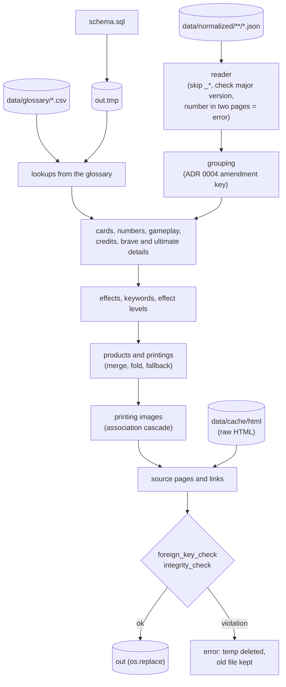

# Database build (`bsdb build`)

The build ([#120](https://github.com/AleFire99/BS_Database/issues/120), epic [#12](https://github.com/AleFire99/BS_Database/issues/12), [ADR 0011](../adr/0011-schema-sql-source-of-truth-without-migrations.md)) turns the normalized card pages of `data/normalized/` into one SQLite file with the 34 tables of [schema.sql](../../src/bs_database/schema.sql) ([target-schema.md](../data-model/target-schema.md)). It uses only the standard library `sqlite3`; SQLAlchemy and the legacy loader were removed.

```bash
uv run bsdb build [--out PATH] [--built-at ISO8601]
```

- `--out` is the database file (default `BSDB_DB_PATH`, `data/battle_spirits.db`). The build always writes a **fresh** file and replaces the old one; it never appends.
- `--built-at` fixes `schema_meta.built_at`, so two builds of the same data are byte-identical.
- It reads `BSDB_NORMALIZED_DIR`, `BSDB_GLOSSARY_DIR` and, for the page hashes, `BSDB_CACHE_DIR`. It makes no network request.
- Exit code 0 on success (warnings do not change it), 1 when the build fails (no normalized pages, invalid glossary, a page of another schema major version, a number in two pages, a foreign key violation). The old output file is then untouched.

## Flow



`build_database` (in `src/bs_database/build/builder.py`) does six steps: write to `<out>.tmp`, run `schema.sql`, set `foreign_keys=ON`, insert everything in **one transaction**, run `PRAGMA foreign_key_check` (any row is an error) and `integrity_check`, then `os.replace` onto the output. On any error the temp file is deleted.

| Module (`bs_database.build`) | Role |
| --- | --- |
| `reader` | Read the documents, sorted by url; checks |
| `grouping` | Card grouping key and `CardGroup` |
| `lookups` | Fill the lookup tables from the glossary, constant `effect_kinds` |
| `cards`, `effects` | Card, gameplay, credits, details; effects, keywords, levels |
| `products` | Products, printings, illustrator rule |
| `images` | Image association cascade, source pages and links |
| `diagnostics` | `BuildWarnings` (counted, with examples), `BuildError` |

## Determinism

Ids are assigned in Python from sorted keys, never from the order of the input: lookups by `code`, cards by their first number, card numbers by number, products by key, printings by `(number, product, variant)`, effects in page order per card, source pages by url. Two builds of the same data differ only in `schema_meta.built_at`; the tests also check that reading the documents in reverse order gives the same bytes.

## Rules

| Area | Rule |
| --- | --- |
| Reading | `schema_version` major must be 1. A number in two documents, or one url twice, is an error. `_report.*` files are skipped. |
| Cards | Several numbers share one card only when the hash of `name_jp`, gameplay, effects (position, levels, header, text), conditions and flavor is equal ([ADR 0004 amendment](../adr/0004-card-printing-identity.md#amendment-2026-11-21-63)). Merged entries must share the name. English names, credits and images are not in the key; the member with the smallest number supplies them. |
| Card English | One `(en_source, en_status)` pair per card (ADR 0005): the pair of the name when `name_en` exists, else the pair of the flavor; no English text gives `pending` (or `failed`). |
| `cards.block_icon` | The icon of the first printing that has one (numbers sorted, page order); a card whose printings show different icons is counted as `block_icon_conflict` (follow-up [#131](https://github.com/AleFire99/BS_Database/issues/131) moves the icon to printings). |
| Colors, families | One row per distinct code; a value without a code is skipped with a warning. |
| Symbols | One row per symbol: a symbol twice on a card (`神(青)神(白)`) gives one row with the counts summed and `variant_jp`, `color_jp` joined with `・` in page order. Reductions use the coded parts only. |
| Levels | One row per level; a repeated level keeps the first. `cores` NULL for a conditional level (`<C2>`) is loaded as is. |
| Credits | `card_credits` of the first member: concept credits first with `role_jp = コンセプト`, then the other credits in page order. |
| Brave / ultimate | `brave_details` (conditions joined by a line break, fusion bonus) and `ultimate_details` (summon condition) for cards of that type. |
| Effect kind | `keyword_line` form gives `keyword_block`; label `メイン` gives `main`, `フラッシュ` gives `flash`; a header starting `【セット中】` gives `set_active`; a `header` with levels gives `level` with a timing and `constant` without; everything else `other`. `effect_kinds` is a constant of the code. On the full data 6,719 effects (about 20%) are `other` and have no `card_effect_levels` rows, including 48 whose text starts with a level such as `Lv1-2『召喚時』`; the normalizer does not parse that prefix yet ([#133](https://github.com/AleFire99/BS_Database/issues/133)). |
| Effect keywords, levels | A keyword without a code is skipped; a keyword twice in one effect keeps the first; a level not on the card is skipped (all with a warning). |
| Product key | The code; else a name used with exactly one code elsewhere takes that code (`product_name_folded`); else the name. |
| Product merge | Name: most frequent (tie: sorted first). Type: most frequent non-null. Release date: earliest non-null. English name: most frequent. A product with no type at all gets `other` (`product_without_type`). `series` stays NULL. |
| Printing key | `(number, product, variant)`. The first row in `(url, page)` order wins, nulls are filled from later rows, a conflicting rarity keeps the first (`printing_rarity_conflict`). A printing of a number without an entry is skipped. |
| Illustrator | No name: NULL. One name: that name. Several: the one whose note matches the product, variant, note or detail text of the printing; else the only one without a note; else all names joined with ` / `. |
| Images | Each image goes to a printing of its number by a cascade: L0 the number has one printing; L1 the caption names one printing's product; L2 several printings of that product, the variant word of the caption (`シークレット`, `パラレル`, `フルアート`) picks one; L3 no product match, the variant word alone picks a unique printing; L4 first printing of the product (`normal` first); L5 first printing of the number (`normal` first). Several images of one printing and size get `position` 1, 2, ... in page order. |
| Source pages | One row per document: `fetched_at` from the provenance, `parser_version` is the parsed schema version, `content_sha256` is the sha256 of the cached raw HTML (`RawCache`) or, when it is missing, of the normalized document (`source_page_without_raw_html`). Links to cards and products. |
| `schema_meta` | A minimal row: schema version from `user_version`, `data_version` `dev`, generator `bsdb <version>`, `built_at`, and a snapshot text. The real values belong to [#121](https://github.com/AleFire99/BS_Database/issues/121). |

## Data with no column (dropped)

The normalized documents hold values that the schema has no column for. They are not loaded; follow-up [#130](https://github.com/AleFire99/BS_Database/issues/130) proposes additive columns.

- `reduction.plain` (10,407 entries), the variant and colour of reduction parts
- `deck_limit` (85)
- the overclock values and `overclock_condition_jp` (517)
- `flavor_note_jp` (19)
- printing `detail_jp`, `note_jp` and `section` (used only to match illustrators and images), `product_href`
- the credits of the other members of a merged card
- `differences` of a page

Concept credits are loaded (`card_credits`, role `コンセプト`).

## Warnings

Every kind is counted and printed by `bsdb build`; none stops the build.

| Kind | Meaning |
| --- | --- |
| `block_icon_conflict` | A card whose printings have different block icons |
| `color_unmapped`, `symbol_unmapped`, `family_unmapped`, `keyword_unmapped` | A value without a glossary code was skipped |
| `symbol_merged` | The same symbol twice on a card, merged |
| `level_duplicate`, `effect_position_invalid`, `keyword_duplicate` | A repeated level, effect position or keyword, first kept |
| `effect_level_missing` | An effect level that is not a level of the card, skipped |
| `product_name_folded` | A name-only row joined a product by its code |
| `product_name_conflict`, `product_type_conflict` | A product with several names or types, the rule picked one |
| `product_without_type` | A product with no type, set to `other` |
| `printing_duplicate_merged`, `printing_rarity_conflict` | Duplicate printing rows merged; two different rarities |
| `printing_number_unknown` | A printing of a number with no card entry, skipped |
| `image_fallback_first_of_product` (L4), `image_fallback_first_of_number` (L5), `image_without_printing` | Weak image association, or an image of a number without printings (skipped) |
| `source_page_without_raw_html` | The raw HTML was not in the cache; the hash is of the normalized document |

Quality rules and `--strict` are [#122](https://github.com/AleFire99/BS_Database/issues/122).

## Measured on the full local data

13,480 pages, 2026-11-21, offline, about 5 s and a 31 MB file: 14,693 cards for 14,715 numbers (22 cards with two numbers), 1,044 products, 24,130 printings (186 duplicate rows merged), 34,977 effects, 41,234 printing images (L0 11,134, L1 7,809, L2 6, L3 3, L4 3, L5 1,662), 13,480 source pages. `foreign_key_check` is empty and `integrity_check` is `ok`.
