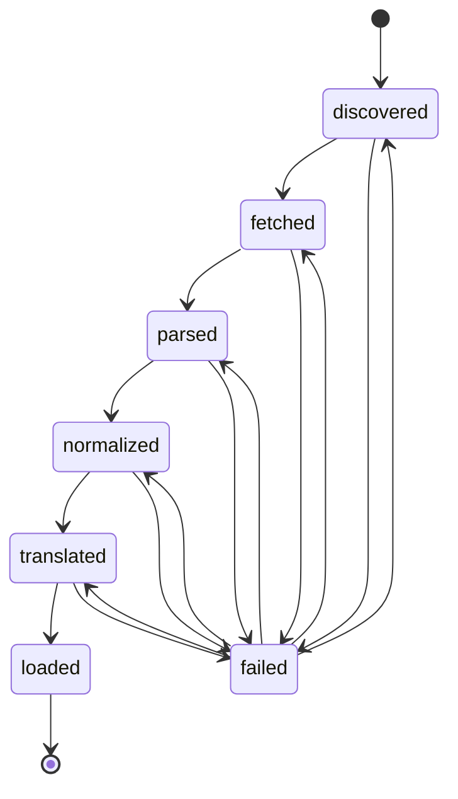
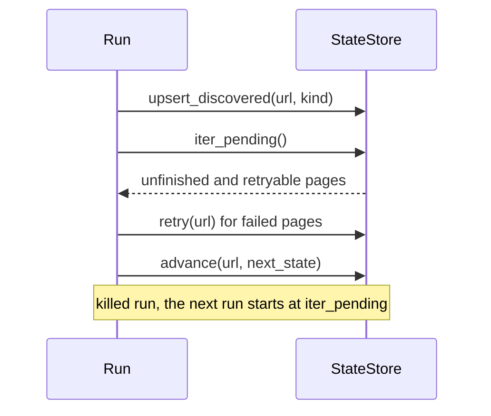

# Ingestion state

Every page the ingestion pipeline touches (index, set or card) has one row in a small SQLite store, `data/state/ingest.db` (git-ignored; the path is wired by #73). The store makes runs resumable: a page that reached a stage is never redone, and a failed page is kept and retried on a later run. Implemented in `src/bs_database/ingest/state.py` (#72).

## State machine



- The forward chain is `discovered` to `fetched` to `parsed` to `normalized` to `translated` to `loaded`. Epic #10 drives pages up to `parsed`; later states are validated but unused until #11 and #12.
- Any non-terminal state can move to `failed`. `loaded` is terminal.
- `failed` can return to any stage in the table, but the store only allows the stage that failed (`failed_from`), so the failed stage re-runs and completed stages are not repeated.
- Anything else raises `IllegalTransition`.

## Retry and attempts

- `mark_failed(url, reason)` stores `failed_from`, `last_error`, and increments `attempts`.
- A successful `advance` resets `attempts` to 0 and clears the error.
- `retry(url)` moves `failed` back to `failed_from`. When `attempts >= max_attempts` (constructor argument, default 3) it raises `RetriesExhausted`.
- `iter_pending()` returns unfinished pages and failed pages that can still be retried; `iter_exhausted()` lists the pages that ran out of attempts so a failure never disappears silently.

## Schema

`PRAGMA user_version = 1`; migrations are applied in order inside one transaction, and a database newer than the code is refused.

```sql
CREATE TABLE pages (
  url TEXT PRIMARY KEY,
  kind TEXT NOT NULL CHECK (kind IN ('index','set','card')),
  state TEXT NOT NULL,
  failed_from TEXT,
  attempts INTEGER NOT NULL DEFAULT 0,
  last_error TEXT,
  content_sha256 TEXT,
  updated_at TEXT NOT NULL
);
CREATE INDEX pages_state ON pages(state, kind);
```

`updated_at` is UTC ISO-8601. The database uses WAL; each API call is one `BEGIN IMMEDIATE` transaction, so a killed process leaves either the old or the new row.

## Resume


