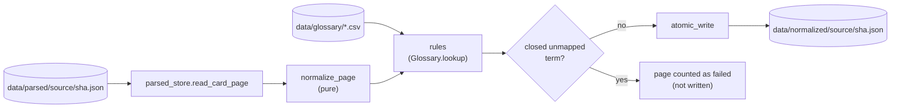

# Normalization (`bsdb normalize`)

The normalization stage ([#93](https://github.com/AleFire99/BS_Database/issues/93), [ADR 0008](../adr/0008-normalization-and-translation.md)) turns the Japanese parsed pages of `data/parsed/` into records shaped like the [target schema](../data-model/target-schema.md), with a glossary code for every Japanese glyph. It is non-destructive: it reads `data/parsed/` and `data/glossary/`, and writes `data/normalized/`. It does no machine translation and no network access; translation is [#94](https://github.com/AleFire99/BS_Database/issues/94) and [#95](https://github.com/AleFire99/BS_Database/issues/95).

## Flow



## Modules

| Module | Role |
| --- | --- |
| `bs_database.normalize.records` | Frozen, slotted record dataclasses, `UnmappedTerm` and `UnmappedCollector` |
| `bs_database.normalize.rules` | Pure mapping rules: closed codes, colours, symbols, rarity, variant, product type, family re-join and keywords |
| `bs_database.normalize.pipeline` | `normalize_page(page, glossary)` (pure: no I/O, no settings) and `normalize_tree(parsed_dir, normalized_dir, glossary)` |
| `bs_database.ingest.parsed_store.read_card_page` | Rebuilds a `CardPage` from a parsed file; rejects another `schema_version` ("re-parse from the HTML cache") |

The output path is `normalized_dir/<source>/<sha>.json`, the same stem as the parsed file. Writes are atomic and the text is `json.dumps(ensure_ascii=False, indent=2)` plus a newline, so two runs give byte-identical files. Normalized files whose parsed source was deleted are not pruned.

## Rules

- **Closed kinds** (`colors`, `symbols`, `card_types`, `rarities`, `variants`, `product_types`): a value with no glossary entry is an **error**. The page is not written, it is counted as failed, and the run continues.
- **Families.** The parser splits on `・`; adjacent tokens are re-joined when the joined text is a glossary family marked `no_split`. Order is source order, duplicates removed. A family whose glossary row has an empty `code`, or no row, gets `code = None` and an unmapped **warning**. A glossary `en` gives `en_source = manual`, `en_status = reviewed`; without one, `en = None`, `en_source = None`, `en_status = pending`.
- **Keywords.** A miss gives `code = None` and an unmapped warning.
- **Rarity.** `None` stays `None`; a value missing from the glossary is a closed error.
- **Variant.** The printing note is looked up in `variants`; a miss means `normal` and is never unmapped (ADR 0008, D5).
- **Product type.** A `product_types` title marker contained in the product name gives the code (ADR 0008, D6); no marker gives `None`. A product-code prefix rule is curated in [#96](https://github.com/AleFire99/BS_Database/issues/96).
- **English texts.** `name_en` is set only when the batspi `<h3>` printed one (source `batspi`, status `reviewed`). Every other `_en` (product name, effect, flavour) is `None` with status `pending`.

## Normalized document

```text
{
  schema_version: "1.0.0",
  parsed_schema_version, url, provenance,        # provenance copied from the parsed file
  page: {
    url, title_jp, differences, images,           # as parsed
    entries: [ {number, name_jp, name_en, en_source, en_status,
                gameplay: {card_type_jp, card_type_code, colors[{jp, code}],
                           symbols[{symbol_jp, symbol_code, count}], reduction,
                           families[{jp, code, en, en_source, en_status}], ...},
                text: {effects[{keywords[{bracket, name_jp, code, parameter_jp}],
                                text_jp, text_en, ...}], flavor_jp, flavor_en, ...}} ],
    printings: [ {number, product_name_jp, product_name_en, product_type_code,
                  rarity_jp, rarity_code, variant_jp, variant_code, ...} ],
    unmapped: [ {kind, jp, number} ]              # deduplicated and sorted
  }
}
```

`unmapped` is part of the page, so the result stays pure and the report of #95 can be built from the normalized tree.

## CLI

`bsdb normalize` takes no options. It reads `glossary_dir` and `parsed_dir`, writes `normalized_dir`, and prints `Normalized N pages, K unmapped terms (C closed)`. It exits 1 if a page failed, the glossary is invalid or the parsed directory is missing.

## Tests

- Unit tests per rule on a hand-built glossary (`tests/test_normalize_rules.py`).
- Goldens in `tests/goldens/normalized/` for every card fixture: HTML, parse, parsed store, `normalize_tree`. They are regenerated only by `uv run python tests/tools/regen_normalized_goldens.py`, never by a pytest flag.
- Idempotency (byte-equal reruns) and a hash check that `parsed/` is untouched.
- The goldens carry unmapped warnings for the 15 uncurated families until [#96](https://github.com/AleFire99/BS_Database/issues/96), which regenerates them.
