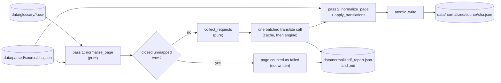

# Normalization (`bsdb normalize`)

The normalization stage ([#93](https://github.com/AleFire99/BS_Database/issues/93), [ADR 0008](../adr/0008-normalization-and-translation.md)) turns the Japanese parsed pages of `data/parsed/` into records shaped like the [target schema](../data-model/target-schema.md), with a glossary code for every Japanese glyph. It is non-destructive: it reads `data/parsed/` and `data/glossary/`, and writes `data/normalized/`. Card names, product names and families get a machine translation through the [translator](translation.md) ([#94](https://github.com/AleFire99/BS_Database/issues/94), wired in [#95](https://github.com/AleFire99/BS_Database/issues/95)); without the quickmt model the run is offline.

## Flow

`normalize_tree` reads the parsed tree twice, so it never holds every page in memory. Pass 1 normalizes each page and keeps only the Japanese texts that need an English name; one batched `translate` call follows; pass 2 normalizes again, applies the results and writes. A page that fails sends nothing to the translator.



## Modules

| Module | Role |
| --- | --- |
| `bs_database.normalize.records` | Frozen, slotted record dataclasses, `UnmappedTerm` and `UnmappedCollector` |
| `bs_database.normalize.rules` | Pure mapping rules: closed codes, colours, symbols, rarity, variant, product type, family re-join and keywords |
| `bs_database.normalize.translation` | Pure helpers: `collect_requests`, `collect_texts` and `apply_translations(page, results)` |
| `bs_database.normalize.pipeline` | `normalize_page(page, glossary)` (pure: no I/O, no settings) and `normalize_tree(parsed_dir, normalized_dir, glossary, translator)`; the translator is required, tests pass `NullTranslator()` |
| `bs_database.normalize.report` | `build_report`, `render_json`, `render_markdown` and `write_report` for `_report.json` and `_report.md` |
| `bs_database.ingest.parsed_store.read_card_page` | Rebuilds a `CardPage` from a parsed file; rejects another `schema_version` ("re-parse from the HTML cache") |

The output path is `normalized_dir/<source>/<sha>.json`, the same stem as the parsed file. Writes are atomic and the text is `json.dumps(ensure_ascii=False, indent=2)` plus a newline, so two runs give byte-identical files. Normalized files whose parsed source was deleted are not pruned.

## Rules

- **Closed kinds** (`colors`, `symbols`, `card_types`, `rarities`, `variants`, `product_types`): a value with no glossary entry is an **error**. The page is not written, it is counted as failed, and the run continues.
- **Families.** The parser splits on `・`; adjacent tokens are re-joined when the joined text is a glossary family marked `no_split`. Order is source order, duplicates removed. A family with no glossary row gets `code = None` and an unmapped **warning**. A row whose `code` is still empty is **uncurated** (ADR 0008, D7): `code = None`, listed apart from unmapped terms, never a warning. A glossary `en` gives `en_source = manual`, `en_status = reviewed`; without one, `en = None`, `en_source = None`, `en_status = pending`.
- **Keywords.** No row gives `code = None` and an unmapped warning; a row with an empty `code` is uncurated.
- **Rarity.** `None` stays `None`; a value missing from the glossary is a closed error.
- **Variant.** The printing note is looked up in `variants`; a miss means `normal` and is never unmapped (ADR 0008, D5).
- **Product type.** A `product_types` title marker contained in the product name gives the code (ADR 0008, D6); no marker gives `None`. A product-code prefix rule is curated in [#96](https://github.com/AleFire99/BS_Database/issues/96).
- **English texts.** `name_en` is set only when the batspi `<h3>` printed one (source `batspi`, status `reviewed`). Card names, product names and families that have no English name yet are translated (see below). Effect, flavour and condition `_en` stay `None` with status `pending`.

## Translation

Lookup order: a glossary family `en` stays (`manual`, `reviewed`); a name printed by batspi stays (`batspi`, `reviewed`); everything else goes to the cache, then the engine. Requests are ordered families, then card names, then product names, each sorted by Japanese text, so short family names are never starved by `--max-chars`. A `machine` result sets `en`, `en_source = machine` and `en_status = machine`. A `failed` or `pending` result leaves `en = None`, no source, and that status. With the `NullTranslator` the output has no machine text (equal to the goldens).

## Normalized document

```text
{
  schema_version: "1.1.0",
  parsed_schema_version, url, provenance,        # provenance copied from the parsed file
  page: {
    url, title_jp, differences, images,           # as parsed
    entries: [ {number, name_jp, name_en, en_source, en_status,
                gameplay: {card_type_jp, card_type_code, colors[{jp, code}],
                           symbols[{symbol_jp, symbol_code, count}], reduction,
                           families[{jp, code, en, en_source, en_status}], ...},
                text: {effects[{keywords[{bracket, name_jp, code, parameter_jp}],
                                text_jp, text_en, ...}], flavor_jp, flavor_en, ...}} ],
    printings: [ {number, product_name_jp, product_name_en, product_type_code,
                  rarity_jp, rarity_code, variant_jp, variant_code, ...} ],
    unmapped: [ {kind, jp, number} ],             # no glossary row; deduplicated and sorted
    uncurated: [ {kind, jp, number} ]             # row without a code yet (1.1.0, ADR 0008 D7)
  }
}
```

`unmapped` and `uncurated` are part of the page, so the result stays pure. A loader ([#12](https://github.com/AleFire99/BS_Database/issues/12)) that reads schema 1.1.0 must read or ignore `uncurated`.

## CLI

`bsdb normalize [--strict] [--max-chars N]` reads `glossary_dir` and `parsed_dir`, writes `normalized_dir` and prints three lines:

```text
Normalized N pages, K unmapped terms (C closed), U uncurated terms
Translation (engine): M machine, P pending, F failed
Report: <normalized_dir>/_report.md
```

Exit 1 when a page failed (a closed unmapped term or an unreadable file), the glossary is invalid, the parsed directory is missing, or `--strict` is set and a family or keyword has no glossary row. Pages are written even when strict fails. Uncurated terms and `pending` or `failed` translations never fail strict: they depend on the network, the key and the budget. `--max-chars 0` means cache only; a negative or non-numeric value exits 2. There is no `--no-translate`: no key means offline.

## Report

`_report.json` and `_report.md` sit at the root of `normalized_dir`, outside the `*/*.json` page glob. They are deterministic (no timestamps, everything sorted); engine call statistics depend on the cache and go to the log and stdout instead. See [CONTRIBUTING](../../CONTRIBUTING.md#reading-the-normalize-report).

```text
{schema_version, engine, pages: {written, failed: [paths]},
 unmapped: {closed: [Term], warnings: [Term]}, uncurated: [Term],
 translation: {families|names|products: {distinct, from_glossary_or_batspi, machine, pending, failed}}}
Term = {kind, jp, pages, samples: [up to 5 sorted URLs]}
```

The Markdown report shows only the first sample of each term; the JSON keeps up to 5. Terms and translation counts describe the parsed tree as pass 1 read it; the written and failed page counts are final (a page that changes or breaks between the two passes is counted as failed).

## Tests

- Unit tests per rule on a hand-built glossary (`tests/test_normalize_rules.py`).
- Goldens in `tests/goldens/normalized/` for every card fixture: HTML, parse, parsed store, `normalize_tree`. They are regenerated only by `uv run python tests/tools/regen_normalized_goldens.py`, never by a pytest flag.
- Idempotency (byte-equal reruns) and a hash check that `parsed/` is untouched.
- The goldens list the 15 uncurated families under `uncurated` until [#96](https://github.com/AleFire99/BS_Database/issues/96) curates them and regenerates the goldens.
- Translation helpers, the report and a fake engine over the fixtures: the second run makes zero engine calls and its pages and `_report.json` are byte-equal.
- `tests/test_normalize_strict.py` is the CI check: `bsdb normalize --strict` over every card fixture with the real glossary and no key must exit 0 with no unmapped terms. It runs in the normal pytest step.
