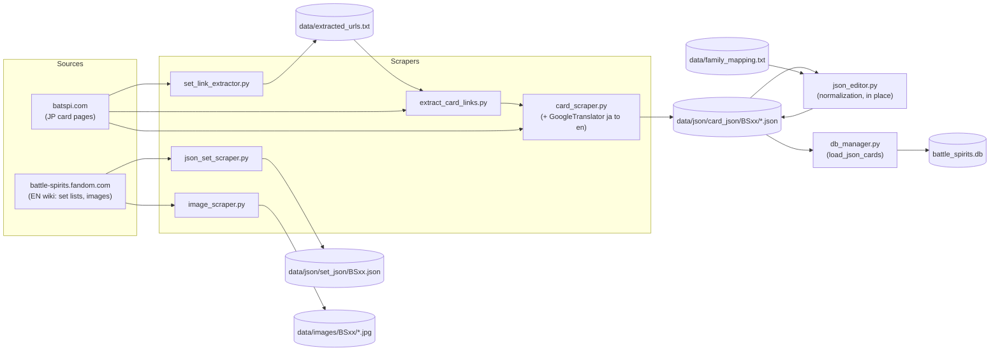
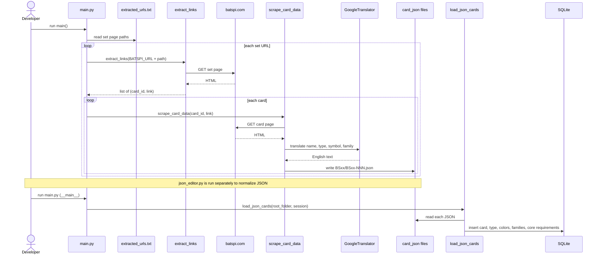

# Architecture overview (current state)

This document describes the **legacy** pipeline as it exists today. It is a baseline, not a target design. Roadmap epics are listed in the [top-level README](../../README.md).

## Pipeline

## Main flow

`main.py` currently contains two functions that are **not called** (`main`, `extract_images`); its `__main__` block only loads JSON into the database. The sequence below shows the intended scrape flow implemented by `main()` plus the load step.

## Components

| File | Responsibility | Inputs | Outputs |
| --- | --- | --- | --- |
| `main.py` | Orchestration; `__main__` creates the DB and loads JSON | `data/extracted_urls.txt`, JSON folder | `battle_spirits.db` |
| `config/settings.py` | URL and path constants | none | `BASE_URL`, `BASE_SET_URL`, `IMAGE_FOLDER_PATH`, `JSON_FOLDER_PATH`, `BATSPI_URL` |
| `scripts/set_link_extractor.py` | Collect set page links from the batspi card list (runs at import) | `https://batspi.com/index.php?カードリスト` | `extracted_urls.txt` (cwd) |
| `scripts/extract_card_links.py` | Extract `(card_id, link)` pairs from a set page | set page URL | list of tuples |
| `scripts/scraper/card_scraper.py` | Parse a batspi card page, translate fields, write JSON | card page URL | `data/json/card_json/BSxx/BSxx-NNN.json` |
| `scripts/scraper/json_set_scraper.py` | Parse set tables from the EN wiki | `BASE_SET_URL + BSxx` | `data/json/set_json/BSxx.json` |
| `scripts/scraper/image_scraper.py` | Download card images from the EN wiki | wiki set and card pages | `data/images/BSxx/<card_id>.jpg` |
| `json_editor.py` | Normalize family names, type, image path in place (runs at import) | card JSON tree, `data/family_mapping.txt` | rewritten JSON files. Logic ported to `bs_database.normalize` (legacy removed in #23) |
| `scripts/db/db_manager.py` | SQLAlchemy models, JSON loader, color derivation | card JSON tree | SQLite rows. Logic ported to `bs_database.db` (legacy removed in #23) |
| `data/family_mapping.txt` | Manual `machine translation = canonical name` overrides | n/a | used by `json_editor.py` |
| `example_query.sql` | Sample SQL queries | n/a | n/a |
| `Notes.md` | Informal notes (card type list) | n/a | n/a |

## Known issues / tech debt

Tags refer to the future epic addressing each item: E2 restructure ([#7](https://github.com/AleFire99/BS_Database/issues/7)), E3 data model ([#8](https://github.com/AleFire99/BS_Database/issues/8)), E4 source analysis ([#9](https://github.com/AleFire99/BS_Database/issues/9)), E5 scraper rewrite ([#10](https://github.com/AleFire99/BS_Database/issues/10)), E6 normalization and translation ([#11](https://github.com/AleFire99/BS_Database/issues/11)), E7 DB build and validation ([#12](https://github.com/AleFire99/BS_Database/issues/12)), E8 images ([#13](https://github.com/AleFire99/BS_Database/issues/13)), E9 distribution ([#14](https://github.com/AleFire99/BS_Database/issues/14)).

| Issue | Evidence | Epic |
| --- | --- | --- |
| Hardcoded Windows paths | `main.py`, `json_editor.py`, `config/settings.py` use `C:\Users\AleFire\...` | E2 |
| Inconsistent relative paths and DB locations | `main.py` uses `sqlite:///battle_spirits.db`, `db_manager.py` `__main__` uses `data/battle_spirits.db`, `card_scraper.py` has its own `IMAGE_PATH` | E2 |
| No package layout; scripts run side effects at import | `json_editor.py` and `set_link_extractor.py` execute on import; `scripts/` has no `__init__.py` | E2 |
| Dead and broken code | `main.py` `main()` and `extract_images()` never called (and `extract_images` guards on `__name__` inside a function); `card_scraper.main()` passes a non-card URL; `db_manager.__main__` has a placeholder path; `extract_card_infos` resets `links` per table so only the last table is returned | E2, E5 |
| Missing dependencies in `requirements.txt` | `requests` and `beautifulsoup4` are imported but not listed; `selenium` and `webdriver-manager` are listed but unused; `libretranslatepy` is only a transitive dependency | E2 |
| Database committed to git | `battle_spirits.db` is tracked | E7, E9 |
| Machine translation of names and families | `GoogleTranslator` output is stored as canonical names; family names are patched with ad-hoc rules in `json_editor.py` plus `family_mapping.txt` (e.g. "Snake" forced to "Dark Snake", naive plural stripping) | E6 |
| Translation failures stored as data | `translate()` returns `"Error: ..."` strings that would be persisted | E6 |
| Colors derived from translated symbol | Symbol-to-color map in `db_manager.py` lacks `white`; multicolor strings (e.g. "Red purple green white yellow blue") match nothing | E3, E6 |
| No caching, retries, rate limiting or User-Agent | Every run re-downloads and re-translates (one translation request per field); `requests.get` without timeout | E5 |
| Brittle HTML selectors | `<pre>` line positions, `#mw-content-text > div > table:nth-child(2)`, `
` and `zip(matches, a_tags)` pairing | E4, E5 |
| Card effects/text not scraped | Only name, type, cost, symbol, family, core requirements; `reduction` is scraped to JSON but never loaded into the DB | E3, E5 |
| Cards without a `<pre>` block are saved with null fields | `card_scraper.py` falls back to all-`None`, then `insert_card` fails on missing `type` | E5, E7 |
| Loader is not idempotent for requirements and is slow | Per-card commits and per-row `get_or_create` queries; existing cards are skipped, so changes are never updated | E7 |
| No validation of loaded data | No constraints, no checks on set coverage or duplicates | E7 |
| Images not versioned or described | Paths are stored as strings; image set range (BS19-71) is hardcoded; `data/images` and `data/json` are absent from the repository | E8 |
| No tests, no CI, no lint at baseline | No test folder or config | E2 |
| No license or distribution story | No license file, no release artifacts | E9 |
