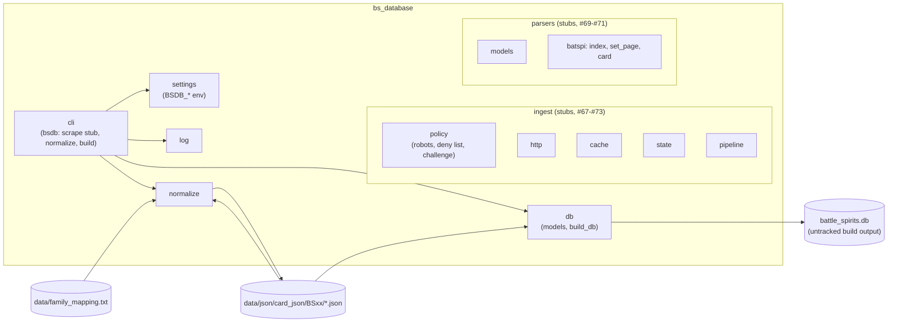
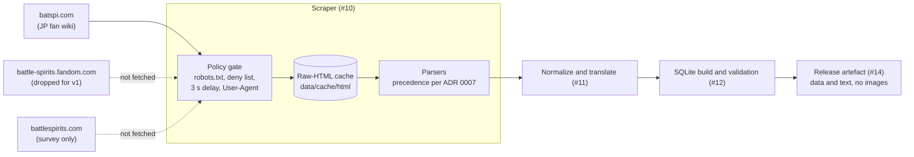
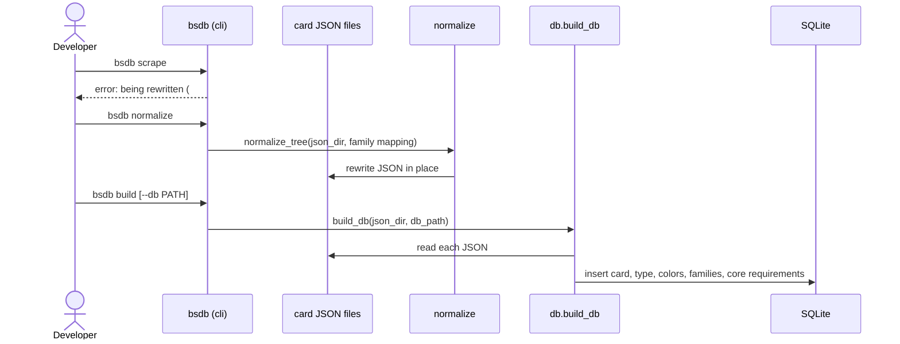

# Architecture overview (current state)

This document describes the `bs_database` package as restructured in E2 ([#7](https://github.com/AleFire99/BS_Database/issues/7)). The earlier script-based prototype is available at tag `v0.1.0`. Roadmap epics are listed in the [top-level README](../../README.md).

## Package layout

The `ingest` and `parsers` packages hold the target layout of the scraper rewrite ([#10](https://github.com/AleFire99/BS_Database/issues/10)). Only `ingest.policy` has code today (the scraping policy helpers); the other modules are docstring stubs owned by the issues named in them. `bsdb scrape` is a stub that exits with an error until the rewrite lands. The legacy scrapers and `bsdb images` were removed in [#66](https://github.com/AleFire99/BS_Database/issues/66); they are at tag `v0.1.0` or commit `f90747b`.

### Card page parser

`bs_database.parsers.batspi.card.parse_card_page(html, url)` ([#70](https://github.com/AleFire99/BS_Database/issues/70)) is a pure function: cached HTML in, a `CardPage` out, with no network, translation or file I/O. It reads identity (card numbers, `name_ja`, `name_en`) and gameplay values (type, cost, reduction, colours, families, levels, symbols, plus `fusion_bp_bonus` for Brave and `overclock` for Ultimate) of every card block in the card region of the page. Erratum and trial-spec blocks, Q&A and the related listing are skipped. The DTOs are frozen slotted dataclasses in `bs_database.parsers.card_models`, JSON-ready through `dataclasses.asdict`, and carry `SCHEMA_VERSION` (`1.0.0`). #71 adds text and printings as optional fields (`1.1.0`). Unknown cost, level or symbol syntax raises `ParseError` instead of being guessed.

- **Number source.** The number in the print heading comes first, because it is the only per-block source (the `span.cardno` order differs on promo pages and the spans lack the `(A)`/`(B)` face on flip pages). The page's own `span.cardno` values are a set cross-check, and a mismatch is logged as a warning. Pages without a heading number take the span at the same position. This clarifies the "cardno span is authoritative" rule of [ADR 0007](../adr/0007-source-of-truth.md) for #12; the ADR itself is unchanged.
- **Literal values.** Colours, symbols, types and families keep the Japanese glyphs of the source; mapping to codes is the loader's job (#12).
- **Per-number differences (#63).** Gameplay fields that differ between numbers with the same name are logged at INFO and listed in `CardPage.differences`, so #12 can decide the card-versus-number grouping.
- **Fields without a schema column.** `deck_limit` (`制限カード<N>`) and `overclock` are parsed but have no column in the [target schema](../data-model/target-schema.md); #12 decides where they go.

## Target data flow

The pipeline that the roadmap epics build, following the [scraping policy](../sources/policy.md), [ADR 0006](../adr/0006-scraping-and-redistribution-policy.md) and [ADR 0007](../adr/0007-source-of-truth.md). batspi.com is the only source fetched in v1. The fandom wiki is dropped ([fandom.md](../sources/fandom.md)), and the official site is a survey only ([official.md](../sources/official.md)). Field-level coverage is in the [coverage matrix](../sources/coverage-matrix.md).

## CLI flow

## Components

| Module | Responsibility | Inputs | Outputs |
| --- | --- | --- | --- |
| `bs_database.cli` | Typer app (`bsdb`): `scrape` (stub), `normalize`, `build`, global `--log-level` and `--version` | `Settings`, command options | calls the modules below |
| `bs_database.settings` | `Settings` (pydantic-settings): `BSDB_*` env and `.env`, paths derived from `data_dir` | environment | URLs, directories, request delay |
| `bs_database.log` | `configure_logging` | level name | root logger setup |
| `bs_database.ingest.policy` | Scraping policy helpers: base URL, User-Agent, deny list, robots.txt split and check, challenge detection | URL, robots rules, page text | `StopRun` or a boolean |
| `bs_database.ingest.http` | HTTP client with the policy gate (stub, #67) | n/a | n/a |
| `bs_database.ingest.cache` | Raw-HTML cache (stub, #68) | n/a | n/a |
| `bs_database.ingest.state` | Run state and resume (stub, #72) | n/a | n/a |
| `bs_database.ingest.pipeline` | Ingestion orchestration (stub, #73) | n/a | n/a |
| `bs_database.parsers.models` | Parsed record models (stub, #69) | n/a | n/a |
| `bs_database.parsers.card_models`, `.errors` | Card page DTOs with `SCHEMA_VERSION`, and `ParseError` | n/a | n/a |
| `bs_database.parsers.batspi.index`, `.set_page` | batspi.com page parsers (stubs, #69) | cached HTML | parsed records |
| `bs_database.parsers.batspi.card` | Card page parser: identity and gameplay values (#70); text and printings follow in #71 | cached HTML, URL | `CardPage` |
| `bs_database.normalize` | Normalize family names, type, image path in place | card JSON tree, `data/family_mapping.txt` | rewritten JSON files |
| `bs_database.db` | SQLAlchemy models, JSON loader, color derivation, `build_db` | card JSON tree | SQLite rows |
| `data/family_mapping.txt` | Manual `machine translation = canonical name` overrides | n/a | used by `normalize` |
| `tests/tools/db_counts.py` | Per-table row counts of a SQLite file as JSON | a `.db` file | JSON on stdout |
| `example_query.sql` | Sample SQL queries | n/a | n/a |
| `Notes.md` | Informal notes (card type list) | n/a | n/a |

Kept quirks (covered by golden tests): the family order from the legacy normalizer was a set, so goldens are sorted. The quirks of the removed scrapers are described in the [legacy mapping](../data-model/legacy-mapping.md).

## Known issues / tech debt

The legacy data model is described in [current-schema.md](../data-model/current-schema.md); its replacement is designed in the [target schema](../data-model/target-schema.md), with a per-column [legacy mapping](../data-model/legacy-mapping.md). Rows tagged E3 below link to the part of the target schema that addresses them; the implementation stays in the later epics.

Tags refer to the epic addressing each item: E2 restructure ([#7](https://github.com/AleFire99/BS_Database/issues/7)), E3 data model ([#8](https://github.com/AleFire99/BS_Database/issues/8)), E4 source analysis ([#9](https://github.com/AleFire99/BS_Database/issues/9)), E5 scraper rewrite ([#10](https://github.com/AleFire99/BS_Database/issues/10)), E6 normalization and translation ([#11](https://github.com/AleFire99/BS_Database/issues/11)), E7 DB build and validation ([#12](https://github.com/AleFire99/BS_Database/issues/12)), E8 images ([#13](https://github.com/AleFire99/BS_Database/issues/13)), E9 distribution ([#14](https://github.com/AleFire99/BS_Database/issues/14)).

| Issue | Evidence | Epic |
| --- | --- | --- |
| Resolved: hardcoded Windows paths | Paths now come from `BSDB_*` settings; CI fails on absolute user paths | E2 |
| Resolved: inconsistent paths and DB locations | Single `Settings` with paths derived from `data_dir` | E2 |
| Resolved: no package layout, import-time side effects | `src/bs_database` package with a `bsdb` entry point | E2 |
| Resolved: dead and broken code | Legacy scripts removed in #23 (tag `v0.1.0`) | E2 |
| Resolved: dependency list | Unused `selenium`, `webdriver-manager`, `libretranslatepy`, `lxml` dropped; used packages declared | E2 |
| Resolved: database committed to git | `battle_spirits.db` untracked and ignored in #23 (release artefact is E9) | E2, E9 |
| Resolved: no tests, CI or lint | pytest with goldens, ruff, mypy strict, CI and pre-commit | E2 |
| Resolved: legacy scrapers and fandom code | Removed in #66 (commit `f90747b` has them); fandom is dropped for v1 ([fandom.md](../sources/fandom.md)); the new ingestion modules are stubs implemented in #67-#73 | E5 |
| Machine translation of names and families | `GoogleTranslator` output is stored as canonical names; family names are patched with ad-hoc rules in `normalize` plus `family_mapping.txt` (e.g. "Snake" forced to "Dark Snake", naive plural stripping) | E6 |
| Translation failures stored as data | `translate()` returns `"Error: ..."` strings that would be persisted | E6 |
| Colors derived from translated symbol | Symbol-to-color map in `db.py` lacks `white`; multicolor strings (e.g. "Red purple green white yellow blue") match nothing. Designed in the target schema: `colors` with White and a `card_colors` junction filled from the Japanese colour segment ([target-schema](../data-model/target-schema.md#card_colors)); the fix is in E6/E7. | E3, E6 |
| No caching, retries or User-Agent | The legacy scrapers were removed in #66; the new client, cache and state are #67, #68 and #72. Requirements are set in the [scraping policy](../sources/policy.md#5-requirements-for-the-scraper-rewrite-10) | E5 |
| Brittle HTML selectors | `<pre>` line positions, `#mw-content-text > div > table:nth-child(2)`, `
` and `zip(matches, a_tags)` pairing | E4, E5 |
| Card effects/text not scraped | Only name, type, cost, symbol, family, core requirements; `reduction` is scraped to JSON but never loaded into the DB. Designed in the target schema: `card_effects`, `card_reductions` and flavor text ([effects](../data-model/target-schema.md#effects-and-keywords), [reductions](../data-model/target-schema.md#card_reductions)); the fix is in E5/E7. | E3, E5 |
| Cards without a `<pre>` block are saved with null fields | `batspi_card` falls back to all-`None`, then `insert_card` fails on missing `type` | E5, E7 |
| Loader is not idempotent for requirements and is slow | Per-card commits and per-row `get_or_create` queries; existing cards are skipped, so changes are never updated | E7 |
| No validation of loaded data | No constraints, no checks on set coverage or duplicates | E7 |
| Images not versioned or described | Paths are stored as strings; default image set range (BS19-71) is hardcoded; `data/images` and `data/json` are not in the repository | E8 |
| No license or distribution story | No license file, no release artifacts | E9 |
