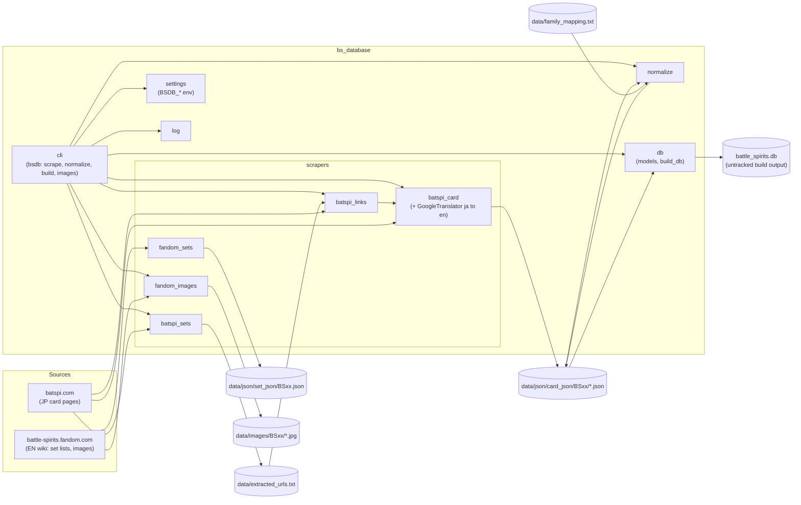
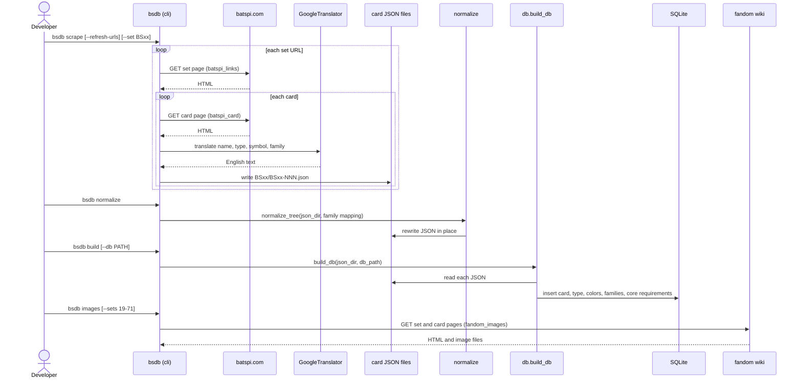

# Architecture overview (current state)

This document describes the `bs_database` package as restructured in E2 ([#7](https://github.com/AleFire99/BS_Database/issues/7)). The earlier script-based prototype is available at tag `v0.1.0`. Roadmap epics are listed in the [top-level README](../../README.md).

## Package layout

## CLI flow

`bsdb images` is independent of the other commands.

## Components

| Module | Responsibility | Inputs | Outputs |
| --- | --- | --- | --- |
| `bs_database.cli` | Typer app (`bsdb`): `scrape`, `normalize`, `build`, `images`, global `--log-level` and `--version` | `Settings`, command options | calls the modules below |
| `bs_database.settings` | `Settings` (pydantic-settings): `BSDB_*` env and `.env`, paths derived from `data_dir` | environment | URLs, directories, request delay |
| `bs_database.log` | `configure_logging` | level name | root logger setup |
| `bs_database.scrapers.batspi_sets` | Collect set page links from the batspi card list | batspi card list URL | `extracted_urls.txt` |
| `bs_database.scrapers.batspi_links` | Extract `(card_id, link)` pairs from a set page | set page URL | list of tuples |
| `bs_database.scrapers.batspi_card` | Parse a card page, translate fields, write JSON | card page URL | `data/json/card_json/BSxx/BSxx-NNN.json` |
| `bs_database.scrapers.fandom_sets` | Parse set tables from the EN wiki (not wired to the CLI) | set page URL | `data/json/set_json/BSxx.json` |
| `bs_database.scrapers.fandom_images` | Download card images from the EN wiki | wiki set and card pages | `data/images/BSxx/<card_id>.jpg` |
| `bs_database.normalize` | Normalize family names, type, image path in place | card JSON tree, `data/family_mapping.txt` | rewritten JSON files |
| `bs_database.db` | SQLAlchemy models, JSON loader, color derivation, `build_db` | card JSON tree | SQLite rows |
| `data/family_mapping.txt` | Manual `machine translation = canonical name` overrides | n/a | used by `normalize` |
| `tests/tools/db_counts.py` | Per-table row counts of a SQLite file as JSON | a `.db` file | JSON on stdout |
| `example_query.sql` | Sample SQL queries | n/a | n/a |
| `Notes.md` | Informal notes (card type list) | n/a | n/a |

Kept quirks (ported unchanged, covered by golden tests): translation failures return `"Error: ..."` strings; an unspaced mixed reduction gives `[]`; `extract_card_infos` returns only the last table; the image set loop builds `<set_url><nn>` without `BS`; the fandom scrapers have no rate limiting; `fandom_sets` needs the `<tbody>` the wiki serves; the family order from the legacy normalizer was a set, so goldens are sorted.

## Known issues / tech debt

The legacy data model is described in [current-schema.md](../data-model/current-schema.md); its replacement is designed in the [target schema](../data-model/target-schema.md), with a per-column [legacy mapping](../data-model/legacy-mapping.md). Rows tagged E3 below link to the part of the target schema that addresses them; the implementation stays in the later epics.

Tags refer to the epic addressing each item: E2 restructure ([#7](https://github.com/AleFire99/BS_Database/issues/7)), E3 data model ([#8](https://github.com/AleFire99/BS_Database/issues/8)), E4 source analysis ([#9](https://github.com/AleFire99/BS_Database/issues/9)), E5 scraper rewrite ([#10](https://github.com/AleFire99/BS_Database/issues/10)), E6 normalization and translation ([#11](https://github.com/AleFire99/BS_Database/issues/11)), E7 DB build and validation ([#12](https://github.com/AleFire99/BS_Database/issues/12)), E8 images ([#13](https://github.com/AleFire99/BS_Database/issues/13)), E9 distribution ([#14](https://github.com/AleFire99/BS_Database/issues/14)).

| Issue | Evidence | Epic |
| --- | --- | --- |
| Resolved: hardcoded Windows paths | Paths now come from `BSDB_*` settings; CI fails on absolute user paths | E2 |
| Resolved: inconsistent paths and DB locations | Single `Settings` with paths derived from `data_dir` | E2 |
| Resolved: no package layout, import-time side effects | `src/bs_database` package with a `bsdb` entry point | E2 |
| Resolved: dead and broken code | Legacy scripts removed in #23 (tag `v0.1.0`) | E2 |
| Resolved: dependency list | Unused `selenium`, `webdriver-manager`, `libretranslatepy`, `lxml` dropped; used packages declared | E2 |
| Resolved: database committed to git | `battle_spirits.db` untracked and ignored in #23 (release artefact is E9) | E2, E9 |
| Resolved: no tests, CI or lint | pytest with goldens, ruff, mypy strict, CI and pre-commit | E2 |
| battle-spirits.fandom.com behind Cloudflare challenge | Legacy fandom scrapers and `bsdb images` fail against the live wiki; tests use synthetic fixtures | E5, E8 |
| Dead-ish code kept as is | `extract_card_infos` returns only the last table; `fandom_sets` is not wired to the CLI | E5 |
| Machine translation of names and families | `GoogleTranslator` output is stored as canonical names; family names are patched with ad-hoc rules in `normalize` plus `family_mapping.txt` (e.g. "Snake" forced to "Dark Snake", naive plural stripping) | E6 |
| Translation failures stored as data | `translate()` returns `"Error: ..."` strings that would be persisted | E6 |
| Colors derived from translated symbol | Symbol-to-color map in `db.py` lacks `white`; multicolor strings (e.g. "Red purple green white yellow blue") match nothing Designed in the target schema: `colors` with White and a `card_colors` junction filled from the Japanese colour segment ([target-schema](../data-model/target-schema.md#card_colors)); the fix is in E6/E7. | E3, E6 |
| No caching, retries or User-Agent | Every run re-downloads and re-translates (one translation request per field); only a configurable `request_delay` exists | E5 |
| Brittle HTML selectors | `<pre>` line positions, `#mw-content-text > div > table:nth-child(2)`, `
` and `zip(matches, a_tags)` pairing | E4, E5 |
| Card effects/text not scraped | Only name, type, cost, symbol, family, core requirements; `reduction` is scraped to JSON but never loaded into the DB Designed in the target schema: `card_effects`, `card_reductions` and flavor text ([effects](../data-model/target-schema.md#effects-and-keywords), [reductions](../data-model/target-schema.md#card_reductions)); the fix is in E5/E7. | E3, E5 |
| Cards without a `<pre>` block are saved with null fields | `batspi_card` falls back to all-`None`, then `insert_card` fails on missing `type` | E5, E7 |
| Loader is not idempotent for requirements and is slow | Per-card commits and per-row `get_or_create` queries; existing cards are skipped, so changes are never updated | E7 |
| No validation of loaded data | No constraints, no checks on set coverage or duplicates | E7 |
| Images not versioned or described | Paths are stored as strings; default image set range (BS19-71) is hardcoded; `data/images` and `data/json` are not in the repository | E8 |
| No license or distribution story | No license file, no release artifacts | E9 |
