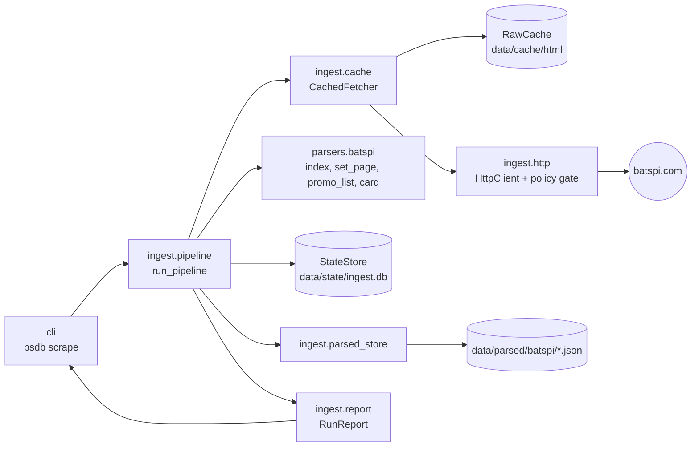
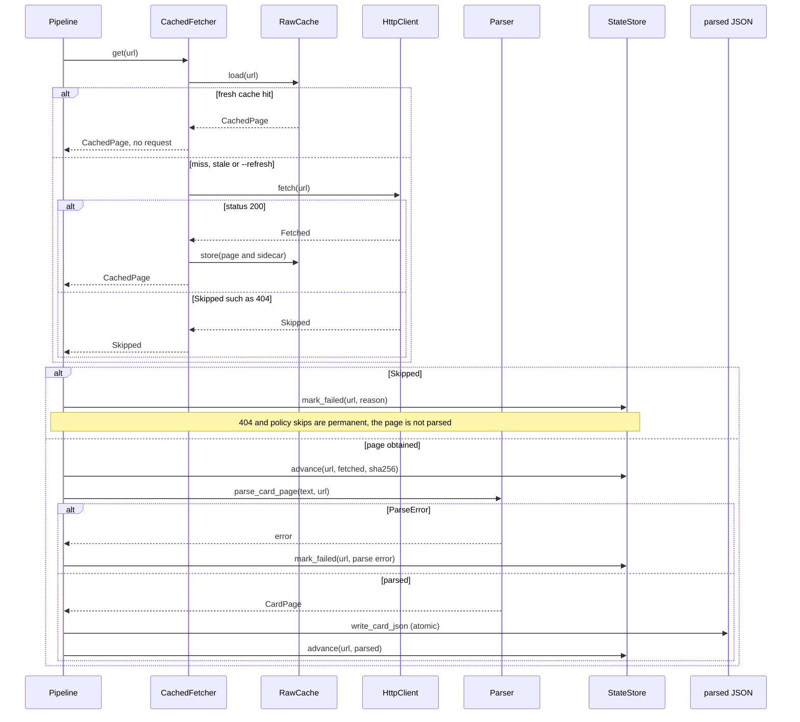

# Scraper pipeline

`bsdb scrape` ([#73](https://github.com/AleFire99/BS_Database/issues/73), epic [#10](https://github.com/AleFire99/BS_Database/issues/10)) crawls batspi.com in three phases (index, set pages, card pages) and writes one parsed JSON file per card page. It is built from the blocks of the epic: the policy-gated HTTP client (#67), the raw cache (#68), the parsers (#69-#71) and the state store (#72). Nothing here talks to the network except `HttpClient`.

## Components



## Fetch, cache, parse, state



The JSON is written before the state advances, so a kill never records `parsed` without a file. A kill between the two leaves the page `fetched` plus a file: harmless, the file is rewritten on resume.

## Run semantics

One run is index, then sets, then cards.

1. **Index.** `INDEX_URL` goes through the cache, `parse_index` lists the products (577 on the fixture, 571 unique URLs), each unique URL is recorded as a `set` page, then the index becomes `parsed`. Children are recorded before the parent advances, so a kill in between only re-parses from the cache.
2. **Sets.** Every set that passes `--set` is fetched and parsed (`parse_promo_list` for the promotion list, `parse_set_page` otherwise); each card link is recorded as a `card` page, then the set becomes `parsed`. Sets that are already `parsed` are walked again in memory, through the cache, so card links of a set are known on every run. A revisit that fails is a warning in the report, never a state change. A set page without a 収録カード heading (events, books) raises `NoCardList`: it becomes `parsed` with zero cards and is listed in the report.
3. **Cards.** The pages in `discovered`, `fetched` or `failed` (with attempts left) are worked in URL order, at most `--limit` of them. With `--set`, only the cards found in the sets visited by this run. A card goes `discovered`, `fetched`, `parsed`; a `fetched` page (a resumed run) is read from the cache, so no request is repeated.

Resume and retry come from the [state store](ingestion-state.md): every store call is its own transaction, so a killed run restarts at the first unfinished page. A failed page is retried on a **later** run from the stage that failed (`failed_from`), at most three attempts, then it is listed as exhausted. A page that fails in this run is not retried in the same run.

Failures are of two kinds:

- **Permanent** (a 404, a 410, a policy skip such as the deny list): the page is exhausted at once (`mark_failed(permanent=True)`), reported and never requested again (policy 3.5: log and skip, no retry). The BS72 set page alone links 105 card pages that do not exist.
- **Retryable** (a 5xx after the HTTP backoff, a transport error, a parse error): one attempt consumed, retried on the next run.

`StopRun` is not a page failure. The budget, a 403 or challenge page, an unreadable robots.txt and a `Retry-After` above 300 s end the run normally; no attempt is consumed and the state is already committed. Any other exception propagates and the state stays resumable.

### Options and exit codes

| Option | Meaning |
| --- | --- |
| `--set TEXT` (repeatable) | Case-insensitive substring of the Japanese product name from the index, applied before any fetch. Set codes such as `BS72` cannot be filtered: the code is known only after parsing the set page and the state does not store it |
| `--refresh` | Fetch again every page this run visits (index, selected sets, pending cards). Use it with `--set` and `--limit`; alone it fetches the index and all sets again, and the request budget stops it half-way. Cards that are already `parsed` are never revisited |
| `--max-age 30d` | Fetch again cached pages older than this (`<int><unit>`, units `s m h d w`) |
| `--limit N` | Take at most N card pages this run (cache hits count) |

| Exit code | Meaning |
| --- | --- |
| 0 | Completed, or the request budget is spent (the normal way a crawl of about 6,500 pages proceeds over several runs: run again), or only per-page failures (they are in the report) |
| 1 | The index could not be obtained and there is nothing to resume |
| 2 | Usage error (a bad option value) |
| 3 | The run was stopped by `Blocked`, `RobotsUnavailable` or `RetryAfterTooLong`: needs a human or time |

## Parsed JSON

`data/parsed/batspi/<sha256(url)>.json`, written atomically (temp file, fsync, rename) as UTF-8 with `ensure_ascii=False`:

```json
{
  "schema_version": "1.1.0",
  "url": "https://batspi.com/index.php?...",
  "provenance": {"source": "batspi", "fetched_at": "2026-11-15T12:00:00+00:00", "from_cache": true},
  "page": {"title_ja": "...", "entries": ["..."], "printings": ["..."], "images": ["..."]}
}
```

The file name is the same digest as the cache stem, so one URL maps to `cache/html/batspi/<d>.html` and `.json` and to `parsed/batspi/<d>.json`; to go from a file back to its URL, read the `url` field. The page name is not used: Japanese names take up to three bytes per character (255-byte limit) and differ by percent-encoding form. `page` is `dataclasses.asdict` of the `CardPage` (see the [card page parser](overview.md#card-page-parser)). `fetched_at` is the time of the original fetch (the cache sidecar); `from_cache` says whether the read that produced this file came from the cache, not whether the original fetch did.

## Report

Each run prints: pages per state, cards parsed this run, failures with reasons (this run, the first 20, then `+N more`), exhausted pages, sets without a card list, discovery notes, warnings, `Requests made N (incl. robots.txt)`, the cache hit rate (`hits / (hits + fetched)` over the pages obtained this run) and why the run stopped.

- **Discovery notes** list, per set page, the card numbers no known scheme recognises (the promotion list has 9 on the fixture) and the count of entries without a page yet (`cmd=edit` links, never requested). Entries with an unrecognised number still have a URL and are crawled; the card parser decides. The notes are kept in the report only, not in the state: a later run that skips the already-parsed set does not repeat them.

## Zero requests on a warm cache

A page whose result is cached costs no request, not even robots.txt (the cache is consulted before the policy gate fetches it). The cache stores only status-200 pages, so a 404 is not cached; it does not matter, because a 404 is exhausted at once and never requested again. Retryable failures are requested again on their retry runs.

## Known limits

- Whole-promo-list crawls are about 1,210 pages (about an hour at 3 s per request); `--limit` and the request budget bound a run.
- The parsers are unsampled for BS75, CB and LM pages (epic #10 risk): real runs may produce `parse error` failures. They are visible in the report, never silent.
