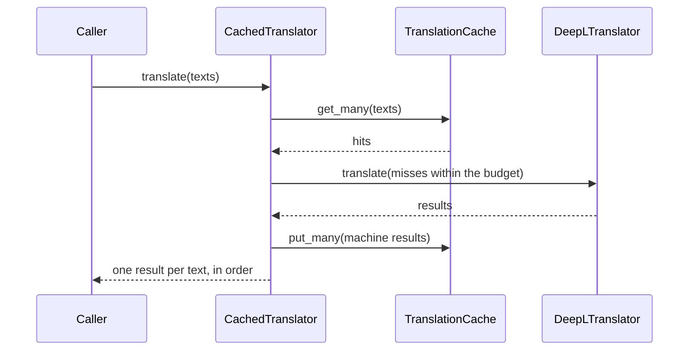

# Translation

The translator ([#94](https://github.com/AleFire99/BS_Database/issues/94), [ADR 0008](../adr/0008-normalization-and-translation.md)) turns Japanese texts into English with a pluggable engine and a persistent cache. It lives in `src/bs_database/translate/`. Wiring it into `bsdb normalize` is [#95](https://github.com/AleFire99/BS_Database/issues/95).

## Components

| Module | Role |
| --- | --- |
| `types` | `Translator` protocol, `TranslationResult(text, status, engine)`, language codes `jp` and `en` |
| `null` | `NullTranslator`: every text is `pending`, no I/O |
| `deepl` | `DeepLTranslator` and `RequestsJsonTransport`: the only place that knows the DeepL API codes (`JA`, `EN-US`) |
| `cache` | `TranslationCache`: SQLite, keyed by (engine, src, tgt, sha256 of the text) |
| `cached` | `CachedTranslator`: cache first, optional character budget, one INFO log line per call |
| `factory` | `make_translator(settings)`: picks the engine |

## Flow

## Results and statuses

Every call returns one result per input text, in the same order. The status uses the [ADR 0005](../adr/0005-text-first-effects-and-translations.md) codes:

| Status | Meaning | Cached |
| --- | --- | --- |
| `machine` | translated by the engine, or found in the cache | yes |
| `pending` | not attempted: blank text, over the character budget, or the null engine | no |
| `failed` | attempted but errored; `text` is `None`, never an error string | no |

Neither `pending` nor `failed` is cached, so the next run retries them. An unsupported language pair raises `ValueError`.

## Engine choice

- With `BSDB_DEEPL_API_KEY` set: `CachedTranslator(DeepLTranslator, TranslationCache)`.
- Without a key (or an empty one): a bare `NullTranslator`. It reads no cache and creates no file, so CI stays offline and deterministic.

## Cache

- File: `BSDB_TRANSLATION_CACHE_PATH`, default `data/cache/translations.sqlite` (git-ignored through `/data/cache/`).
- Table `translations(engine, src, tgt, sha256, source_text, translated_text, created_at)`, primary key `(engine, src, tgt, sha256)`, `PRAGMA user_version = 1`.
- A lookup also compares `source_text`, so a hash collision counts as a miss.
- Each chunk of 50 texts is committed on its own, so a killed run keeps what it already translated.
- The file is created on the first write, not on construction.

## Character budget

`CachedTranslator(max_chars=N)` caps the characters sent to the engine over its lifetime (`None` means no limit):

1. Duplicate texts are removed, then the cache is checked. Cache hits are free, even with a budget of 0.
2. Misses are counted in input order. A text that would exceed the budget comes back `pending`, and a later shorter text can still fit.

Each call logs one INFO line, `engine= hits= sent= chars= pending= failed=`. Texts are never logged at INFO. The `--max-chars` CLI flag is #95.

## DeepL engine

- Host: `api-free.deepl.com` for keys ending in `:fx`, otherwise `api.deepl.com`. Request: `POST /v2/translate` with a JSON body (`text[]`, `source_lang`, `target_lang`) and the header `Authorization: DeepL-Auth-Key <key>`.
- Batches hold at most 50 texts and about 100 KiB (DeepL's cap is 128 KiB), sent one at a time.
- 429, 5xx, 529 and transport errors are retried 3 times with 2, 6 and 18 s backoff, honouring `Retry-After` (capped at 300 s). When the retries run out, that batch is `failed` and the next batch is still tried.
- 400, 403 and 456 are not retried. The batch and every remaining text become `failed`, the engine stops for the run and one ERROR line says why (invalid request, authentication or quota).
- A response with a different number of translations than texts sent, or an unreadable one, fails the batch.
- The `X-Trace-ID` response header is logged at DEBUG.

## Key handling

- The key is a pydantic `SecretStr`, so it is hidden in `repr(settings)`. It is read only to build the `Authorization` header.
- It never appears in logs, exceptions or `repr(translator)`; transport errors keep only the exception class name.
- It lives in the environment or the git-ignored `.env`. Tests use the literal `test-key:fx` and never call DeepL.
