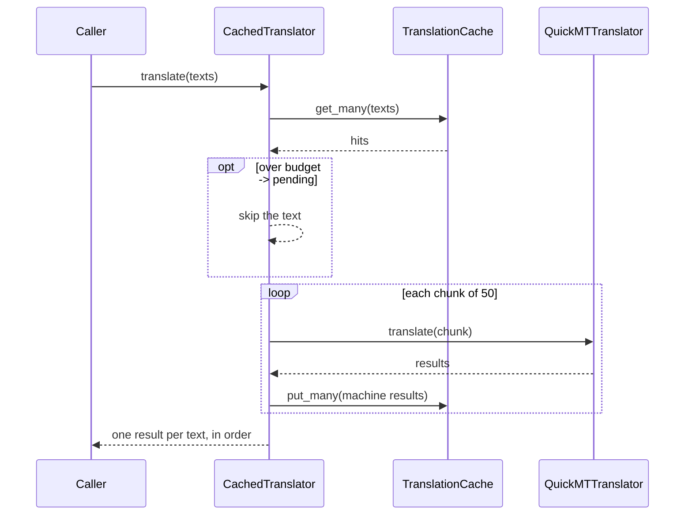

# Translation

The translator ([#94](https://github.com/AleFire99/BS_Database/issues/94), [ADR 0008](../adr/0008-normalization-and-translation.md)) turns Japanese texts into English with a pluggable engine and a persistent cache. It lives in `src/bs_database/translate/`. It is wired into `bsdb normalize` by [#95](https://github.com/AleFire99/BS_Database/issues/95) (see Wiring).

## Components

| Module | Role |
| --- | --- |
| `types` | `Translator` protocol, `TranslationResult(text, status, engine)`, language codes `jp` and `en` |
| `null` | `NullTranslator`: every text is `pending`, no I/O |
| `quickmt` | `QuickMTTranslator`: the offline quickmt ja-en engine (CTranslate2 + SentencePiece, lazy imports) |
| `cache` | `TranslationCache`: SQLite, keyed by (engine, src, tgt, sha256 of the text) |
| `cached` | `CachedTranslator`: cache first, optional character budget, one INFO log line per call |
| `protect` | Term protection (#156): span masking, token validation, `GlossaryResolver`, restore |
| `protected` | `ProtectedTranslator`: per-line batch, validation, sentence-split retry |
| `factory` | `make_translator(settings, protect=None)`: picks the engine |

## Flow



## Results and statuses

Every call returns one result per input text, in the same order. The status uses the [ADR 0005](../adr/0005-text-first-effects-and-translations.md) codes:

| Status | Meaning | Cached |
| --- | --- | --- |
| `machine` | translated by the engine, or found in the cache | yes |
| `pending` | not attempted: blank text, over the character budget, or the null engine | no |
| `failed` | attempted but errored; `text` is `None`, never an error string | no |

Neither `pending` nor `failed` is cached, so the next run retries them. An unsupported language pair raises `ValueError`.

## Wiring into `bsdb normalize`

`normalize_tree` collects the card names, product names and families that have no English name (families with a glossary `en` and names printed by batspi are kept) and makes one batched `translate` call, ordered families, names, products and sorted by Japanese text. `normalize.translation.apply_translations` maps the results onto the fields: `machine` sets the text with source and status `machine`; `failed` and `pending` leave `en = None` with that status. See [normalization.md](normalization.md). A second run is served by the cache and makes no engine call.

## Engine choice

- With the three model files present in `BSDB_MT_MODEL_DIR` and `ctranslate2` and `sentencepiece` importable: `CachedTranslator(QuickMTTranslator, TranslationCache)`.
- Otherwise a bare `NullTranslator`, with one INFO line saying why (model files missing, or run `uv sync --group mt`). It reads no cache and creates no file, so CI stays offline and deterministic.

## Cache

- File: `BSDB_TRANSLATION_CACHE_PATH`, default `data/cache/translations.sqlite` (git-ignored through `/data/cache/`).
- Table `translations(engine, src, tgt, sha256, source_text, translated_text, created_at)`, primary key `(engine, src, tgt, sha256)`, `PRAGMA user_version = 1`.
- A lookup also compares `source_text`, so a hash collision counts as a miss.
- Each chunk of 50 texts is committed on its own, so a killed run keeps what it already translated. `sqlite3` errors propagate: the cache is a local file, not an engine.
- The file is created on the first write, not on construction.

## Character budget

`CachedTranslator(max_chars=N)` caps the characters sent to the engine over its lifetime (`None` means no limit):

1. Duplicate texts are removed, then the cache is checked. Cache hits are free, even with a budget of 0.
2. Misses are counted in input order. A text that would exceed the budget comes back `pending`, and a later shorter text can still fit.

Each call logs one INFO line, `engine= hits= sent= chars= pending= failed=`. Texts are never logged at INFO. `bsdb normalize --max-chars N` sets this budget (0 means cache only).

## quickmt engine

The engine ([#102](https://github.com/AleFire99/BS_Database/issues/102)) runs the [quickmt ja-en](https://huggingface.co/quickmt/quickmt-ja-en) model offline on the CPU, through CTranslate2 and SentencePiece called directly (the `quickmt` package itself is not used).

- Name `quickmt-ja-en`, part of the cache key. A new model, beam size or compute type needs a new name so stale translations are never reused.
- Only `jp` to `en`; any other pair raises `ValueError`.
- Deterministic decoding: beam size 5, one hypothesis, no sampling, one inference thread. Compute type `int8` (a constructor argument, not a setting). Texts go in batches of 32.
- The model loads on the first non-empty call. SentencePiece encodes to pieces without BOS/EOS, `translate_batch` runs, and the target SentencePiece model decodes.
- Nothing raises on engine errors. A load failure (missing or corrupt model, missing library) logs one WARNING and marks every text `failed`. A batch exception, a wrong number of hypotheses, an empty output or a hypothesis that reaches the decoding limit (256 tokens, truncated) marks only that batch (or text) `failed`. Blank text is `pending`.
- The libraries are typed with small private protocols and loaded with `importlib`, so mypy and CI do not need them.

### Setup

The libraries live in the optional uv group `mt`, which CI never installs:

```bash
uv sync --group mt
uvx --from huggingface_hub hf download quickmt/quickmt-ja-en --exclude "eole-model/*" --local-dir data/models/quickmt-ja-en
```

About 410 MB. The flags `--exclude` and `--local-dir` were checked against `hf download --help`. The files `model.bin`, `src.spm.model` and `tgt.spm.model` must end up in `BSDB_MT_MODEL_DIR` (default `data/models/quickmt-ja-en`, git-ignored). Tests never download the model and never read a local one.

## Term protection

[ADR 0012](../adr/0012-english-text-term-protection-and-provenance.md), [#156](https://github.com/AleFire99/BS_Database/issues/156). `make_translator(settings, protect=ProtectionConfig(resolver, glyphs))` returns `ProtectedTranslator(CachedTranslator(QuickMTTranslator))`. Without `protect` nothing changes.

- Per field: split on `\n`, mask each line (`【…】`, `《…》`, `〔…〕`, `『…』`, `「…」`, `系統：`, runs of two or more symbol glyphs become `<k0/>`, numbered per line), send all lines of all texts as one batch, validate, restore, rejoin.
- A line is valid when the token multiset equals the one sent (order is free) and no marker residue is left. Quotes around a token are removed, but only symmetric pairs.
- Restore keeps the source brackets around the English (`【Double Symbol】`). `「…」` is the family English, else the card name map, else the romanised Japanese (`pykakasi` from the `mt` group, imported lazily; the `romanise` argument of `GlossaryResolver` is injectable, default identity). A span the glossaries do not know keeps its Japanese: the field does not fail, and the INFO line counts them (`unresolved=`).
- Retry: a bad line with several sentences is split after each `。` and the sentences are translated in one second batch (decoding is deterministic, so repeating the same input would change nothing). A single sentence fails at once. A line that still fails makes the whole field `failed`, never partial text.
- The engine name is `quickmt-ja-en+prot1` (`PROTECTION_VERSION`); bump it on any rule change. The cache sits below protection and stores engine output per masked line, so glossary or name-map edits apply without re-translating.
- `pykakasi` is GPL-3.0-or-later; see the release epic [#14](https://github.com/AleFire99/BS_Database/issues/14).

## Third-party models

| Model | URL | Licence |
| --- | --- | --- |
| quickmt ja-en | <https://huggingface.co/quickmt/quickmt-ja-en> | CC-BY-4.0 |

Released English names can include output of this model. The credit in the release notes and the database `meta` is tracked in [#14](https://github.com/AleFire99/BS_Database/issues/14).
