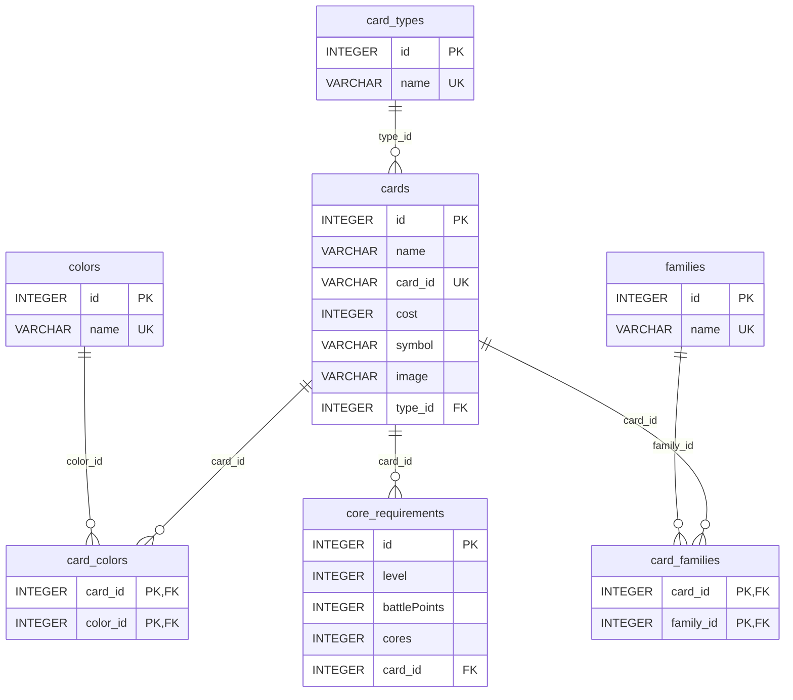
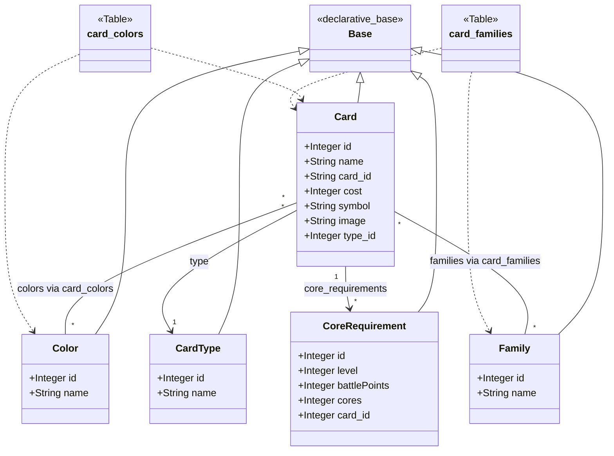

# Current database schema

> **Legacy schema.** This page documents the legacy `battle_spirits.db` schema. It is superseded by the [target schema](target-schema.md) ([ADR 0002](../adr/0002-storage-technology.md), [ADR 0003](../adr/0003-naming-and-schema-versioning.md), [ADR 0004](../adr/0004-card-printing-identity.md), [ADR 0005](../adr/0005-text-first-effects-and-translations.md)) and is kept only as a reference for the migration in [#12](https://github.com/AleFire99/BS_Database/issues/12). Where each legacy table, column and JSON key ends up is in [legacy-mapping.md](legacy-mapping.md).

Schema of `battle_spirits.db`, matching the SQLAlchemy models in `src/bs_database/db.py`. SQLite, created via `Base.metadata.create_all`.

## Entity-relationship diagram

## SQLAlchemy models

## Row counts

Counts are from the last tracked DB snapshot (untracked in #23). Regenerate with `uv run python tests/tools/db_counts.py <db>`.

| Table | Rows | Sample |
| --- | --- | --- |
| `cards` | 6373 | `1 / Goladon / BS01-001 / cost 0 / red / data/images/BS01/BS01-001.jpg / type 1` |
| `card_types` | 5 | Spirit, Nexus, Magic, Brave, Ultimate |
| `colors` | 5 | Red, Purple, Green, Yellow, Blue |
| `families` | 517 | Reptile Beast, Flying Fang, Drifting Spirit |
| `card_colors` | 5236 | `(1, 1)` |
| `card_families` | 8056 | `(1, 1)` |
| `core_requirements` | 11377 | `level 1 / BP 1000 / cores 1 / card 1` |

Cards by type: Spirit 4303, Magic 891, Nexus 642, Brave 353, Ultimate 184. The data covers 72 distinct set prefixes. 1137 cards have no color row and 1533 cards have no core requirements (expected for Magic and Nexus, to verify in E4).

## Observations on stored values

- `cards.symbol` holds raw translated text, not an enum. Besides single colors (`red`, `Blue`, ...) it contains values such as `Blue and red`, `Green Red`, and `Red purple green white yellow blue` (14 cards). Inconsistent casing means `Blue` and `blue` are different strings.
- `colors` has no `White` row: the symbol-to-color map in `get_colors_from_symbol` (`bs_database.db`) contains `black` instead of `white`, so white cards and all multicolor cards get no `card_colors` rows.
- `core_requirements.battlePoints` is camelCase, unlike every other column.
- No `NOT NULL` constraints besides primary keys, and SQLite foreign keys are not enforced unless `PRAGMA foreign_keys=ON`.

## Gaps (input to E3, [#8](https://github.com/AleFire99/BS_Database/issues/8))

- No `sets` table: the set is only implicit in the `card_id` prefix (`BS05`); no set names, release dates or set types (booster, starter deck, promo).
- No rarity.
- No card effects, text, flavor text or keywords.
- No reductions: `reduction` is scraped into JSON but not loaded.
- Colors are derived from the translated symbol string; no multicolor modelling, no white.
- `card_id` is a business string while `id` is a surrogate integer; `core_requirements.card_id` and association tables reference the integer `id`, which is easy to confuse.
- No Japanese names (card, family, type); only machine-translated English.
- No modelling of reprints or promos: one row per printed `card_id`, no link between prints of the same card.
- No image metadata (source, hash, size, language); only a path string to files that are not in the repository.
- No provenance (source URL, scrape date) per row.
- No constraints or enumerations for type, symbol and level.
