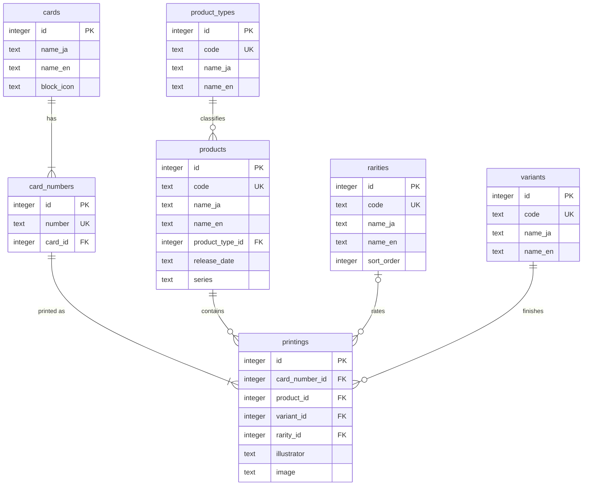

# Target schema

This is the design document for the new normalized schema. It is extended by [#30](https://github.com/AleFire99/BS_Database/issues/30) (gameplay attributes), [#31](https://github.com/AleFire99/BS_Database/issues/31) (effects, i18n, provenance, images) and [#32](https://github.com/AleFire99/BS_Database/issues/32). It is **not** the build source: the DDL and SQLAlchemy models are owned by [#12](https://github.com/AleFire99/BS_Database/issues/12). Naming follows [ADR 0003](../adr/0003-naming-and-schema-versioning.md). Items marked "pending #9" depend on the source analysis ([#9](https://github.com/AleFire99/BS_Database/issues/9)).

## Identity

Card versus printing identity, as decided in [ADR 0004](../adr/0004-card-printing-identity.md): a **card** is the gameplay identity, a **card number** (`BS72-069`) belongs to exactly one card, and a **printing** is one number in one product and variant.

### cards

The gameplay identity: one row per distinct card. Gameplay columns (type, cost, colors, families, levels) are added by #30, effects and i18n details by #31.

| Column | Type | Constraints | Notes |
| --- | --- | --- | --- |
| `id` | INTEGER | PRIMARY KEY | Surrogate key. |
| `name_ja` | TEXT | NOT NULL | Japanese card name (batspi page title). |
| `name_en` | TEXT | | English name; sourcing and fallback rules in #31. |
| `block_icon` | TEXT | | Block icon (`12`, `A`, ...). Placed on the card by default; per card or per number is pending #9. |

Whether numbers with the same name but different numbers are one card is pending #9. The planned rule: link them only if text and stats are identical.

### card_numbers

| Column | Type | Constraints | Notes |
| --- | --- | --- | --- |
| `id` | INTEGER | PRIMARY KEY | |
| `number` | TEXT | NOT NULL, UNIQUE | Printed number, e.g. `BS72-069`. Promo number format pending #9. |
| `card_id` | INTEGER | NOT NULL, FOREIGN KEY to `cards.id` | A number belongs to exactly one card; a card can have several numbers. |

### printings

One physical printing of a number in a product.

| Column | Type | Constraints | Notes |
| --- | --- | --- | --- |
| `id` | INTEGER | PRIMARY KEY | |
| `card_number_id` | INTEGER | NOT NULL, FOREIGN KEY to `card_numbers.id` | |
| `product_id` | INTEGER | NOT NULL, FOREIGN KEY to `products.id` | |
| `variant_id` | INTEGER | NOT NULL, FOREIGN KEY to `variants.id` | Defaults to the `normal` variant; NOT NULL because SQLite treats NULLs as distinct in UNIQUE. |
| `rarity_id` | INTEGER | FOREIGN KEY to `rarities.id` | Nullable: distribution entries on batspi show no rarity (pending #9). |
| `illustrator` | TEXT | | Plain text for now; normalised later if needed. |
| `image` | TEXT | | Image reference; detailed in #31. |

Table constraint: `UNIQUE (card_number_id, product_id, variant_id)`.

### products

Anything a card is released in. A booster set is a product; there is no separate `sets` table.

| Column | Type | Constraints | Notes |
| --- | --- | --- | --- |
| `id` | INTEGER | PRIMARY KEY | |
| `code` | TEXT | UNIQUE | e.g. `BS72`; NULL for distributions without a code (SQLite allows several NULLs). |
| `name_ja` | TEXT | NOT NULL | e.g. `第1章：廻帰再醒`. |
| `name_en` | TEXT | | |
| `product_type_id` | INTEGER | NOT NULL, FOREIGN KEY to `product_types.id` | |
| `release_date` | TEXT | | ISO-8601 date; NULL when the source gives none. |
| `series` | TEXT | | Chapter or saga grouping (`契約編：環`), a plain column, no table. |

### product_types

Lookup, following the lookup convention of ADR 0003.

| Column | Type | Constraints | Notes |
| --- | --- | --- | --- |
| `id` | INTEGER | PRIMARY KEY | |
| `code` | TEXT | NOT NULL, UNIQUE | Planned: `booster`, `starter`, `promo`, `magazine`, `collab`, `other`. Final list pending #9. |
| `name_ja` | TEXT | NOT NULL | |
| `name_en` | TEXT | | |

### rarities

| Column | Type | Constraints | Notes |
| --- | --- | --- | --- |
| `id` | INTEGER | PRIMARY KEY | |
| `code` | TEXT | NOT NULL, UNIQUE | `C`, `U`, `R`, `M`, ... from batspi `<C>`, `<R>`. The full scale is pending #9. |
| `name_ja` | TEXT | NOT NULL | e.g. `コモン`, `レア`. |
| `name_en` | TEXT | | |
| `sort_order` | INTEGER | NOT NULL | Display order from common to rare. |

### variants

| Column | Type | Constraints | Notes |
| --- | --- | --- | --- |
| `id` | INTEGER | PRIMARY KEY | |
| `code` | TEXT | NOT NULL, UNIQUE | Planned: `normal`, `secret`, `full_art`, `promo_art`, parallel. The full list is pending #9. |
| `name_ja` | TEXT | NOT NULL | e.g. `フルアート版`. |
| `name_en` | TEXT | | |
