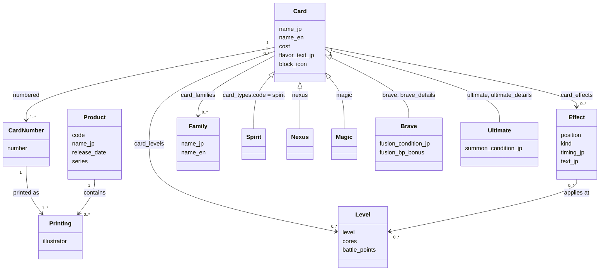
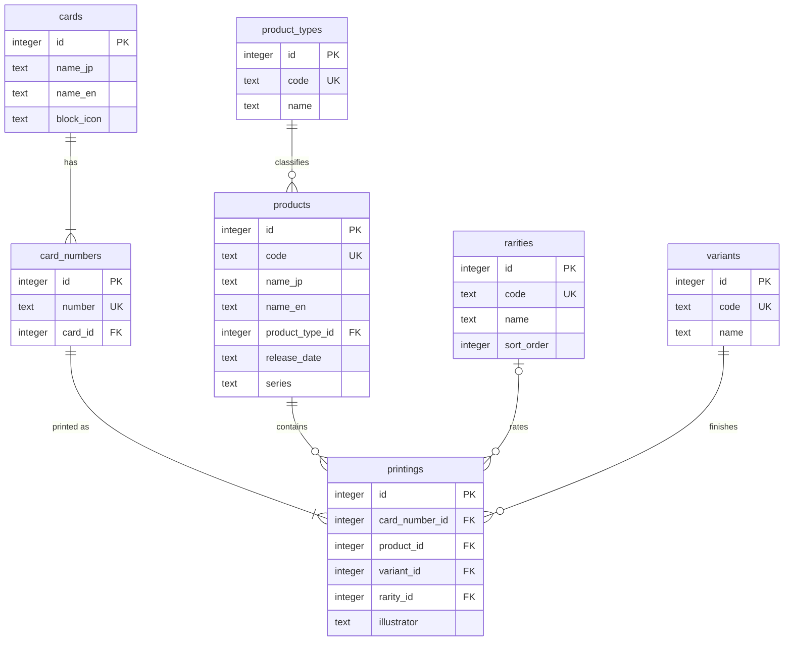
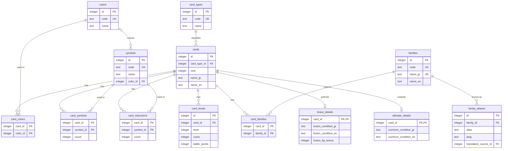
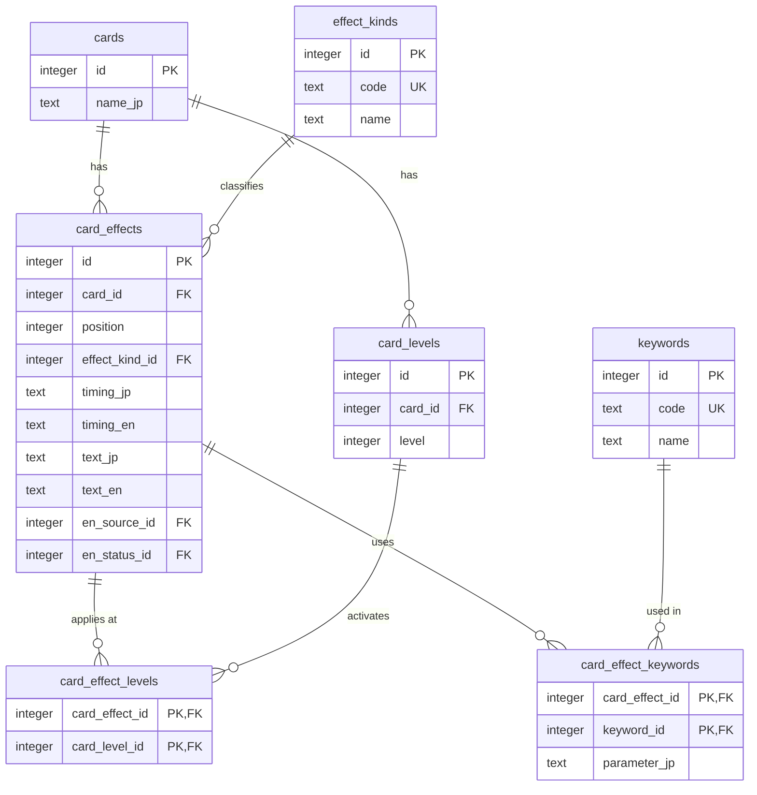
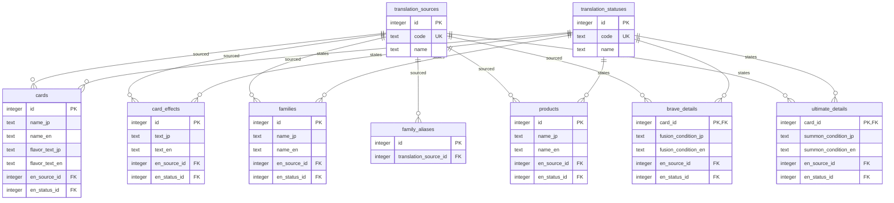
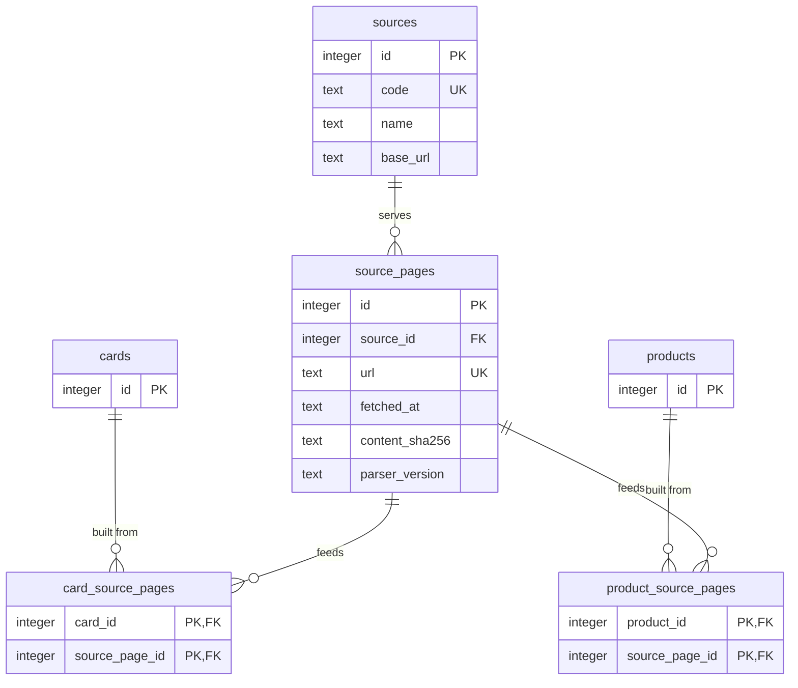
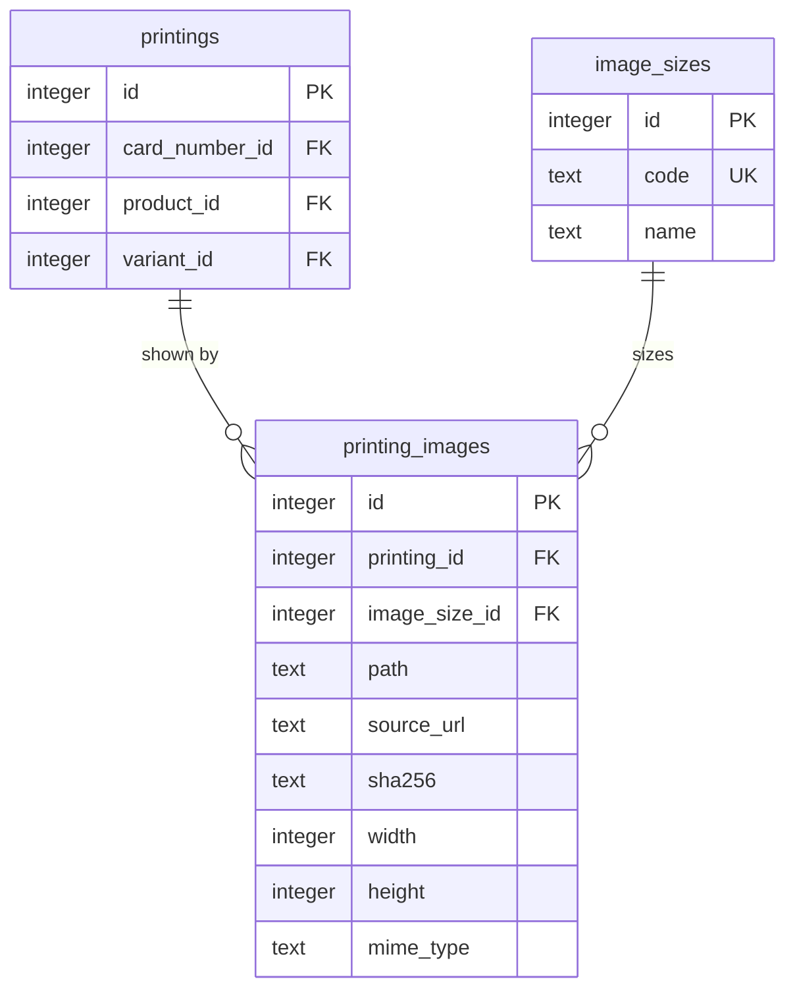

# Target schema

This is the design document for the new normalized schema. It is extended by [#30](https://github.com/AleFire99/BS_Database/issues/30) (gameplay attributes), [#31](https://github.com/AleFire99/BS_Database/issues/31) (effects, i18n, provenance, images) and [#32](https://github.com/AleFire99/BS_Database/issues/32). It is **not** the build source: the DDL and SQLAlchemy models are owned by [#12](https://github.com/AleFire99/BS_Database/issues/12). Naming follows [ADR 0003](../adr/0003-naming-and-schema-versioning.md). Items marked "pending #9" depend on the source analysis ([#9](https://github.com/AleFire99/BS_Database/issues/9)).

## Overview

The model has 33 tables: 32 entities connected by foreign keys plus the single-row `schema_meta` ([ADR 0003](../adr/0003-naming-and-schema-versioning.md)). The two diagrams below are the whole-model view; the sections after them describe each area in detail with column tables.

### Complete ER diagram

Key columns only (PK, FK, UK). Every relationship of the area diagrams is drawn here. The translation foreign keys (`en_source_id`, `en_status_id`) are shown on each table that has them; `family_aliases` has `translation_source_id` only. `schema_meta` has no relationships.

```mermaid
erDiagram
    card_types ||--o{ cards : "classifies"
    cards ||--|{ card_numbers : "has"
    card_numbers ||--|{ printings : "printed as"
    products ||--o{ printings : "contains"
    product_types ||--o{ products : "classifies"
    rarities |o--o{ printings : "rates"
    variants ||--o{ printings : "finishes"
    cards ||--o{ card_colors : "has"
    colors ||--o{ card_colors : "used in"
    cards ||--o{ card_symbols : "has"
    cards ||--o{ card_reductions : "has"
    symbols ||--o{ card_symbols : "used in"
    symbols ||--o{ card_reductions : "used in"
    colors |o--o{ symbols : "colours"
    cards ||--o{ card_levels : "has"
    cards ||--o{ card_families : "has"
    families ||--o{ card_families : "used in"
    families ||--o{ family_aliases : "known as"
    cards ||--o| brave_details : "extends"
    cards ||--o| ultimate_details : "extends"
    cards ||--o{ card_effects : "has"
    effect_kinds ||--o{ card_effects : "classifies"
    card_effects ||--o{ card_effect_levels : "applies at"
    card_levels ||--o{ card_effect_levels : "activates"
    card_effects ||--o{ card_effect_keywords : "uses"
    keywords ||--o{ card_effect_keywords : "used in"
    translation_sources |o--o{ cards : "sourced"
    translation_statuses ||--o{ cards : "states"
    translation_sources |o--o{ card_effects : "sourced"
    translation_statuses ||--o{ card_effects : "states"
    translation_sources |o--o{ families : "sourced"
    translation_statuses ||--o{ families : "states"
    translation_sources ||--o{ family_aliases : "sourced"
    translation_sources |o--o{ products : "sourced"
    translation_statuses ||--o{ products : "states"
    translation_sources |o--o{ brave_details : "sourced"
    translation_statuses ||--o{ brave_details : "states"
    translation_sources |o--o{ ultimate_details : "sourced"
    translation_statuses ||--o{ ultimate_details : "states"
    sources ||--o{ source_pages : "serves"
    cards ||--o{ card_source_pages : "built from"
    source_pages ||--o{ card_source_pages : "feeds"
    products ||--o{ product_source_pages : "built from"
    source_pages ||--o{ product_source_pages : "feeds"
    printings ||--o{ printing_images : "shown by"
    image_sizes ||--o{ printing_images : "sizes"

    cards {
        integer id PK
        integer card_type_id FK
        integer en_source_id FK
        integer en_status_id FK
    }
    card_types {
        integer id PK
        text code UK
    }
    card_numbers {
        integer id PK
        text number UK
        integer card_id FK
    }
    printings {
        integer id PK
        integer card_number_id FK
        integer product_id FK
        integer variant_id FK
        integer rarity_id FK
    }
    products {
        integer id PK
        text code UK
        integer product_type_id FK
        integer en_source_id FK
        integer en_status_id FK
    }
    product_types {
        integer id PK
        text code UK
    }
    rarities {
        integer id PK
        text code UK
    }
    variants {
        integer id PK
        text code UK
    }
    colors {
        integer id PK
        text code UK
    }
    card_colors {
        integer card_id PK, FK
        integer color_id PK, FK
    }
    symbols {
        integer id PK
        text code UK
        integer color_id FK
    }
    card_symbols {
        integer card_id PK, FK
        integer symbol_id PK, FK
    }
    card_reductions {
        integer card_id PK, FK
        integer symbol_id PK, FK
    }
    card_levels {
        integer id PK
        integer card_id FK
    }
    families {
        integer id PK
        text code UK
        text name_jp UK
        integer en_source_id FK
        integer en_status_id FK
    }
    family_aliases {
        integer id PK
        integer family_id FK
        integer translation_source_id FK
    }
    card_families {
        integer card_id PK, FK
        integer family_id PK, FK
    }
    brave_details {
        integer card_id PK, FK
        integer en_source_id FK
        integer en_status_id FK
    }
    ultimate_details {
        integer card_id PK, FK
        integer en_source_id FK
        integer en_status_id FK
    }
    card_effects {
        integer id PK
        integer card_id FK
        integer effect_kind_id FK
        integer en_source_id FK
        integer en_status_id FK
    }
    effect_kinds {
        integer id PK
        text code UK
    }
    card_effect_levels {
        integer card_effect_id PK, FK
        integer card_level_id PK, FK
    }
    keywords {
        integer id PK
        text code UK
    }
    card_effect_keywords {
        integer card_effect_id PK, FK
        integer keyword_id PK, FK
    }
    translation_sources {
        integer id PK
        text code UK
    }
    translation_statuses {
        integer id PK
        text code UK
    }
    sources {
        integer id PK
        text code UK
    }
    source_pages {
        integer id PK
        integer source_id FK
        text url UK
    }
    card_source_pages {
        integer card_id PK, FK
        integer source_page_id PK, FK
    }
    product_source_pages {
        integer product_id PK, FK
        integer source_page_id PK, FK
    }
    image_sizes {
        integer id PK
        text code UK
    }
    printing_images {
        integer id PK
        integer printing_id FK
        integer image_size_id FK
    }
    schema_meta {
        integer id PK
    }
```



### Domain class diagram

The domain view, not the table view. The five card types are one row each in `card_types`; their specific data lives in `card_levels`, `card_effects` and, for Brave and Ultimate, in the side tables `brave_details` and `ultimate_details`. The specialisation arrows therefore show domain concepts, not subclass tables: there is no table per type. Attribute lists are abridged.



## Identity

Card versus printing identity, as decided in [ADR 0004](../adr/0004-card-printing-identity.md): a **card** is the gameplay identity, a **card number** (`BS72-069`) belongs to exactly one card, and a **printing** is one number in one product and variant.



### cards

The gameplay identity: one row per distinct card. Gameplay columns (type, cost) and the related tables (colors, symbols, families, levels) are described in [Gameplay attributes](#gameplay-attributes); effects, text and translation columns are in [Effects and keywords](#effects-and-keywords) and [Multilingual text](#multilingual-text).

| Column | Type | Constraints | Notes |
| --- | --- | --- | --- |
| `id` | INTEGER | PRIMARY KEY | Surrogate key. |
| `name_jp` | TEXT | NOT NULL | Japanese card name (batspi page title). |
| `name_en` | TEXT | | English name; NULL until translated. Source and status in `en_source_id` and `en_status_id` below; see [Multilingual text](#multilingual-text). |
| `flavor_text_jp` | TEXT | | Flavor text as printed (`フレーバーテキスト：` in the `<pre>`). NULL when the card has none (the Magic fixture has none). On the card, not the printing; whether it varies per printing is pending #9. |
| `flavor_text_en` | TEXT | | English flavor text; NULL until translated. |
| `en_source_id` | INTEGER | FOREIGN KEY to `translation_sources.id` | Where the English texts of this row come from; NULL while there is no English text. |
| `en_status_id` | INTEGER | NOT NULL, FOREIGN KEY to `translation_statuses.id` | Translation status of this row; defaults to `pending`. |
| `block_icon` | TEXT | | Block icon (`12`, `A`, ...). Placed on the card by default; per card or per number is pending #9. |

Whether numbers with the same name but different numbers are one card is pending #9. The planned rule: link them only if text and stats are identical.

### card_numbers

| Column | Type | Constraints | Notes |
| --- | --- | --- | --- |
| `id` | INTEGER | PRIMARY KEY | |
| `number` | TEXT | NOT NULL, UNIQUE | Printed number, e.g. `BS72-069`. Promo number format pending #9. |
| `card_id` | INTEGER | NOT NULL, FOREIGN KEY to `cards.id` | A number belongs to exactly one card; a card can have several numbers. |

### printings

One physical printing of a number in a product.

| Column | Type | Constraints | Notes |
| --- | --- | --- | --- |
| `id` | INTEGER | PRIMARY KEY | |
| `card_number_id` | INTEGER | NOT NULL, FOREIGN KEY to `card_numbers.id` | |
| `product_id` | INTEGER | NOT NULL, FOREIGN KEY to `products.id` | |
| `variant_id` | INTEGER | NOT NULL, FOREIGN KEY to `variants.id` | Defaults to the `normal` variant; NOT NULL because SQLite treats NULLs as distinct in UNIQUE. |
| `rarity_id` | INTEGER | FOREIGN KEY to `rarities.id` | Nullable: distribution entries on batspi show no rarity (pending #9). |
| `illustrator` | TEXT | | Plain text for now; normalised later if needed. |

Table constraint: `UNIQUE (card_number_id, product_id, variant_id)`. Images are not a column of `printings`: they are rows of [printing_images](#printing_images).

### products

Anything a card is released in. A booster set is a product; there is no separate `sets` table.

| Column | Type | Constraints | Notes |
| --- | --- | --- | --- |
| `id` | INTEGER | PRIMARY KEY | |
| `code` | TEXT | UNIQUE | e.g. `BS72`; NULL for distributions without a code (SQLite allows several NULLs). |
| `name_jp` | TEXT | NOT NULL | e.g. `第1章：廻帰再醒`. |
| `name_en` | TEXT | | |
| `product_type_id` | INTEGER | NOT NULL, FOREIGN KEY to `product_types.id` | |
| `release_date` | TEXT | | ISO-8601 date; NULL when the source gives none. |
| `series` | TEXT | | Chapter or saga grouping (`契約編：環`), a plain column, no table. |
| `en_source_id` | INTEGER | FOREIGN KEY to `translation_sources.id` | Source of `name_en`; NULL while untranslated. |
| `en_status_id` | INTEGER | NOT NULL, FOREIGN KEY to `translation_statuses.id` | Translation status of `name_en`; defaults to `pending`. |

### product_types

Lookup, following the lookup convention of ADR 0003: `code` plus one English `name`, no Japanese name column.

| Column | Type | Constraints | Notes |
| --- | --- | --- | --- |
| `id` | INTEGER | PRIMARY KEY | |
| `code` | TEXT | NOT NULL, UNIQUE | Planned: `booster`, `starter`, `promo`, `magazine`, `collab`, `other`. Final list pending #9. |
| `name` | TEXT | NOT NULL | English display name. |

### rarities

| Column | Type | Constraints | Notes |
| --- | --- | --- | --- |
| `id` | INTEGER | PRIMARY KEY | |
| `code` | TEXT | NOT NULL, UNIQUE | `C` and `R` seen in batspi `<C>`, `<R>`; other codes and the full scale are pending #9. |
| `name` | TEXT | NOT NULL | English display name, e.g. `Common`, `Rare`. |
| `sort_order` | INTEGER | NOT NULL | Display order from common to rare. |

### variants

| Column | Type | Constraints | Notes |
| --- | --- | --- | --- |
| `id` | INTEGER | PRIMARY KEY | |
| `code` | TEXT | NOT NULL, UNIQUE | Planned: `normal`, `secret`, `full_art`, `promo_art`, parallel. The full list is pending #9. |
| `name` | TEXT | NOT NULL | English display name, e.g. `Full art`. The source text `フルアート版` is mapped to `full_art` by the loader. |

## Gameplay attributes

Added by [#30](https://github.com/AleFire99/BS_Database/issues/30). Gameplay attributes are identical across printings of a card (a reprint keeps its number and text; only rarity and art change, see ADR 0004), so they hang off `cards`, never off `card_numbers` or `printings`. Effects, keywords and alternate costs such as `【ミラージュ：コスト2(1)】` belong to [#31](https://github.com/AleFire99/BS_Database/issues/31) and are modelled in [Effects and keywords](#effects-and-keywords), not here.

Lookup tables (`card_types`, `colors`, `symbols`, `rarities`, `variants`, `product_types`) carry a stable `code` and one English `name`. They have **no Japanese name column**: the Japanese source text is translated to a `code` by the normalization stage ([#11](https://github.com/AleFire99/BS_Database/issues/11), [ADR 0008](../adr/0008-normalization-and-translation.md)), see [JP source to code](#jp-source-to-code). Data entities (`cards`, `families`, `products`) keep `name_jp` so a bad machine translation can be redone.



### cards (gameplay columns)

Columns added by #30 to the identity table above (`name_jp`, `name_en` and `block_icon` are already described there).

| Column | Type | Constraints | Notes |
| --- | --- | --- | --- |
| `card_type_id` | INTEGER | NOT NULL, FOREIGN KEY to `card_types.id` | Type from `<pre>` line 1. |
| `cost` | INTEGER | NOT NULL, CHECK `cost` >= 0 | Number before the parentheses on the cost line (`4` in `4(赤2神1)`). Legacy range 0 to 12. |

### card_types

Lookup.

| Column | Type | Constraints | Notes |
| --- | --- | --- | --- |
| `id` | INTEGER | PRIMARY KEY | |
| `code` | TEXT | NOT NULL, UNIQUE | `spirit`, `nexus`, `magic`, `brave`, `ultimate`. A new type needs no schema change. |
| `name` | TEXT | NOT NULL | English display name, e.g. `Spirit`. |

### colors

Lookup. Colours are the six game colours; the god symbol is not a colour.

| Column | Type | Constraints | Notes |
| --- | --- | --- | --- |
| `id` | INTEGER | PRIMARY KEY | |
| `code` | TEXT | NOT NULL, UNIQUE | `red`, `purple`, `green`, `white`, `yellow`, `blue`. White is included (it is missing from the legacy `colors` table). |
| `name` | TEXT | NOT NULL | English display name. |

### card_colors

Pure junction table. One row per colour of a card; a six-colour card has six rows and there is no "multicolour" pseudo-colour. The colour comes from segment 2 of the cost line in the Japanese text (`赤`, or several colours), never from translated text.

| Column | Type | Constraints | Notes |
| --- | --- | --- | --- |
| `card_id` | INTEGER | FOREIGN KEY to `cards.id` | Part of the composite PRIMARY KEY. |
| `color_id` | INTEGER | FOREIGN KEY to `colors.id` | Part of the composite PRIMARY KEY. |

How several colours are separated in segment 2 is pending #9 (only single-colour fixtures exist).

### symbols

Lookup. Symbols are distinct from colours: a symbol is an icon printed on a card or used to reduce a cost, and the god symbol 神 is a symbol without a colour (same idea as BSS_app `Symbols(ColorID)`).

| Column | Type | Constraints | Notes |
| --- | --- | --- | --- |
| `id` | INTEGER | PRIMARY KEY | |
| `code` | TEXT | NOT NULL, UNIQUE | `red`, `purple`, `green`, `white`, `yellow`, `blue`, `god`. |
| `name` | TEXT | NOT NULL | English display name. |
| `color_id` | INTEGER | FOREIGN KEY to `colors.id` | NULL for `god`. |

### card_symbols

Pure junction table. Symbols printed on the card, from the `シンボル：` line. Magic cards have no such line and therefore no rows.

| Column | Type | Constraints | Notes |
| --- | --- | --- | --- |
| `card_id` | INTEGER | FOREIGN KEY to `cards.id` | Part of the composite PRIMARY KEY. |
| `symbol_id` | INTEGER | FOREIGN KEY to `symbols.id` | Part of the composite PRIMARY KEY. |
| `count` | INTEGER | NOT NULL, CHECK `count` >= 1 | Double symbols use a count. The format of multi-symbol lines is pending #9. |

### card_reductions

Pure junction table. Cost reduction symbols, from the parentheses in the cost line. It is keyed by **symbol**, not by colour as in BSS_app `CardReductions(ColorID)`, because reductions can include the god symbol 神 (see [ADR 0003](../adr/0003-naming-and-schema-versioning.md)).

| Column | Type | Constraints | Notes |
| --- | --- | --- | --- |
| `card_id` | INTEGER | FOREIGN KEY to `cards.id` | Part of the composite PRIMARY KEY. |
| `symbol_id` | INTEGER | FOREIGN KEY to `symbols.id` | Part of the composite PRIMARY KEY. |
| `count` | INTEGER | NOT NULL, CHECK `count` >= 1 | Number of symbols that can be used. |

`4(赤2神1)` gives two rows (red 2, god 1). A plain number such as `(2)` means N symbols of the card's own colour; the loader resolves it. The rule for multicolour cards is pending #9. A `(0)` reduction gives no row.

### card_levels

Per-level rows. Hangs off the card, not the printing.

| Column | Type | Constraints | Notes |
| --- | --- | --- | --- |
| `id` | INTEGER | PRIMARY KEY | Referenced by [card_effect_levels](#card_effect_levels). |
| `card_id` | INTEGER | NOT NULL, FOREIGN KEY to `cards.id` | |
| `level` | INTEGER | NOT NULL, CHECK `level` >= 1 | Flagged in review as a column name (ADR 0003); legal unquoted in SQLite. |
| `cores` | INTEGER | NOT NULL, CHECK `cores` >= 0 | Cores needed on the card to reach this level (the `<n>` in `<3>Lv2`). |
| `battle_points` | INTEGER | CHECK `battle_points` >= 0 | NULL when the level has no BP (Nexus). |

Table constraint: `UNIQUE (card_id, level)`. Magic has no level line and therefore no rows. Legacy data shows Spirit levels 1 to 4, Brave exactly one row at level 1 and Ultimate levels 3 to 6 (see [field-inventory.md](field-inventory.md)); the Brave and Ultimate line formats are pending #9.

### families

Family (系統) tags. The Japanese text is the identity; the English name is the preferred display name.

| Column | Type | Constraints | Notes |
| --- | --- | --- | --- |
| `id` | INTEGER | PRIMARY KEY | |
| `code` | TEXT | UNIQUE | Stable slug of the preferred English name; NULL until assigned (SQLite allows several NULLs). |
| `name_jp` | TEXT | NOT NULL, UNIQUE | e.g. `眷属`, `武迅`. |
| `name_en` | TEXT | | Preferred English name, e.g. `Reptile Beast` for `爬獣`. |
| `en_source_id` | INTEGER | FOREIGN KEY to `translation_sources.id` | Source of `name_en`; NULL while untranslated. |
| `en_status_id` | INTEGER | NOT NULL, FOREIGN KEY to `translation_statuses.id` | Translation status of `name_en`; defaults to `pending`. |

### family_aliases

Other names for a family, so a machine translation can be mapped back to the preferred name.

| Column | Type | Constraints | Notes |
| --- | --- | --- | --- |
| `id` | INTEGER | PRIMARY KEY | |
| `family_id` | INTEGER | NOT NULL, FOREIGN KEY to `families.id` | |
| `alias` | TEXT | NOT NULL | |
| `lang` | TEXT | NOT NULL, CHECK `lang` IN (`jp`, `en`) | Internal language code (closed list: `jp`, `en`). Language codes are the one allowed CHECK-list exception to the lookup rule of [ADR 0003](../adr/0003-naming-and-schema-versioning.md). |
| `translation_source_id` | INTEGER | NOT NULL, FOREIGN KEY to `translation_sources.id` | Where the alias comes from: `machine`, `fandom`, `manual` or `batspi`. |

Table constraint: `UNIQUE (family_id, alias, lang)`. Seeded from the 41 `MT = preferred EN` pairs in `data/family_mapping.txt` (source `machine`; for example `Rebirth = Reptile Beast`: the alias `Rebirth` points to the family whose preferred name is `Reptile Beast`) and from the machine-translated names in the legacy `families` table.

### card_families

Pure junction table. Order of the families on the card is not significant.

| Column | Type | Constraints | Notes |
| --- | --- | --- | --- |
| `card_id` | INTEGER | FOREIGN KEY to `cards.id` | Part of the composite PRIMARY KEY. |
| `family_id` | INTEGER | FOREIGN KEY to `families.id` | Part of the composite PRIMARY KEY. |

Families are segment 3 of the cost line, separated by `・`. Magic and Nexus cards often have none, but the fixtures show a family on each (`武迅`, `皇獣`).

### brave_details

1:1 side table for Brave cards only. Text first (Gate A); all fields are **pending #9** because no Brave fixture exists.

| Column | Type | Constraints | Notes |
| --- | --- | --- | --- |
| `card_id` | INTEGER | PRIMARY KEY, FOREIGN KEY to `cards.id` | The card must have type `brave`. |
| `fusion_condition_jp` | TEXT | | Fusion condition as printed. Pending #9. |
| `fusion_condition_en` | TEXT | | Translation. Pending #9. |
| `fusion_bp_bonus` | INTEGER | | NULL when absent. Pending #9. |
| `en_source_id` | INTEGER | FOREIGN KEY to `translation_sources.id` | Source of `fusion_condition_en`. Pending #9. |
| `en_status_id` | INTEGER | NOT NULL, FOREIGN KEY to `translation_statuses.id` | Translation status; defaults to `pending`. Pending #9. |

### ultimate_details

1:1 side table for Ultimate cards only. Text first, **pending #9**. The Ultimate level rows stay in `card_levels` (they start at 3).

| Column | Type | Constraints | Notes |
| --- | --- | --- | --- |
| `card_id` | INTEGER | PRIMARY KEY, FOREIGN KEY to `cards.id` | The card must have type `ultimate`. |
| `summon_condition_jp` | TEXT | | Summon condition as printed. Pending #9. |
| `summon_condition_en` | TEXT | | Translation. Pending #9. |
| `en_source_id` | INTEGER | FOREIGN KEY to `translation_sources.id` | Source of `summon_condition_en`. Pending #9. |
| `en_status_id` | INTEGER | NOT NULL, FOREIGN KEY to `translation_statuses.id` | Translation status; defaults to `pending`. Pending #9. |

Side tables instead of nullable columns on `cards`: `cards` stays free of type-specific NULL columns, and a new type with its own attributes (for example a 創界神ネクサス) adds a side table without touching `cards`. The cost is one extra join for those types.

### Worked examples

The `<pre>` lines come from the fixtures in `tests/fixtures/html/`. Ids are illustrative.

#### Spirit (`card_spirit.html`)

```text
スピリット
4(赤2神1)/赤/眷属・武迅
<1>Lv1 3000 <3>Lv2 7000
...
シンボル：赤
```

| Line | Target rows |
| --- | --- |
| `スピリット` | `cards.card_type_id` -> `card_types.code = spirit` |
| `4(赤2神1)` | `cards.cost = 4`; `card_reductions`: (red, 2) and (god, 1) |
| `/赤/` | `card_colors`: red |
| `眷属・武迅` | `families` `眷属` and `武迅`; two `card_families` rows |
| `<1>Lv1 3000` | `card_levels`: level 1, cores 1, battle_points 3000 |
| `<3>Lv2 7000` | `card_levels`: level 2, cores 3, battle_points 7000 |
| `シンボル：赤` | `card_symbols`: (red, 1) |

#### Nexus (`card_nexus.html`)

```text
ネクサス
3(2)/赤/皇獣
<0>Lv1 <1>Lv2
...
シンボル：赤
```

| Line | Target rows |
| --- | --- |
| `ネクサス` | `card_types.code = nexus` |
| `3(2)` | `cards.cost = 3`; `card_reductions`: (red, 2), the plain `2` resolved to the card's own colour (single colour here; assumed, pending #9) |
| `/赤/` | `card_colors`: red |
| `皇獣` | `families` `皇獣`; one `card_families` row |
| `<0>Lv1` | `card_levels`: level 1, cores 0, battle_points NULL |
| `<1>Lv2` | `card_levels`: level 2, cores 1, battle_points NULL |
| `シンボル：赤` | `card_symbols`: (red, 1) |

#### Magic (`card_magic.html`)

```text
マジック
4(2)/赤/武迅
【ミラージュ：コスト2(1)(このカードは手札からセットできる)】
...
```

| Line | Target rows |
| --- | --- |
| `マジック` | `card_types.code = magic` |
| `4(2)` | `cards.cost = 4`; `card_reductions`: (red, 2) (assumed: plain `2` = own colour, pending #9) |
| `/赤/` | `card_colors`: red |
| `武迅` | `families` `武迅`; one `card_families` row |
| (no level line) | no `card_levels` rows |
| (no `シンボル：` line) | no `card_symbols` rows |
| `【ミラージュ：コスト2(1)…】` | not a cost: an alternate cost, kept as text in [Effects and keywords](#effects-and-keywords) |

### JP source to code

The normalization stage ([#11](https://github.com/AleFire99/BS_Database/issues/11), [ADR 0008](../adr/0008-normalization-and-translation.md)) maps Japanese source text to lookup codes. The #12 loader only inserts the resulting rows. The mapping is not stored in the database. It is curated as CSV glossaries in `data/glossary/<kind>.csv` (columns `jp,code,en,notes`), created in [#92](https://github.com/AleFire99/BS_Database/issues/92). The table below is the seed for those files.

| Lookup | JP source | Code | Seen in |
| --- | --- | --- | --- |
| `colors` / `symbols` | 赤 | `red` | fixtures |
| `colors` / `symbols` | 紫 | `purple` | glossary, to verify #9 |
| `colors` / `symbols` | 緑 | `green` | glossary, to verify #9 |
| `colors` / `symbols` | 白 | `white` | glossary, to verify #9 |
| `colors` / `symbols` | 黄 | `yellow` | glossary, to verify #9 |
| `colors` / `symbols` | 青 | `blue` | glossary, to verify #9 |
| `symbols` | 神 | `god` | fixture (reduction) |
| `card_types` | スピリット | `spirit` | fixtures |
| `card_types` | ネクサス | `nexus` | fixtures |
| `card_types` | マジック | `magic` | fixtures |
| `card_types` | ブレイヴ | `brave` | not in fixtures, pending #9 |
| `card_types` | アルティメット | `ultimate` | not in fixtures, pending #9 |
| `rarities` | `<C>` | `C` | batspi `収録` list |
| `rarities` | `<R>` | `R` | batspi `収録` list |
| `variants` | `SECRETあり` | `secret` | BS72-007 |
| `variants` | `フルアート版` | `full_art` | BS72-069 |

Other rarities and variants, and the exact spelling of colours and Brave/Ultimate type names on the page, are pending #9. The colour and symbol glyphs 紫, 緑, 白, 黄, 青 are not in the three fixtures and are taken from the game's standard colour names and the glossary. Mark them to verify in #9.

### Legacy mapping

This table summarises the gameplay columns only. The complete mapping of every legacy column and JSON key, with the gap list, is in [legacy-mapping.md](legacy-mapping.md).

| Legacy (current-schema.md) | Target | Note |
| --- | --- | --- |
| `core_requirements` | `card_levels` | Renamed. |
| `core_requirements.battlePoints` | `card_levels.battle_points` | snake_case; NULL for Nexus. |
| `core_requirements.cores` (cores needed) | `card_levels.cores` | Unchanged name. |
| `cards.symbol` (free text, e.g. `Red and blue`) | `card_colors` rows | One row per colour, taken from the Japanese text. |
| `colors` | `colors` | Adds White, drops the lowercase/capitalised variants. |
| `families` (machine-translated EN) | `families` + `family_aliases` | JP name becomes the identity; the legacy EN names become aliases. |
| `card_families` | `card_families` | Same shape. |
| reductions (JSON only) | `card_reductions` | Now stored, including 神. |
| `cards.type_id` -> `card_types.name` | `cards.card_type_id` -> `card_types.code` | |

## Effects and keywords

Added by [#31](https://github.com/AleFire99/BS_Database/issues/31), decided in [ADR 0005](../adr/0005-text-first-effects-and-translations.md). Effects are **text-first** (Gate A of epic #8): each effect block of the `<pre>` is stored as printed, with its timing kept as text. Conditions, costs and actions are not parsed in v1. A structured model in the style of BSS_app (`Steps`, `Conditions`, `EffectSteps`) is a future, additive extension that would reference `card_effects` rows; it is not built now.

Effects hang off `cards`, like the gameplay attributes, because a reprint keeps its text. `cards`, `card_levels` and `printings` are shown with key columns only.



### card_effects

One row per effect block in the `<pre>`, in printed order.

| Column | Type | Constraints | Notes |
| --- | --- | --- | --- |
| `id` | INTEGER | PRIMARY KEY | |
| `card_id` | INTEGER | NOT NULL, FOREIGN KEY to `cards.id` | |
| `position` | INTEGER | NOT NULL, CHECK `position` >= 1 | Order of the block on the card. |
| `effect_kind_id` | INTEGER | NOT NULL, FOREIGN KEY to `effect_kinds.id` | Kind of block. |
| `timing_jp` | TEXT | | The timing as printed, brackets included (`『自分のアタックステップ』`). NULL when the block has none. Kept as text, not parsed. |
| `timing_en` | TEXT | | English timing; NULL until translated. |
| `text_jp` | TEXT | NOT NULL | The effect text as printed: the lines of the block after its header, joined with line breaks. For a `keyword_block` it is the whole `【…】` line. A block ends at the next effect header or at the first of `シンボル：`, `イラスト：` or `フレーバーテキスト：`. |
| `text_en` | TEXT | | English text; NULL until translated. |
| `en_source_id` | INTEGER | FOREIGN KEY to `translation_sources.id` | Source of `timing_en` and `text_en`; NULL while untranslated. |
| `en_status_id` | INTEGER | NOT NULL, FOREIGN KEY to `translation_statuses.id` | Defaults to `pending`. |

Table constraint: `UNIQUE (card_id, position)`. How blocks are segmented in older eras, and in Brave and Ultimate cards, is pending #9: only the three fixtures were checked.

### effect_kinds

Lookup (`code` plus English `name`, no Japanese name column).

| Column | Type | Constraints | Notes |
| --- | --- | --- | --- |
| `id` | INTEGER | PRIMARY KEY | |
| `code` | TEXT | NOT NULL, UNIQUE | Planned: `level` (a `LvN` header with a timing), `constant` (a `LvN` header with no timing), `main` (`メイン：`), `flash` (`フラッシュ：`), `set_active` (`【セット中】`), `keyword_block` (a `【…】` line), `other`. `flash` is seen only in related-card blocks (pending #9); Brave and Ultimate blocks are pending #9. |
| `name` | TEXT | NOT NULL | English display name. |

The kind is derived by the loader from the block header. Whether `level` and `constant` should be one kind is a judgment call; the split follows the two shapes in the fixtures.

### card_effect_levels

Pure junction table. Which levels a block applies to. `Lv1・Lv2` gives two rows. A block with no rows applies to every level or is not level-scoped (Magic). The foreign key to `card_levels` keeps the levels consistent with the card (as BSS_app `EffectLevels`).

| Column | Type | Constraints | Notes |
| --- | --- | --- | --- |
| `card_effect_id` | INTEGER | FOREIGN KEY to `card_effects.id` | Part of the composite PRIMARY KEY. |
| `card_level_id` | INTEGER | FOREIGN KEY to `card_levels.id` | Part of the composite PRIMARY KEY. The level must belong to the same card as the effect; checked by the build (a plain foreign key cannot enforce it). |

### keywords

Lookup of keyword abilities written as `【…】`.

| Column | Type | Constraints | Notes |
| --- | --- | --- | --- |
| `id` | INTEGER | PRIMARY KEY | |
| `code` | TEXT | NOT NULL, UNIQUE | Only `mirage` (`ミラージュ`) is seen in the fixtures. The list is built from the source analysis ([#9](https://github.com/AleFire99/BS_Database/issues/9), [#11](https://github.com/AleFire99/BS_Database/issues/11)) and can grow without a schema change. |
| `name` | TEXT | NOT NULL | English display name, e.g. `Mirage`. |

### card_effect_keywords

Pure junction table with one extra column. Which keywords a block declares.

| Column | Type | Constraints | Notes |
| --- | --- | --- | --- |
| `card_effect_id` | INTEGER | FOREIGN KEY to `card_effects.id` | Part of the composite PRIMARY KEY. |
| `keyword_id` | INTEGER | FOREIGN KEY to `keywords.id` | Part of the composite PRIMARY KEY. |
| `parameter_jp` | TEXT | | The parameter as printed, e.g. `コスト2(1)` for Mirage. NULL for a keyword with none. |

The extra column makes this more than a pure junction, but the composite key stays because a keyword appears once per block. Text-first: the alternate cost `コスト2(1)` is **not** split into numbers in v1. The reminder text `(このカードは手札からセットできる)` stays in `card_effects.text_jp`.

### Worked examples (effects)

The blocks come from the `<pre>` of the fixtures in `tests/fixtures/html/`. Ids are illustrative and continue the ids used in [ADR 0004](../adr/0004-card-printing-identity.md): Nexus BS72-069 is card 1, Magic BS72-075 is card 2, Spirit BS72-007 is card 3. Level ids follow [card_levels](#card_levels). Long texts are shortened with `…`; the stored `text_jp` is the full block text. `en_status_id` is `pending` and `en_source_id` NULL in every row, as nothing is translated yet. Effect kinds are shown by code.

#### Spirit BS72-007

`card_levels` (card 3): id 1 = Lv1, id 2 = Lv2.

`card_effects` (card 3):

| id | position | effect_kind | timing_jp | text_jp (start) |
| --- | --- | --- | --- | --- |
| 1 | 1 | `level` | `『自分のアタックステップ開始時』` | 自分の「契約神ルー」すべてのブレイヴ1つにつき、… |
| 2 | 2 | `level` | `『自分のアタックステップ』` | 系統：「武迅」を持つ自分のスピリットがアタックしたとき、… |

`card_effect_levels`:

| card_effect_id | card_level_id | Source header |
| --- | --- | --- |
| 1 | 1 (Lv1) | `Lv1・Lv2` |
| 1 | 2 (Lv2) | `Lv1・Lv2` |
| 2 | 2 (Lv2) | `Lv2` |

`card_effect_keywords`: none. Flavor text goes to `cards.flavor_text_jp` (`ルーの下に集った武芸者たちは、…`).

#### Nexus BS72-069

`card_levels` (card 1): id 3 = Lv1, id 4 = Lv2.

`card_effects` (card 1):

| id | position | effect_kind | timing_jp | text_jp (start) |
| --- | --- | --- | --- | --- |
| 3 | 1 | `level` | `『このネクサスの配置時』` | 自分のネクサスが「ゼウス」だけのとき、…(3 lines) |
| 4 | 2 | `constant` | NULL | 系統：「眷属」/「締皇」を持つ自分の赤のスピリットすべては、… |

`card_effect_levels`:

| card_effect_id | card_level_id | Source header |
| --- | --- | --- |
| 3 | 3 (Lv1) | `Lv1・Lv2` |
| 3 | 4 (Lv2) | `Lv1・Lv2` |
| 4 | 4 (Lv2) | `Lv2`, no timing |

`card_effect_keywords`: none. Flavor text goes to `cards.flavor_text_jp` (`噴火すると、周囲に雷火を落とすオリン随一の山。…`, including the closing `―『創世書記』神世界図125―`).

#### Magic BS72-075

The Magic fixture has no level line, so no `card_effect_levels` rows and no flavor text.

`card_effects` (card 2):

| id | position | effect_kind | timing_jp | text_jp (start) |
| --- | --- | --- | --- | --- |
| 5 | 1 | `keyword_block` | NULL | `【ミラージュ：コスト2(1)(このカードは手札からセットできる)】` |
| 6 | 2 | `set_active` | `『自分のアタックステップ開始時』` | 相手の手元にあるカードの色3色につき、…(2 lines) |
| 7 | 3 | `main` | NULL | 自分はデッキから2枚ドローする。…(4 lines) |

`card_effect_keywords`:

| card_effect_id | keyword | parameter_jp |
| --- | --- | --- |
| 5 | `mirage` | `コスト2(1)` |

The `メイン：` label is not part of `text_jp`: it becomes the kind `main`. Whether `【セット中】` is a block kind or a keyword of its own is pending #9 (the fixture shows it as a header with a timing, so it is a kind here). The `フラッシュ：` label is seen only in related-card blocks, not in a card's own `<pre>` (pending #9).

## Multilingual text

Pattern decided in [ADR 0005](../adr/0005-text-first-effects-and-translations.md), option 1. Every translatable text has a Japanese source column `X_jp` (NOT NULL where the source always has it) and an English column `X_en` (NULL until translated). Each row with English text carries two foreign keys that describe it.



The same two columns are on `products`, `brave_details` and `ultimate_details`; `family_aliases` has `translation_source_id` only. Gameplay and identity diagrams above omit these columns; this diagram is where every translation foreign key is drawn.

### translation_sources

Lookup: where an English text came from.

| Column | Type | Constraints | Notes |
| --- | --- | --- | --- |
| `id` | INTEGER | PRIMARY KEY | |
| `code` | TEXT | NOT NULL, UNIQUE | `batspi` (English name printed on the batspi `<h3>`, added by [ADR 0008](../adr/0008-normalization-and-translation.md)), `official`, `fandom`, `manual`, `machine`. Also used by `family_aliases.translation_source_id`. |
| `name` | TEXT | NOT NULL | English display name. |

### translation_statuses

Lookup: how far a translation has come.

| Column | Type | Constraints | Notes |
| --- | --- | --- | --- |
| `id` | INTEGER | PRIMARY KEY | |
| `code` | TEXT | NOT NULL, UNIQUE | `pending` (not translated yet), `machine` (machine translated, not reviewed), `reviewed` (checked by a person or taken from an official or wiki source), `failed` (the translation did not work). |
| `name` | TEXT | NOT NULL | English display name. |

### Rules

- The Japanese text is the source of truth and is never overwritten by a translation.
- A failed translation is `X_en` NULL with the status `failed`. An error string is **never** stored as text; this fixes the legacy `Error: …` and `Aaaaaa` names.
- `en_source_id` and `en_status_id` describe the row's **non-NULL** English texts, not a single column ([ADR 0008](../adr/0008-normalization-and-translation.md)). A NULL `X_en` always means "not translated". On `cards`, one pair covers `name_en` and `flavor_text_en`: `name_en` can be machine-translated (status `machine`) while `flavor_text_en` stays NULL. If a row needs different sources for two texts, the model must change (accepted for v1, see ADR 0005).
- `en_source_id` is NULL while there is no English text. `en_status_id` is NOT NULL with the default `pending`. Names on lookups are English only, as in [ADR 0003](../adr/0003-naming-and-schema-versioning.md).
- A third language would add `_xx` columns; it is out of scope.
- Full-text search (FTS5) over `cards.name_*` and `card_effects.text_*` is a build option for [#12](https://github.com/AleFire99/BS_Database/issues/12), not designed here.

## Provenance

Which source pages a row was built from, so a build can be reproduced and an error traced back to its page. The raw HTML cache that fills these tables is defined in [#9](https://github.com/AleFire99/BS_Database/issues/9) and [#10](https://github.com/AleFire99/BS_Database/issues/10). `schema_meta.source_snapshot` ([ADR 0003](../adr/0003-naming-and-schema-versioning.md)) identifies the cache snapshot as a whole; these tables identify single pages.



### sources

Lookup of the sites the data comes from.

| Column | Type | Constraints | Notes |
| --- | --- | --- | --- |
| `id` | INTEGER | PRIMARY KEY | |
| `code` | TEXT | NOT NULL, UNIQUE | `batspi` (batspi.com, Japanese card pages) and `fandom` (battle-spirits.fandom.com, English wiki). |
| `name` | TEXT | NOT NULL | English display name. |
| `base_url` | TEXT | NOT NULL | Site root, used to resolve relative links such as `/card/BS7/small/BS72-007.jpg`. |

### source_pages

One row per fetched page.

| Column | Type | Constraints | Notes |
| --- | --- | --- | --- |
| `id` | INTEGER | PRIMARY KEY | |
| `source_id` | INTEGER | NOT NULL, FOREIGN KEY to `sources.id` | |
| `url` | TEXT | NOT NULL, UNIQUE | Page address. |
| `fetched_at` | TEXT | NOT NULL | ISO-8601 UTC timestamp of the fetch. |
| `content_sha256` | TEXT | NOT NULL | Hash of the raw HTML in the cache. |
| `parser_version` | TEXT | NOT NULL | Version of the parser that read the page. |

### card_source_pages

Pure junction table. The pages a card was built from.

| Column | Type | Constraints | Notes |
| --- | --- | --- | --- |
| `card_id` | INTEGER | FOREIGN KEY to `cards.id` | Part of the composite PRIMARY KEY. |
| `source_page_id` | INTEGER | FOREIGN KEY to `source_pages.id` | Part of the composite PRIMARY KEY. |

### product_source_pages

Pure junction table. The pages a product was built from (for example a set list page).

| Column | Type | Constraints | Notes |
| --- | --- | --- | --- |
| `product_id` | INTEGER | FOREIGN KEY to `products.id` | Part of the composite PRIMARY KEY. |
| `source_page_id` | INTEGER | FOREIGN KEY to `source_pages.id` | Part of the composite PRIMARY KEY. |

The build always has at least one source page per card; whether that is enforced in the schema or by a build check is left to [#12](https://github.com/AleFire99/BS_Database/issues/12).

## Images

Images belong to the printing, not to the card: BS72-007 has two images for its normal and its secret printing (see [ADR 0004](../adr/0004-card-printing-identity.md)). `printing_images` replaces the legacy `cards.image` path string and the earlier `printings.image` column.



### image_sizes

Lookup (`code` plus English `name`).

| Column | Type | Constraints | Notes |
| --- | --- | --- | --- |
| `id` | INTEGER | PRIMARY KEY | |
| `code` | TEXT | NOT NULL, UNIQUE | `small` is the `` under `/card/BS7/small/`, `large` is the linked file under `/card/BS7/` (both seen in the fixtures). Whether more sizes exist is pending #9. |
| `name` | TEXT | NOT NULL | English display name. |

### printing_images

| Column | Type | Constraints | Notes |
| --- | --- | --- | --- |
| `id` | INTEGER | PRIMARY KEY | |
| `printing_id` | INTEGER | NOT NULL, FOREIGN KEY to `printings.id` | |
| `image_size_id` | INTEGER | NOT NULL, FOREIGN KEY to `image_sizes.id` | Size of the file. |
| `path` | TEXT | NOT NULL | Path relative to the release artefact. The layout is decided in [#13](https://github.com/AleFire99/BS_Database/issues/13). |
| `source_url` | TEXT | NOT NULL | Where the file was downloaded from. |
| `sha256` | TEXT | | Hash of the file; NULL until downloaded. |
| `width` | INTEGER | CHECK `width` > 0 | Pixels; NULL until downloaded (not read from the page). Pending #9. |
| `height` | INTEGER | CHECK `height` > 0 | Pixels; NULL until downloaded. Pending #9. |
| `mime_type` | TEXT | | e.g. `image/jpeg`; NULL until downloaded. |

Table constraint: `UNIQUE (printing_id, image_size_id)`. Storage, download and versioning of the files are decided in [#13](https://github.com/AleFire99/BS_Database/issues/13). A row says where an image is and where it came from; it does not require the file to be in the artefact.

### Worked example (BS72-007)

The page links `BS72-007.jpg` and `BS72-007-2.jpg`, each as a small `` and a larger link. Printing ids are those of [ADR 0004](../adr/0004-card-printing-identity.md) (5 = normal, 6 = secret). Which image is the secret art is pending #9 (see ADR 0004), so the mapping below is an assumption: the plain file to the normal printing and the `-2` file to the secret printing.

| id | printing_id | image_size | source_url (relative) |
| --- | --- | --- | --- |
| 1 | 5 (normal) | `small` | `/card/BS7/small/BS72-007.jpg` |
| 2 | 5 (normal) | `large` | `/card/BS7/BS72-007.jpg` |
| 3 | 6 (secret) | `small` | `/card/BS7/small/BS72-007-2.jpg` |
| 4 | 6 (secret) | `large` | `/card/BS7/BS72-007-2.jpg` |

`path`, `sha256`, `width`, `height` and `mime_type` are filled by the image download of #13 and are not in the fixtures.

### Out of scope for v1

Q&A (ADR 0003), the batspi effect-category tags (カード効果 and 発揮タイミング tags outside the `<pre>`, a possible future source) and structured effects.

## BSS_app deviations

Summary of where this model departs from the sister project [BSS_app](https://github.com/AleFire99/BSS_app). The full name mapping, with every BSS_app table, is in [ADR 0003](../adr/0003-naming-and-schema-versioning.md#bss_app--bs_database).

| Deviation | BSS_app | BS_Database | Reason |
| --- | --- | --- | --- |
| Naming style | PascalCase, backtick-quoted, `<Singular>ID` keys | lower snake_case plural, `id` keys, no quoting | Python and SQLAlchemy idiom, continuity with the legacy schema (ADR 0003). |
| Card identity | `Cards.CardID` TEXT primary key (`BSS01-001`) | `cards` + `card_numbers.number` UNIQUE + `printings` | Surrogate keys; reprints, promos and variants without duplicating the card ([ADR 0004](../adr/0004-card-printing-identity.md)). |
| Rarity | free text `Cards.Rarity` | `rarities` lookup, `printings.rarity_id` | Enum-like values are lookups; rarity belongs to the printing. |
| Sets | `Sets` | `products` + `product_types` | Promos, magazines and distributions are releases too. |
| Subtypes | `Subtypes`, `CardSubtypes` | `families`, `card_families`, `family_aliases` | Game term (系統); Japanese name is the identity, machine translations become aliases. |
| Reductions | `CardReductions(ColorID)` | `card_reductions(symbol_id)` | Reductions include the god symbol 神, which is not a colour. |
| Levels | `Core` (`BP`, `Cores`) | `card_levels` (`battle_points`, `cores`) | Plural rule, readable names; `battle_points` NULL for Nexus. |
| Effects | `Effects`, `Conditions`, `Steps`, `EffectSteps` | `card_effects` as text, `card_effect_levels`, `card_effect_keywords`; structured tables deferred | Text-first effects in v1 ([ADR 0005](../adr/0005-text-first-effects-and-translations.md)); a structured model can be added later. |
| Keyword modifier | `EffectKeywords.Modifier` | `card_effect_keywords.parameter_jp` | Kept as printed text, not structured. |
| Languages | no i18n | `_jp`/`_en` columns plus `translation_sources` and `translation_statuses` | Japanese source is kept; translation provenance is tracked (ADR 0005). |
| Provenance and images | none | `sources`, `source_pages`, link tables, `printing_images`, `image_sizes` | Reproducible builds and per-printing images. |
| Versioning | none | `PRAGMA user_version` and `schema_meta` | Cheap compatibility check (ADR 0003). |
| Q&A | `QA_cards`, `QA_keywords` | none | Out of scope for v1. |

## DDL draft

This is a **draft for review, not the build source**. The real DDL and the SQLAlchemy models, including the `naming_convention`, are owned by [#12](https://github.com/AleFire99/BS_Database/issues/12) and may differ. The draft exists to check that the column tables above are consistent and that the [sample cards](samples.md) can be loaded; it runs unchanged in SQLite. Notes on the choices:

- `PRAGMA user_version = 100` is schema `0.1.0` under the `major * 10000 + minor * 100 + patch` encoding of ADR 0003.
- Constraints are named `pk_`, `fk_`, `uq_`, `ck_` and `ix_` followed by `<table>_<cols>`. Primary keys are table constraints on an `INTEGER` column, which SQLite still treats as the rowid alias.
- `en_status_id` and `variant_id` default to `1`, which assumes the lookup seed inserts `pending` and `normal` first (id 1). The build, not the schema, guarantees that order.
- A foreign key in SQLite cannot check that a `card_levels` row belongs to the same card as the `card_effects` row, nor that a `brave_details` card has type `brave`; the build checks both.
- Indexes are added on foreign key columns that no primary key or unique constraint already leads with. The translation foreign keys point at tiny lookups and are not indexed.

```sql
PRAGMA foreign_keys = ON;
PRAGMA user_version = 100;

-- Versioning (ADR 0003): exactly one row.
CREATE TABLE schema_meta (
    id INTEGER NOT NULL,
    schema_version TEXT NOT NULL,
    data_version TEXT NOT NULL,
    built_at TEXT NOT NULL,
    source_snapshot TEXT,
    generator TEXT NOT NULL,
    CONSTRAINT pk_schema_meta_id PRIMARY KEY (id),
    CONSTRAINT ck_schema_meta_id CHECK (id = 1)
);

-- Lookups
CREATE TABLE translation_statuses (
    id INTEGER NOT NULL,
    code TEXT NOT NULL,
    name TEXT NOT NULL,
    CONSTRAINT pk_translation_statuses_id PRIMARY KEY (id),
    CONSTRAINT uq_translation_statuses_code UNIQUE (code)
);

CREATE TABLE translation_sources (
    id INTEGER NOT NULL,
    code TEXT NOT NULL,
    name TEXT NOT NULL,
    CONSTRAINT pk_translation_sources_id PRIMARY KEY (id),
    CONSTRAINT uq_translation_sources_code UNIQUE (code)
);

CREATE TABLE card_types (
    id INTEGER NOT NULL,
    code TEXT NOT NULL,
    name TEXT NOT NULL,
    CONSTRAINT pk_card_types_id PRIMARY KEY (id),
    CONSTRAINT uq_card_types_code UNIQUE (code)
);

CREATE TABLE colors (
    id INTEGER NOT NULL,
    code TEXT NOT NULL,
    name TEXT NOT NULL,
    CONSTRAINT pk_colors_id PRIMARY KEY (id),
    CONSTRAINT uq_colors_code UNIQUE (code)
);

CREATE TABLE symbols (
    id INTEGER NOT NULL,
    code TEXT NOT NULL,
    name TEXT NOT NULL,
    color_id INTEGER,
    CONSTRAINT pk_symbols_id PRIMARY KEY (id),
    CONSTRAINT uq_symbols_code UNIQUE (code),
    CONSTRAINT fk_symbols_color_id FOREIGN KEY (color_id) REFERENCES colors (id)
);
CREATE INDEX ix_symbols_color_id ON symbols (color_id);

CREATE TABLE product_types (
    id INTEGER NOT NULL,
    code TEXT NOT NULL,
    name TEXT NOT NULL,
    CONSTRAINT pk_product_types_id PRIMARY KEY (id),
    CONSTRAINT uq_product_types_code UNIQUE (code)
);

CREATE TABLE rarities (
    id INTEGER NOT NULL,
    code TEXT NOT NULL,
    name TEXT NOT NULL,
    sort_order INTEGER NOT NULL,
    CONSTRAINT pk_rarities_id PRIMARY KEY (id),
    CONSTRAINT uq_rarities_code UNIQUE (code)
);

CREATE TABLE variants (
    id INTEGER NOT NULL,
    code TEXT NOT NULL,
    name TEXT NOT NULL,
    CONSTRAINT pk_variants_id PRIMARY KEY (id),
    CONSTRAINT uq_variants_code UNIQUE (code)
);

CREATE TABLE effect_kinds (
    id INTEGER NOT NULL,
    code TEXT NOT NULL,
    name TEXT NOT NULL,
    CONSTRAINT pk_effect_kinds_id PRIMARY KEY (id),
    CONSTRAINT uq_effect_kinds_code UNIQUE (code)
);

CREATE TABLE keywords (
    id INTEGER NOT NULL,
    code TEXT NOT NULL,
    name TEXT NOT NULL,
    CONSTRAINT pk_keywords_id PRIMARY KEY (id),
    CONSTRAINT uq_keywords_code UNIQUE (code)
);

CREATE TABLE image_sizes (
    id INTEGER NOT NULL,
    code TEXT NOT NULL,
    name TEXT NOT NULL,
    CONSTRAINT pk_image_sizes_id PRIMARY KEY (id),
    CONSTRAINT uq_image_sizes_code UNIQUE (code)
);

CREATE TABLE sources (
    id INTEGER NOT NULL,
    code TEXT NOT NULL,
    name TEXT NOT NULL,
    base_url TEXT NOT NULL,
    CONSTRAINT pk_sources_id PRIMARY KEY (id),
    CONSTRAINT uq_sources_code UNIQUE (code)
);

-- Data entities
CREATE TABLE cards (
    id INTEGER NOT NULL,
    card_type_id INTEGER NOT NULL,
    cost INTEGER NOT NULL,
    name_jp TEXT NOT NULL,
    name_en TEXT,
    flavor_text_jp TEXT,
    flavor_text_en TEXT,
    en_source_id INTEGER,
    en_status_id INTEGER NOT NULL DEFAULT 1,
    block_icon TEXT,
    CONSTRAINT pk_cards_id PRIMARY KEY (id),
    CONSTRAINT fk_cards_card_type_id FOREIGN KEY (card_type_id) REFERENCES card_types (id),
    CONSTRAINT fk_cards_en_source_id FOREIGN KEY (en_source_id) REFERENCES translation_sources (id),
    CONSTRAINT fk_cards_en_status_id FOREIGN KEY (en_status_id) REFERENCES translation_statuses (id),
    CONSTRAINT ck_cards_cost CHECK (cost >= 0)
);
CREATE INDEX ix_cards_card_type_id ON cards (card_type_id);

CREATE TABLE card_numbers (
    id INTEGER NOT NULL,
    number TEXT NOT NULL,
    card_id INTEGER NOT NULL,
    CONSTRAINT pk_card_numbers_id PRIMARY KEY (id),
    CONSTRAINT uq_card_numbers_number UNIQUE (number),
    CONSTRAINT fk_card_numbers_card_id FOREIGN KEY (card_id) REFERENCES cards (id)
);
CREATE INDEX ix_card_numbers_card_id ON card_numbers (card_id);

CREATE TABLE products (
    id INTEGER NOT NULL,
    code TEXT,
    name_jp TEXT NOT NULL,
    name_en TEXT,
    product_type_id INTEGER NOT NULL,
    release_date TEXT,
    series TEXT,
    en_source_id INTEGER,
    en_status_id INTEGER NOT NULL DEFAULT 1,
    CONSTRAINT pk_products_id PRIMARY KEY (id),
    CONSTRAINT uq_products_code UNIQUE (code),
    CONSTRAINT fk_products_product_type_id FOREIGN KEY (product_type_id) REFERENCES product_types (id),
    CONSTRAINT fk_products_en_source_id FOREIGN KEY (en_source_id) REFERENCES translation_sources (id),
    CONSTRAINT fk_products_en_status_id FOREIGN KEY (en_status_id) REFERENCES translation_statuses (id)
);
CREATE INDEX ix_products_product_type_id ON products (product_type_id);

CREATE TABLE printings (
    id INTEGER NOT NULL,
    card_number_id INTEGER NOT NULL,
    product_id INTEGER NOT NULL,
    variant_id INTEGER NOT NULL DEFAULT 1,
    rarity_id INTEGER,
    illustrator TEXT,
    CONSTRAINT pk_printings_id PRIMARY KEY (id),
    CONSTRAINT uq_printings_card_number_id_product_id_variant_id UNIQUE (card_number_id, product_id, variant_id),
    CONSTRAINT fk_printings_card_number_id FOREIGN KEY (card_number_id) REFERENCES card_numbers (id),
    CONSTRAINT fk_printings_product_id FOREIGN KEY (product_id) REFERENCES products (id),
    CONSTRAINT fk_printings_variant_id FOREIGN KEY (variant_id) REFERENCES variants (id),
    CONSTRAINT fk_printings_rarity_id FOREIGN KEY (rarity_id) REFERENCES rarities (id)
);
CREATE INDEX ix_printings_product_id ON printings (product_id);
CREATE INDEX ix_printings_variant_id ON printings (variant_id);
CREATE INDEX ix_printings_rarity_id ON printings (rarity_id);

CREATE TABLE printing_images (
    id INTEGER NOT NULL,
    printing_id INTEGER NOT NULL,
    image_size_id INTEGER NOT NULL,
    path TEXT NOT NULL,
    source_url TEXT NOT NULL,
    sha256 TEXT,
    width INTEGER,
    height INTEGER,
    mime_type TEXT,
    CONSTRAINT pk_printing_images_id PRIMARY KEY (id),
    CONSTRAINT uq_printing_images_printing_id_image_size_id UNIQUE (printing_id, image_size_id),
    CONSTRAINT fk_printing_images_printing_id FOREIGN KEY (printing_id) REFERENCES printings (id),
    CONSTRAINT fk_printing_images_image_size_id FOREIGN KEY (image_size_id) REFERENCES image_sizes (id),
    CONSTRAINT ck_printing_images_width CHECK (width > 0),
    CONSTRAINT ck_printing_images_height CHECK (height > 0)
);
CREATE INDEX ix_printing_images_image_size_id ON printing_images (image_size_id);

-- Gameplay attributes
CREATE TABLE card_colors (
    card_id INTEGER NOT NULL,
    color_id INTEGER NOT NULL,
    CONSTRAINT pk_card_colors_card_id_color_id PRIMARY KEY (card_id, color_id),
    CONSTRAINT fk_card_colors_card_id FOREIGN KEY (card_id) REFERENCES cards (id),
    CONSTRAINT fk_card_colors_color_id FOREIGN KEY (color_id) REFERENCES colors (id)
);
CREATE INDEX ix_card_colors_color_id ON card_colors (color_id);

CREATE TABLE card_symbols (
    card_id INTEGER NOT NULL,
    symbol_id INTEGER NOT NULL,
    count INTEGER NOT NULL,
    CONSTRAINT pk_card_symbols_card_id_symbol_id PRIMARY KEY (card_id, symbol_id),
    CONSTRAINT fk_card_symbols_card_id FOREIGN KEY (card_id) REFERENCES cards (id),
    CONSTRAINT fk_card_symbols_symbol_id FOREIGN KEY (symbol_id) REFERENCES symbols (id),
    CONSTRAINT ck_card_symbols_count CHECK (count >= 1)
);
CREATE INDEX ix_card_symbols_symbol_id ON card_symbols (symbol_id);

CREATE TABLE card_reductions (
    card_id INTEGER NOT NULL,
    symbol_id INTEGER NOT NULL,
    count INTEGER NOT NULL,
    CONSTRAINT pk_card_reductions_card_id_symbol_id PRIMARY KEY (card_id, symbol_id),
    CONSTRAINT fk_card_reductions_card_id FOREIGN KEY (card_id) REFERENCES cards (id),
    CONSTRAINT fk_card_reductions_symbol_id FOREIGN KEY (symbol_id) REFERENCES symbols (id),
    CONSTRAINT ck_card_reductions_count CHECK (count >= 1)
);
CREATE INDEX ix_card_reductions_symbol_id ON card_reductions (symbol_id);

CREATE TABLE card_levels (
    id INTEGER NOT NULL,
    card_id INTEGER NOT NULL,
    level INTEGER NOT NULL,
    cores INTEGER NOT NULL,
    battle_points INTEGER,
    CONSTRAINT pk_card_levels_id PRIMARY KEY (id),
    CONSTRAINT uq_card_levels_card_id_level UNIQUE (card_id, level),
    CONSTRAINT fk_card_levels_card_id FOREIGN KEY (card_id) REFERENCES cards (id),
    CONSTRAINT ck_card_levels_level CHECK (level >= 1),
    CONSTRAINT ck_card_levels_cores CHECK (cores >= 0),
    CONSTRAINT ck_card_levels_battle_points CHECK (battle_points >= 0)
);

CREATE TABLE families (
    id INTEGER NOT NULL,
    code TEXT,
    name_jp TEXT NOT NULL,
    name_en TEXT,
    en_source_id INTEGER,
    en_status_id INTEGER NOT NULL DEFAULT 1,
    CONSTRAINT pk_families_id PRIMARY KEY (id),
    CONSTRAINT uq_families_code UNIQUE (code),
    CONSTRAINT uq_families_name_jp UNIQUE (name_jp),
    CONSTRAINT fk_families_en_source_id FOREIGN KEY (en_source_id) REFERENCES translation_sources (id),
    CONSTRAINT fk_families_en_status_id FOREIGN KEY (en_status_id) REFERENCES translation_statuses (id)
);

CREATE TABLE family_aliases (
    id INTEGER NOT NULL,
    family_id INTEGER NOT NULL,
    alias TEXT NOT NULL,
    lang TEXT NOT NULL,
    translation_source_id INTEGER NOT NULL,
    CONSTRAINT pk_family_aliases_id PRIMARY KEY (id),
    CONSTRAINT uq_family_aliases_family_id_alias_lang UNIQUE (family_id, alias, lang),
    CONSTRAINT fk_family_aliases_family_id FOREIGN KEY (family_id) REFERENCES families (id),
    CONSTRAINT fk_family_aliases_translation_source_id FOREIGN KEY (translation_source_id) REFERENCES translation_sources (id),
    CONSTRAINT ck_family_aliases_lang CHECK (lang IN ('jp', 'en'))
);

CREATE TABLE card_families (
    card_id INTEGER NOT NULL,
    family_id INTEGER NOT NULL,
    CONSTRAINT pk_card_families_card_id_family_id PRIMARY KEY (card_id, family_id),
    CONSTRAINT fk_card_families_card_id FOREIGN KEY (card_id) REFERENCES cards (id),
    CONSTRAINT fk_card_families_family_id FOREIGN KEY (family_id) REFERENCES families (id)
);
CREATE INDEX ix_card_families_family_id ON card_families (family_id);

CREATE TABLE brave_details (
    card_id INTEGER NOT NULL,
    fusion_condition_jp TEXT,
    fusion_condition_en TEXT,
    fusion_bp_bonus INTEGER,
    en_source_id INTEGER,
    en_status_id INTEGER NOT NULL DEFAULT 1,
    CONSTRAINT pk_brave_details_card_id PRIMARY KEY (card_id),
    CONSTRAINT fk_brave_details_card_id FOREIGN KEY (card_id) REFERENCES cards (id),
    CONSTRAINT fk_brave_details_en_source_id FOREIGN KEY (en_source_id) REFERENCES translation_sources (id),
    CONSTRAINT fk_brave_details_en_status_id FOREIGN KEY (en_status_id) REFERENCES translation_statuses (id)
);

CREATE TABLE ultimate_details (
    card_id INTEGER NOT NULL,
    summon_condition_jp TEXT,
    summon_condition_en TEXT,
    en_source_id INTEGER,
    en_status_id INTEGER NOT NULL DEFAULT 1,
    CONSTRAINT pk_ultimate_details_card_id PRIMARY KEY (card_id),
    CONSTRAINT fk_ultimate_details_card_id FOREIGN KEY (card_id) REFERENCES cards (id),
    CONSTRAINT fk_ultimate_details_en_source_id FOREIGN KEY (en_source_id) REFERENCES translation_sources (id),
    CONSTRAINT fk_ultimate_details_en_status_id FOREIGN KEY (en_status_id) REFERENCES translation_statuses (id)
);

-- Effects and keywords
CREATE TABLE card_effects (
    id INTEGER NOT NULL,
    card_id INTEGER NOT NULL,
    position INTEGER NOT NULL,
    effect_kind_id INTEGER NOT NULL,
    timing_jp TEXT,
    timing_en TEXT,
    text_jp TEXT NOT NULL,
    text_en TEXT,
    en_source_id INTEGER,
    en_status_id INTEGER NOT NULL DEFAULT 1,
    CONSTRAINT pk_card_effects_id PRIMARY KEY (id),
    CONSTRAINT uq_card_effects_card_id_position UNIQUE (card_id, position),
    CONSTRAINT fk_card_effects_card_id FOREIGN KEY (card_id) REFERENCES cards (id),
    CONSTRAINT fk_card_effects_effect_kind_id FOREIGN KEY (effect_kind_id) REFERENCES effect_kinds (id),
    CONSTRAINT fk_card_effects_en_source_id FOREIGN KEY (en_source_id) REFERENCES translation_sources (id),
    CONSTRAINT fk_card_effects_en_status_id FOREIGN KEY (en_status_id) REFERENCES translation_statuses (id),
    CONSTRAINT ck_card_effects_position CHECK (position >= 1)
);
CREATE INDEX ix_card_effects_effect_kind_id ON card_effects (effect_kind_id);

CREATE TABLE card_effect_levels (
    card_effect_id INTEGER NOT NULL,
    card_level_id INTEGER NOT NULL,
    CONSTRAINT pk_card_effect_levels_card_effect_id_card_level_id PRIMARY KEY (card_effect_id, card_level_id),
    CONSTRAINT fk_card_effect_levels_card_effect_id FOREIGN KEY (card_effect_id) REFERENCES card_effects (id),
    CONSTRAINT fk_card_effect_levels_card_level_id FOREIGN KEY (card_level_id) REFERENCES card_levels (id)
);
CREATE INDEX ix_card_effect_levels_card_level_id ON card_effect_levels (card_level_id);

CREATE TABLE card_effect_keywords (
    card_effect_id INTEGER NOT NULL,
    keyword_id INTEGER NOT NULL,
    parameter_jp TEXT,
    CONSTRAINT pk_card_effect_keywords_card_effect_id_keyword_id PRIMARY KEY (card_effect_id, keyword_id),
    CONSTRAINT fk_card_effect_keywords_card_effect_id FOREIGN KEY (card_effect_id) REFERENCES card_effects (id),
    CONSTRAINT fk_card_effect_keywords_keyword_id FOREIGN KEY (keyword_id) REFERENCES keywords (id)
);
CREATE INDEX ix_card_effect_keywords_keyword_id ON card_effect_keywords (keyword_id);

-- Provenance
CREATE TABLE source_pages (
    id INTEGER NOT NULL,
    source_id INTEGER NOT NULL,
    url TEXT NOT NULL,
    fetched_at TEXT NOT NULL,
    content_sha256 TEXT NOT NULL,
    parser_version TEXT NOT NULL,
    CONSTRAINT pk_source_pages_id PRIMARY KEY (id),
    CONSTRAINT uq_source_pages_url UNIQUE (url),
    CONSTRAINT fk_source_pages_source_id FOREIGN KEY (source_id) REFERENCES sources (id)
);
CREATE INDEX ix_source_pages_source_id ON source_pages (source_id);

CREATE TABLE card_source_pages (
    card_id INTEGER NOT NULL,
    source_page_id INTEGER NOT NULL,
    CONSTRAINT pk_card_source_pages_card_id_source_page_id PRIMARY KEY (card_id, source_page_id),
    CONSTRAINT fk_card_source_pages_card_id FOREIGN KEY (card_id) REFERENCES cards (id),
    CONSTRAINT fk_card_source_pages_source_page_id FOREIGN KEY (source_page_id) REFERENCES source_pages (id)
);
CREATE INDEX ix_card_source_pages_source_page_id ON card_source_pages (source_page_id);

CREATE TABLE product_source_pages (
    product_id INTEGER NOT NULL,
    source_page_id INTEGER NOT NULL,
    CONSTRAINT pk_product_source_pages_product_id_source_page_id PRIMARY KEY (product_id, source_page_id),
    CONSTRAINT fk_product_source_pages_product_id FOREIGN KEY (product_id) REFERENCES products (id),
    CONSTRAINT fk_product_source_pages_source_page_id FOREIGN KEY (source_page_id) REFERENCES source_pages (id)
);
CREATE INDEX ix_product_source_pages_source_page_id ON product_source_pages (source_page_id);
```
