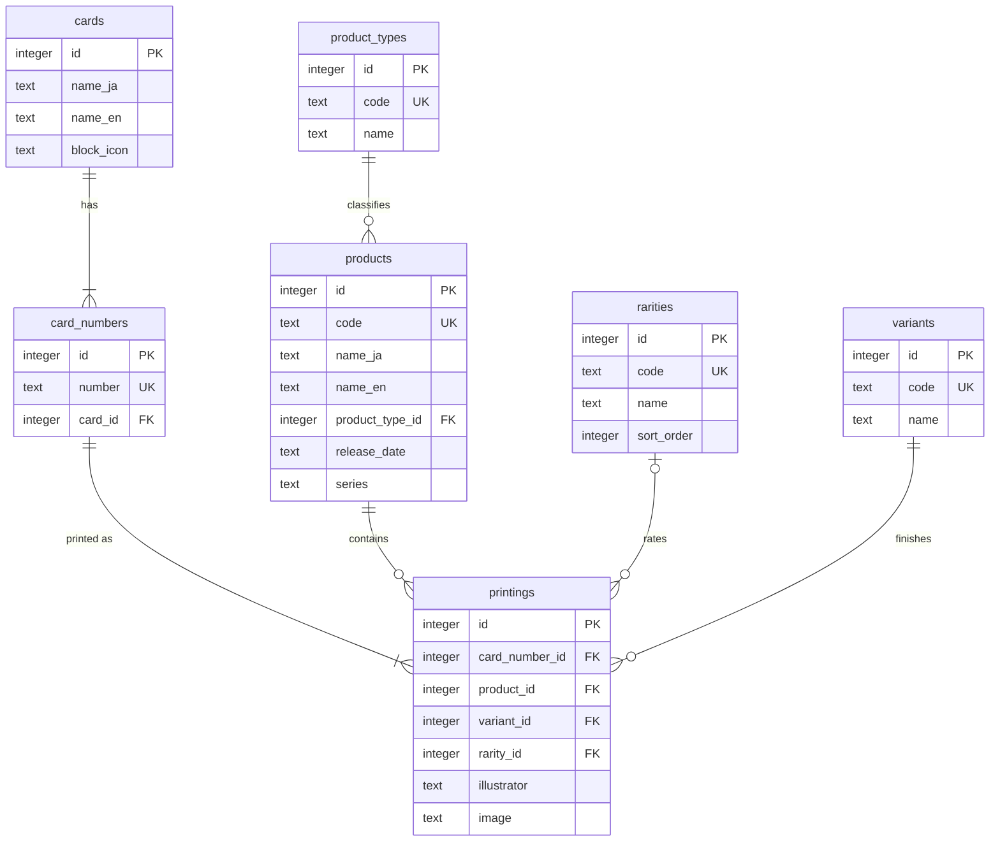
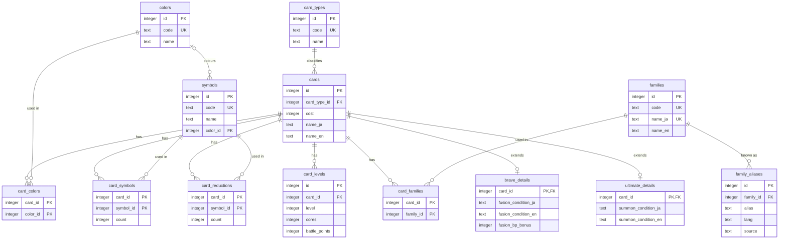

# Target schema

This is the design document for the new normalized schema. It is extended by [#30](https://github.com/AleFire99/BS_Database/issues/30) (gameplay attributes), [#31](https://github.com/AleFire99/BS_Database/issues/31) (effects, i18n, provenance, images) and [#32](https://github.com/AleFire99/BS_Database/issues/32). It is **not** the build source: the DDL and SQLAlchemy models are owned by [#12](https://github.com/AleFire99/BS_Database/issues/12). Naming follows [ADR 0003](../adr/0003-naming-and-schema-versioning.md). Items marked "pending #9" depend on the source analysis ([#9](https://github.com/AleFire99/BS_Database/issues/9)).

## Identity

Card versus printing identity, as decided in [ADR 0004](../adr/0004-card-printing-identity.md): a **card** is the gameplay identity, a **card number** (`BS72-069`) belongs to exactly one card, and a **printing** is one number in one product and variant.



### cards

The gameplay identity: one row per distinct card. Gameplay columns (type, cost) and the related tables (colors, symbols, families, levels) are described in [Gameplay attributes](#gameplay-attributes); effects and i18n details are added by #31.

| Column | Type | Constraints | Notes |
| --- | --- | --- | --- |
| `id` | INTEGER | PRIMARY KEY | Surrogate key. |
| `name_ja` | TEXT | NOT NULL | Japanese card name (batspi page title). |
| `name_en` | TEXT | | English name; sourcing and fallback rules in #31. |
| `block_icon` | TEXT | | Block icon (`12`, `A`, ...). Placed on the card by default; per card or per number is pending #9. |

Whether numbers with the same name but different numbers are one card is pending #9. The planned rule: link them only if text and stats are identical.

### card_numbers

| Column | Type | Constraints | Notes |
| --- | --- | --- | --- |
| `id` | INTEGER | PRIMARY KEY | |
| `number` | TEXT | NOT NULL, UNIQUE | Printed number, e.g. `BS72-069`. Promo number format pending #9. |
| `card_id` | INTEGER | NOT NULL, FOREIGN KEY to `cards.id` | A number belongs to exactly one card; a card can have several numbers. |

### printings

One physical printing of a number in a product.

| Column | Type | Constraints | Notes |
| --- | --- | --- | --- |
| `id` | INTEGER | PRIMARY KEY | |
| `card_number_id` | INTEGER | NOT NULL, FOREIGN KEY to `card_numbers.id` | |
| `product_id` | INTEGER | NOT NULL, FOREIGN KEY to `products.id` | |
| `variant_id` | INTEGER | NOT NULL, FOREIGN KEY to `variants.id` | Defaults to the `normal` variant; NOT NULL because SQLite treats NULLs as distinct in UNIQUE. |
| `rarity_id` | INTEGER | FOREIGN KEY to `rarities.id` | Nullable: distribution entries on batspi show no rarity (pending #9). |
| `illustrator` | TEXT | | Plain text for now; normalised later if needed. |
| `image` | TEXT | | Image reference; detailed in #31. |

Table constraint: `UNIQUE (card_number_id, product_id, variant_id)`.

### products

Anything a card is released in. A booster set is a product; there is no separate `sets` table.

| Column | Type | Constraints | Notes |
| --- | --- | --- | --- |
| `id` | INTEGER | PRIMARY KEY | |
| `code` | TEXT | UNIQUE | e.g. `BS72`; NULL for distributions without a code (SQLite allows several NULLs). |
| `name_ja` | TEXT | NOT NULL | e.g. `第1章：廻帰再醒`. |
| `name_en` | TEXT | | |
| `product_type_id` | INTEGER | NOT NULL, FOREIGN KEY to `product_types.id` | |
| `release_date` | TEXT | | ISO-8601 date; NULL when the source gives none. |
| `series` | TEXT | | Chapter or saga grouping (`契約編：環`), a plain column, no table. |

### product_types

Lookup, following the lookup convention of ADR 0003: `code` plus one English `name`, no Japanese name column.

| Column | Type | Constraints | Notes |
| --- | --- | --- | --- |
| `id` | INTEGER | PRIMARY KEY | |
| `code` | TEXT | NOT NULL, UNIQUE | Planned: `booster`, `starter`, `promo`, `magazine`, `collab`, `other`. Final list pending #9. |
| `name` | TEXT | NOT NULL | English display name. |

### rarities

| Column | Type | Constraints | Notes |
| --- | --- | --- | --- |
| `id` | INTEGER | PRIMARY KEY | |
| `code` | TEXT | NOT NULL, UNIQUE | `C` and `R` seen in batspi `<C>`, `<R>`; other codes and the full scale are pending #9. |
| `name` | TEXT | NOT NULL | English display name, e.g. `Common`, `Rare`. |
| `sort_order` | INTEGER | NOT NULL | Display order from common to rare. |

### variants

| Column | Type | Constraints | Notes |
| --- | --- | --- | --- |
| `id` | INTEGER | PRIMARY KEY | |
| `code` | TEXT | NOT NULL, UNIQUE | Planned: `normal`, `secret`, `full_art`, `promo_art`, parallel. The full list is pending #9. |
| `name` | TEXT | NOT NULL | English display name, e.g. `Full art`. The source text `フルアート版` is mapped to `full_art` by the loader. |

## Gameplay attributes

Added by [#30](https://github.com/AleFire99/BS_Database/issues/30). Gameplay attributes are identical across printings of a card (a reprint keeps its number and text; only rarity and art change, see ADR 0004), so they hang off `cards`, never off `card_numbers` or `printings`. Effects, keywords and alternate costs such as `【ミラージュ：コスト2(1)】` belong to [#31](https://github.com/AleFire99/BS_Database/issues/31) and are not modelled here.

Lookup tables (`card_types`, `colors`, `symbols`, `rarities`, `variants`, `product_types`) carry a stable `code` and one English `name`. They have **no Japanese name column**: the Japanese source text is translated to a `code` by the loader ([#12](https://github.com/AleFire99/BS_Database/issues/12)), see [JP source to code](#jp-source-to-code). Data entities (`cards`, `families`, `products`) keep `name_ja` so a bad machine translation can be redone.



### cards (gameplay columns)

Columns added by #30 to the identity table above (`name_ja`, `name_en` and `block_icon` are already described there).

| Column | Type | Constraints | Notes |
| --- | --- | --- | --- |
| `card_type_id` | INTEGER | NOT NULL, FOREIGN KEY to `card_types.id` | Type from `<pre>` line 1. |
| `cost` | INTEGER | NOT NULL, CHECK `cost` >= 0 | Number before the parentheses on the cost line (`4` in `4(赤2神1)`). Legacy range 0 to 12. |

### card_types

Lookup.

| Column | Type | Constraints | Notes |
| --- | --- | --- | --- |
| `id` | INTEGER | PRIMARY KEY | |
| `code` | TEXT | NOT NULL, UNIQUE | `spirit`, `nexus`, `magic`, `brave`, `ultimate`. A new type needs no schema change. |
| `name` | TEXT | NOT NULL | English display name, e.g. `Spirit`. |

### colors

Lookup. Colours are the six game colours; the god symbol is not a colour.

| Column | Type | Constraints | Notes |
| --- | --- | --- | --- |
| `id` | INTEGER | PRIMARY KEY | |
| `code` | TEXT | NOT NULL, UNIQUE | `red`, `purple`, `green`, `white`, `yellow`, `blue`. White is included (it is missing from the legacy `colors` table). |
| `name` | TEXT | NOT NULL | English display name. |

### card_colors

Pure junction table. One row per colour of a card; a six-colour card has six rows and there is no "multicolour" pseudo-colour. The colour comes from segment 2 of the cost line in the Japanese text (`赤`, or several colours), never from translated text.

| Column | Type | Constraints | Notes |
| --- | --- | --- | --- |
| `card_id` | INTEGER | FOREIGN KEY to `cards.id` | Part of the composite PRIMARY KEY. |
| `color_id` | INTEGER | FOREIGN KEY to `colors.id` | Part of the composite PRIMARY KEY. |

How several colours are separated in segment 2 is pending #9 (only single-colour fixtures exist).

### symbols

Lookup. Symbols are distinct from colours: a symbol is an icon printed on a card or used to reduce a cost, and the god symbol 神 is a symbol without a colour (same idea as BSS_app `Symbols(ColorID)`).

| Column | Type | Constraints | Notes |
| --- | --- | --- | --- |
| `id` | INTEGER | PRIMARY KEY | |
| `code` | TEXT | NOT NULL, UNIQUE | `red`, `purple`, `green`, `white`, `yellow`, `blue`, `god`. |
| `name` | TEXT | NOT NULL | English display name. |
| `color_id` | INTEGER | FOREIGN KEY to `colors.id` | NULL for `god`. |

### card_symbols

Pure junction table. Symbols printed on the card, from the `シンボル：` line. Magic cards have no such line and therefore no rows.

| Column | Type | Constraints | Notes |
| --- | --- | --- | --- |
| `card_id` | INTEGER | FOREIGN KEY to `cards.id` | Part of the composite PRIMARY KEY. |
| `symbol_id` | INTEGER | FOREIGN KEY to `symbols.id` | Part of the composite PRIMARY KEY. |
| `count` | INTEGER | NOT NULL, CHECK `count` >= 1 | Double symbols use a count. The format of multi-symbol lines is pending #9. |

### card_reductions

Pure junction table. Cost reduction symbols, from the parentheses in the cost line. It is keyed by **symbol**, not by colour as in BSS_app `CardReductions(ColorID)`, because reductions can include the god symbol 神 (see [ADR 0003](../adr/0003-naming-and-schema-versioning.md)).

| Column | Type | Constraints | Notes |
| --- | --- | --- | --- |
| `card_id` | INTEGER | FOREIGN KEY to `cards.id` | Part of the composite PRIMARY KEY. |
| `symbol_id` | INTEGER | FOREIGN KEY to `symbols.id` | Part of the composite PRIMARY KEY. |
| `count` | INTEGER | NOT NULL, CHECK `count` >= 1 | Number of symbols that can be used. |

`4(赤2神1)` gives two rows (red 2, god 1). A plain number such as `(2)` means N symbols of the card's own colour; the loader resolves it. The rule for multicolour cards is pending #9. A `(0)` reduction gives no row.

### card_levels

Per-level rows. Hangs off the card, not the printing.

| Column | Type | Constraints | Notes |
| --- | --- | --- | --- |
| `id` | INTEGER | PRIMARY KEY | Referenced by effects in #31 (`effect_levels`). |
| `card_id` | INTEGER | NOT NULL, FOREIGN KEY to `cards.id` | |
| `level` | INTEGER | NOT NULL, CHECK `level` >= 1 | Flagged in review as a column name (ADR 0003); legal unquoted in SQLite. |
| `cores` | INTEGER | NOT NULL, CHECK `cores` >= 0 | Cores needed on the card to reach this level (the `<n>` in `<3>Lv2`). |
| `battle_points` | INTEGER | CHECK `battle_points` >= 0 | NULL when the level has no BP (Nexus). |

Table constraint: `UNIQUE (card_id, level)`. Magic has no level line and therefore no rows. Legacy data shows Spirit levels 1 to 4, Brave exactly one row at level 1 and Ultimate levels 3 to 6 (see [field-inventory.md](field-inventory.md)); the Brave and Ultimate line formats are pending #9.

### families

Family (系統) tags. The Japanese text is the identity; the English name is the preferred display name.

| Column | Type | Constraints | Notes |
| --- | --- | --- | --- |
| `id` | INTEGER | PRIMARY KEY | |
| `code` | TEXT | UNIQUE | Stable slug of the preferred English name; NULL until assigned (SQLite allows several NULLs). |
| `name_ja` | TEXT | NOT NULL, UNIQUE | e.g. `眷属`, `武迅`. |
| `name_en` | TEXT | | Preferred English name, e.g. `Reptile Beast` for `爬獣`. |

### family_aliases

Other names for a family, so a machine translation can be mapped back to the preferred name.

| Column | Type | Constraints | Notes |
| --- | --- | --- | --- |
| `id` | INTEGER | PRIMARY KEY | |
| `family_id` | INTEGER | NOT NULL, FOREIGN KEY to `families.id` | |
| `alias` | TEXT | NOT NULL | |
| `lang` | TEXT | NOT NULL, CHECK `lang` IN (`ja`, `en`) | |
| `source` | TEXT | NOT NULL | `machine_translation`, `fandom` or `manual`. |

Table constraint: `UNIQUE (family_id, alias, lang)`. Seeded from the 40 `MT = preferred EN` pairs in `data/family_mapping.txt` (for example `Rebirth = Reptile Beast`: the alias `Rebirth` points to the family whose preferred name is `Reptile Beast`) and from the machine-translated names in the legacy `families` table.

### card_families

Pure junction table. Order of the families on the card is not significant.

| Column | Type | Constraints | Notes |
| --- | --- | --- | --- |
| `card_id` | INTEGER | FOREIGN KEY to `cards.id` | Part of the composite PRIMARY KEY. |
| `family_id` | INTEGER | FOREIGN KEY to `families.id` | Part of the composite PRIMARY KEY. |

Families are segment 3 of the cost line, separated by `・`. Magic and Nexus cards often have none, but the fixtures show a family on each (`武迅`, `皇獣`).

### brave_details

1:1 side table for Brave cards only. Text first (Gate A); all fields are **pending #9** because no Brave fixture exists.

| Column | Type | Constraints | Notes |
| --- | --- | --- | --- |
| `card_id` | INTEGER | PRIMARY KEY, FOREIGN KEY to `cards.id` | The card must have type `brave`. |
| `fusion_condition_ja` | TEXT | | Fusion condition as printed. Pending #9. |
| `fusion_condition_en` | TEXT | | Translation. Pending #9. |
| `fusion_bp_bonus` | INTEGER | | NULL when absent. Pending #9. |

### ultimate_details

1:1 side table for Ultimate cards only. Text first, **pending #9**. The Ultimate level rows stay in `card_levels` (they start at 3).

| Column | Type | Constraints | Notes |
| --- | --- | --- | --- |
| `card_id` | INTEGER | PRIMARY KEY, FOREIGN KEY to `cards.id` | The card must have type `ultimate`. |
| `summon_condition_ja` | TEXT | | Summon condition as printed. Pending #9. |
| `summon_condition_en` | TEXT | | Translation. Pending #9. |

Side tables instead of nullable columns on `cards`: `cards` stays free of type-specific NULL columns, and a new type with its own attributes (for example a 創界神ネクサス) adds a side table without touching `cards`. The cost is one extra join for those types.

### Worked examples

The `<pre>` lines come from the fixtures in `tests/fixtures/html/`. Ids are illustrative.

#### Spirit (`card_spirit.html`)

```text
スピリット
4(赤2神1)/赤/眷属・武迅
<1>Lv1 3000 <3>Lv2 7000
...
シンボル：赤
```

| Line | Target rows |
| --- | --- |
| `スピリット` | `cards.card_type_id` -> `card_types.code = spirit` |
| `4(赤2神1)` | `cards.cost = 4`; `card_reductions`: (red, 2) and (god, 1) |
| `/赤/` | `card_colors`: red |
| `眷属・武迅` | `families` `眷属` and `武迅`; two `card_families` rows |
| `<1>Lv1 3000` | `card_levels`: level 1, cores 1, battle_points 3000 |
| `<3>Lv2 7000` | `card_levels`: level 2, cores 3, battle_points 7000 |
| `シンボル：赤` | `card_symbols`: (red, 1) |

#### Nexus (`card_nexus.html`)

```text
ネクサス
3(2)/赤/皇獣
<0>Lv1 <1>Lv2
...
シンボル：赤
```

| Line | Target rows |
| --- | --- |
| `ネクサス` | `card_types.code = nexus` |
| `3(2)` | `cards.cost = 3`; `card_reductions`: (red, 2), the plain `2` resolved to the card's own colour (single colour here; assumed, pending #9) |
| `/赤/` | `card_colors`: red |
| `皇獣` | `families` `皇獣`; one `card_families` row |
| `<0>Lv1` | `card_levels`: level 1, cores 0, battle_points NULL |
| `<1>Lv2` | `card_levels`: level 2, cores 1, battle_points NULL |
| `シンボル：赤` | `card_symbols`: (red, 1) |

#### Magic (`card_magic.html`)

```text
マジック
4(2)/赤/武迅
【ミラージュ：コスト2(1)(このカードは手札からセットできる)】
...
```

| Line | Target rows |
| --- | --- |
| `マジック` | `card_types.code = magic` |
| `4(2)` | `cards.cost = 4`; `card_reductions`: (red, 2) (assumed: plain `2` = own colour, pending #9) |
| `/赤/` | `card_colors`: red |
| `武迅` | `families` `武迅`; one `card_families` row |
| (no level line) | no `card_levels` rows |
| (no `シンボル：` line) | no `card_symbols` rows |
| `【ミラージュ：コスト2(1)…】` | not a cost: an alternate cost, left to #31 |

### JP source to code

The loader (#12) maps Japanese source text to lookup codes. The mapping is code, not data: it is not stored in the database.

| Lookup | JP source | Code | Seen in |
| --- | --- | --- | --- |
| `colors` / `symbols` | 赤 | `red` | fixtures |
| `colors` / `symbols` | 紫 | `purple` | glossary, to verify #9 |
| `colors` / `symbols` | 緑 | `green` | glossary, to verify #9 |
| `colors` / `symbols` | 白 | `white` | glossary, to verify #9 |
| `colors` / `symbols` | 黄 | `yellow` | glossary, to verify #9 |
| `colors` / `symbols` | 青 | `blue` | glossary, to verify #9 |
| `symbols` | 神 | `god` | fixture (reduction) |
| `card_types` | スピリット | `spirit` | fixtures |
| `card_types` | ネクサス | `nexus` | fixtures |
| `card_types` | マジック | `magic` | fixtures |
| `card_types` | ブレイヴ | `brave` | not in fixtures, pending #9 |
| `card_types` | アルティメット | `ultimate` | not in fixtures, pending #9 |
| `rarities` | `<C>` | `C` | batspi `収録` list |
| `rarities` | `<R>` | `R` | batspi `収録` list |
| `variants` | `SECRETあり` | `secret` | BS72-007 |
| `variants` | `フルアート版` | `full_art` | BS72-069 |

Other rarities and variants, and the exact spelling of colours and Brave/Ultimate type names on the page, are pending #9. The colour and symbol glyphs 紫, 緑, 白, 黄, 青 are not in the three fixtures and are taken from the game's standard colour names and the glossary. Mark them to verify in #9.

### Legacy mapping

| Legacy (current-schema.md) | Target | Note |
| --- | --- | --- |
| `core_requirements` | `card_levels` | Renamed. |
| `core_requirements.battlePoints` | `card_levels.battle_points` | snake_case; NULL for Nexus. |
| `core_requirements.cores` (cores needed) | `card_levels.cores` | Unchanged name. |
| `cards.symbol` (free text, e.g. `Red and blue`) | `card_colors` rows | One row per colour, taken from the Japanese text. |
| `colors` | `colors` | Adds White, drops the lowercase/capitalised variants. |
| `families` (machine-translated EN) | `families` + `family_aliases` | JP name becomes the identity; the legacy EN names become aliases. |
| `card_families` | `card_families` | Same shape. |
| reductions (JSON only) | `card_reductions` | Now stored, including 神. |
| `cards.type_id` -> `card_types.name` | `cards.card_type_id` -> `card_types.code` | |
