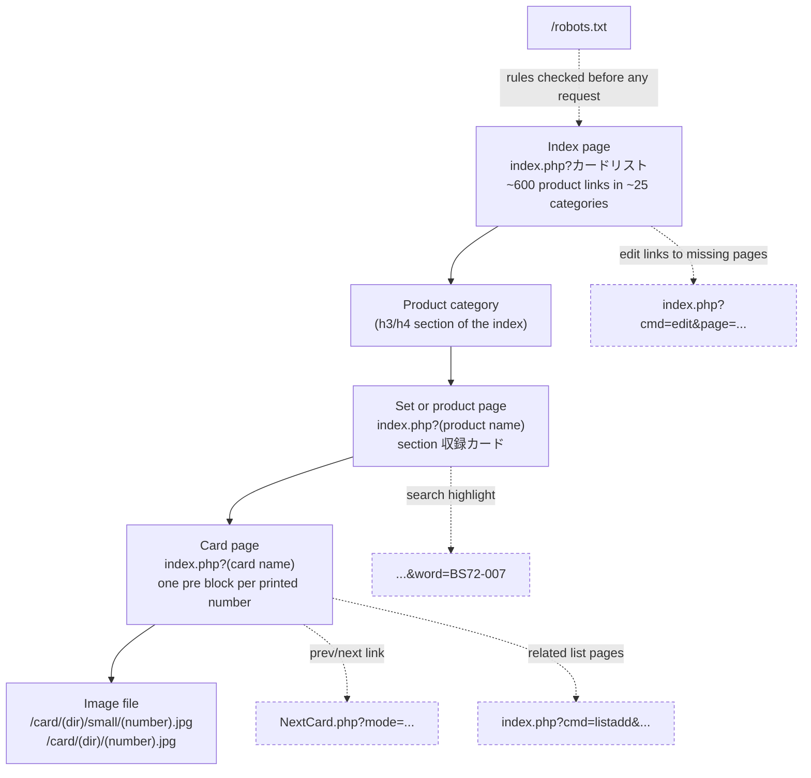

# Source catalogue: batspi.com

Catalogue of [batspi.com](https://batspi.com/) (バトルスピリッツ wiki), the primary source of card data for the Japanese Battle Spirits database. It records what the site is, how it is laid out, what a crawler may and may not request, and how the pages are structured. It is evidence for the source policy ([#53](https://github.com/AleFire99/BS_Database/issues/53)), the fixtures ([#54](https://github.com/AleFire99/BS_Database/issues/54)), the field inventory update ([#55](https://github.com/AleFire99/BS_Database/issues/55)) and the scraper rewrite ([#10](https://github.com/AleFire99/BS_Database/issues/10)). It makes no policy or modelling decisions. Terms are defined in the [glossary](../domain/glossary.md). The card fields per type are listed in the [field inventory](../data-model/field-inventory.md).

## How to read this document

- **Fetch date.** Every fact marked "live" was observed on **2026-11-14** with a plain `GET` and the user agent `Mozilla/5.0 (compatible; bs-database-research)`. The site changes daily, so counts and page contents are dated snapshots.
- **Fixture facts** come from the files in [tests/fixtures/html/](../../tests/fixtures/html/), whose URLs are in [fixtures.json](../../tests/fixtures/html/fixtures.json). The fixture `index.html` carries the stamp `Last-modified: 2026-02-05`.
- Japanese strings are quoted exactly as served. URLs are shown decoded where that helps reading; the raw form is always percent-encoded UTF-8.
- Pages that were not fetched are not described.

## 1. Site overview

| Item | Value |
| --- | --- |
| Software | PukiWiki with a MariaDB backend and custom plugins (footer: `PukiWiki +MariaDB`, `Powered by PHP 8.4.27`, live 2026-11-14) |
| Language | Japanese only (`バトルスピリッツ wiki`) |
| Content | Card pages, set (product) pages, category pages, errata and official Q&A, deck and rules pages |
| Editing | Open wiki: each page has edit, backup and attachment links. Pages that do not exist yet are linked with `cmd=edit` |
| Card images | Hosted on the same site under `/card/` |
| Page size | 90 to 160 KB per card or set page, up to about 450 KB for the promo list (live 2026-11-14), mostly navigation and ad markup |

### Robots policy

`https://batspi.com/robots.txt`, fetched live on 2026-11-14:

```text
User-agent: *
Disallow: /index.php?%E3%82%AB%E3%83%BC%E3%83%89%E6%83%85%E5%A0%B1%E7%B5%9E%E8%BE%BC%E3%81%BF&
Disallow: /?
Disallow: /index.php/

User-agent: bingbot
User-agent: Sogou web spider
User-agent: SemrushBot
User-agent: Baiduspider

Disallow: /

Sitemap: https://batspi.com/index.php?cmd=rss&ver=2.0
```

Reading of the rules:

- The first group applies to every other client, including this project. The percent-encoded path decodes to `/index.php?カード情報絞込み&`: the card-filter search page with any query parameters is disallowed.
- `/?` disallows any URL of the form `https://batspi.com/?…`.
- `/index.php/` disallows path-style URLs (`/index.php/<something>`). The normal pattern `/index.php?<name>` has a `?` after `php`, so it is not matched.
- Four named crawlers are disallowed from the whole site. This project is not one of them, but it should not send their user agent strings.
- The `Sitemap` line points to the PukiWiki RSS feed of recent changes (`cmd=rss`). It is not a full sitemap.
- The file sets no `Crawl-delay`.

### Licence and terms (risk, not a decision)

The footer of every page (live 2026-11-14, and in the fixtures) says:

> ※当サイト上で使用しているカード、パッケージなどの画像およびテキストなどの著作権および商標権、その他知的財産権は、販売メーカー元に帰属します。

In English: copyright, trademark and other intellectual property rights of the card, package images and text used on the site belong to the maker. The same footer says `Copyright © 2001-2006 PukiWiki Developers Team. License is GPL.`: that licence covers the PukiWiki software only, not the wiki content.

No content licence, terms-of-service page or statement about reuse of wiki text was found on the pages sampled. A link to a "利用規約" or "ライセンス" page was not seen on any of them. The consequence for redistributing card text and images in the release artefact is open and is handed to [#53](https://github.com/AleFire99/BS_Database/issues/53).

## 2. Site map

The crawl path from the card list to an image. Dotted edges are links that exist on the pages but that the crawler should not follow.



## 3. URL patterns

Every page is `https://batspi.com/index.php?<name>` where `<name>` is the page name, percent-encoded UTF-8. A card page is named after the card's Japanese name, a set page after the product's Japanese name (examples: `index.php?ゴラドン`, `index.php?契約編：環 第4章：英雄傑集`). Spaces are encoded as `%20` and the full-width colon `：` as `%EF%BC%9A`. Set page names contain no `BS\d{2}` code, so the set code must be taken from the card numbers listed on the page.

| Pattern | Purpose | Crawl |
| --- | --- | --- |
| `index.php?カードリスト` | Index of all products, grouped in sections | yes, entry point |
| `index.php?<product name>` | Set or product page | yes |
| `index.php?<card name>` | Card page | yes |
| `index.php?<category>` (for example `アルティメット`, `赤`, `プロモーションカード`) | Rules, attribute and list pages | only the promo list is a known target |
| `/card/<dir>/small/<file>.jpg`, `/card/<dir>/<file>.jpg` | Card images | no: image files are not downloaded by this catalogue |
| `index.php?<name>&word=<number>` | Same page with a search term highlighted | no: duplicate of the plain page |
| `index.php?cmd=edit&page=<name>` | Edit form. Also the link target for pages that do not exist yet | **do not crawl** |
| `index.php?cmd=backup&page=<name>`, `plugin=attach…`, `plugin=related…` | Wiki maintenance tools | **do not crawl** |
| `index.php?cmd=rss&ver=…` | Recent-changes feed, named as the sitemap in robots.txt | do not crawl for card data; only a future change-detection design may use it |
| `index.php?cmd=listadd&tree=…&rowid=…&pcnt1=…` | Ajax fragment that fills the "related cards" list at the bottom of a card page, 50 rows per page | **do not crawl** |
| `NextCard.php?mode=<0 or 1>&no=<number>&card=<name>` | Previous and next card links | no: the set page already gives the order |
| `/index.php?カード情報絞込み&…` | Card filter search | **disallowed by robots.txt** |
| `/?…`, `/index.php/…` | Alternative URL forms | **disallowed by robots.txt** |
| `bbs/index.php?…` | Bulletin board (for example the "カード画像の提供" link) | do not crawl |

The page name is not a stable key. Two cards can share a name (a card reprinted in different sets with the same name shares one page), and a name can change on the wiki. The card number is the stable identifier; it is printed in `<span class="cardno">` and in the `<h3>` headings of the card page.

## 4. Product categories and set pages

### Index page

The index `index.php?カードリスト` is one HTML page with no pagination: all links come in a single response, and the page has no paging elements. The fixture [index.html](../../tests/fixtures/html/index.html) (`Last-modified: 2026-02-05`) has **577 product links** in the sections below (counted by section heading, links to wiki tools excluded). Seven further links use `cmd=edit&page=…` and point to pages that do not exist yet; they must be skipped:

`BATTLE SPIRITS スペシャルスタッフトークショー 2025`, `バトスピフェスタ2008`, `ガンダムカップ2024`, `バトルスピリッツ 覇者の咆哮`, `バトルスピリッツ デジタルスターター`, `バトルスピリッツ ヒーローズソウル`, `バトルスピリッツ 輝石の覇者`.

The structure is `h2 カードリスト` → `h3` category → optional `h4` subcategory → links. A page can appear under more than one heading (for example `プロモーションカード`).

| Category (heading) | Links | Examples (as linked) | Number prefix seen |
| --- | --- | --- | --- |
| `ブースターパック` (h3) | 76 | `契約編：環 第4章：英雄傑集`, `星座編 第一弾：八星龍降臨`, `第一弾`, `アルティメットバトル01` | `BS##` |
| `構築済みデッキ` (h3) | 79 | `メガデッキ【豪炎の創世主】`, `バトスピスタートデッキ【煌臨スル龍皇】`, `コラボスターター【ガンダム ～OPERATION UC～】` | `SD##` |
| `テーマパック/再録パック` (h3) | 51 | `GREATEST RECORD 2020`, `ディーバブースター【メモリアルレコード】`, `Xレアパック 【龍皇ジークフリード】` | `BSC##`, plus reprint numbers of other sets |
| `コラボブースター` (h3) | 34 | `コラボブースター【仮面ライダー ～善悪の選択～】` | `CB##` |
| `コラボブースターEX` (h3) | 1 | `コラボブースターEX【ガンダム ～運命と自由～】` | not sampled |
| `プレミアムカードセット` (h3) | 12 | `バトスピプレミアムカードセット 新世紀エヴァンゲリオン` | not sampled |
| `ウエハース` (h4 under `食玩`) | 38 | `バトルスピリッツ ウエハース ～蛇皇襲来～` | reprint numbers of other sets |
| `フィギュアコレクション` (h4 under `食玩`) | 3 | `バトルスピリッツ覇王フィギュアコレクション` | not sampled |
| `食玩その他` (h4 under `食玩`) | 1 | `バトルスピリッツスペシャルスターターセット` | not sampled |
| `プレミアムバンダイ` (h4 under `限定商品`) | 64 | `バトルスピリッツ プレミアムフルールBOX`, `コラボスターター【仮面ライダー 時刻の特異点】` | not sampled (the promo list has `PB##` numbers) |
| `リミテッドパック` (h4 under `限定商品`) | 28 | `リミテッドパック2026 契約編：環 Vol.2`, `リミテッドパック2018` | `LM##` |
| `DVD-BOX/Blu-ray BOX` (h4) | 10 | `バトルスピリッツ サーガブレイヴ コレクターズBOX` | not sampled |
| `最強ジャンプ応募者全員サービス` (h4) | 4 | `戦極最強パック` | not sampled |
| `限定品その他` (h4) | 12 | `プレミアムカードコレクション 三賢神` | not sampled |
| `配布品・付録` (h3) | 36 | `プロモーションカード`, `キャンペーンカード`, `バトスピ部` | see the promo list in the next section |
| `書籍特典` (h4 under `配布品・付録`) | 33 | links named after the cards, for example `ジークヴルム・シックスファクター` | not sampled |
| `バトルスキー イベント` (h4) | 6 | `バトルスキー`, `バトルスキー トレジャーパック2019 vol.1` | not sampled |
| `バトスピショップバトル ・ バトスピフレンドリーバトル` (h4) | 17 | `バトスピ トレジャーパック2023` | not sampled |
| `大会・イベント` (h3) and its h4 `オンライン` (3), `アニメイベント` (5), `大会` (39), `ショップバトル` (19) | 4 + 66 | `バトスピチャンピオンシップ2023` | prize cards, not sampled |
| `ゲーム` (h3) | 2 | `バトルスピリッツ クロスオーバー` | video games, no cards sampled |

The heading text in the page carries a trailing `†` (PukiWiki anchor) and some spaces; the table gives the text as normalized. Counts are links, not distinct products: a product can be linked twice.

For card data, the categories sampled for this catalogue are boosters, ready-made decks (starters), theme and reprint packs, collab boosters, limited packs, wafers and the promo list. The remaining categories are listed for completeness only; which of them are in scope is a decision for the source policy ([#53](https://github.com/AleFire99/BS_Database/issues/53)) and the scraper design.

### Set naming

A set page is named after the product, not after a code. Sampled pairs of page name and card-number prefix (live 2026-11-14, from the card numbers on each page):

| Page name | Prefix | Note |
| --- | --- | --- |
| `第一弾` | `BS01` | first booster; the page title is only `第一弾` |
| `星座編 第一弾：八星龍降臨` | `BS10` | seen through the card `砲凰竜フェニック・キャノン` (`BS10-062`) |
| `烈火伝 第1章` | `BS31` | seen through `BS31-XX02` |
| `神煌臨編 第1章：創界神の鼓動` | `BS44` | release 2018-04-21 |
| `転醒編 第1章：輪廻転生` | `BS52` | release 2020-04-25 |
| `契約編：環 第1章：廻帰再醒` | `BS72` | release 2025-05-17 |
| `契約編：環 第4章：英雄傑集` | `BS75` | `Last-modified: 2026-03-16` |
| `コラボブースター【仮面ライダー ～善悪の選択～】` | `CB34` | collab prefix `CB##` |
| `コラボスターター【ガンダム ～OPERATION UC～】` | `SD54` | collab starters use the starter prefix |
| `リミテッドパック2018` | `LM18` | plus two reprints `BS46-RV007`, `BS46-RV008` |
| `バトスピスタートデッキ(烈火伝)` | `SD29` | starter; cards from `SD19`, `SD03`, `SD10`, `BS01` are reused |
| `GREATEST RECORD 2020` | none of its own | 87 reprints, all with the original sets' numbers |
| `バトルスピリッツ ウエハース ～蛇皇襲来～` | none of its own | 25 reprints with the original numbers |

Observations:

- Names are Japanese product names and contain full-width characters (`：`, `～`, `【】`) and spaces. Some are page names without the product line (`第一弾`); the era is in the set's own number and the `Before:` / `After:` navigation at the top of the page (for example `Before：超煌臨編 第4章：神攻勢力` / `After：転醒編 第2章：神出鬼没`).
- A set page therefore does not tell the set code. The code is the common prefix of the card numbers in the main sections; reprints of other sets in the same list carry their original prefix (the `契約編：環 第1章` list holds `BS44-086`, `BSC42-082` and `BS49-RV012`).
- A set page lists only what its product contains. It does not list every printing of a card.

### Set page layout

Seen on the sampled set pages (live 2026-11-14):

1. Title `<h2>` with the product name, then a header block: `Before:` / `After:` links, the release date (`2020年4月25日発売`), the price and pack size (`ブースターパック 1パック9枚:270円+税`), the totals (`全99種+11種(自販機ブースター：全99種+17種)`) and a rarity breakdown (`コモン(C)：45　レア(R)：15　マスターレア(M)：12`).
2. `h2 収録カード`, an inline link `[リスト解析表示]`, then colour `h3` (`赤`, `紫`, `緑`, `白`, `黄`, `青`, `6色`) and card-type `h4` (`スピリット`, `ブレイヴ`, `ネクサス`, `マジック`). Then special sections as `h3`: `Xレア`, `XXレア`, `AXレア`, `契約Xレア`, `転醒Xレア`, `10thXレア`, `キャンペーンカード`, `BOX購入特典キャンペーンカード`.
3. Each entry is plain text: the card number, a space, the card name as a link to the card page, then an optional rarity and a note. Example (BS01): `BS01-001 ゴラドン` followed by `<br />`. With rarity: `BS72-005 サンダー・Z・チュウレオン R`. Special: `BS44-X01 太陽神星龍アポロヴルム X (パラレルあり)`.
4. Starter pages (`SD29`, `SD54`) have type headings without colours (or `－赤－` lines inside them) and a copy count in brackets after the name: `SD54-001 ロト (3)`, `SD54-010 バナージ・リンクス R (2)`. A section `差し替えカード` lists a card swapped in from another product (`SD06-016 絶甲氷盾 (3)`).
5. Wafer and reprint pages have the colour `h3` only and notes such as `（※ブロックアイコン<5>）(新規CGイラスト)` after the rarity: `SD43-RV001 ブレイドラ（※ブロックアイコン<5>）(新規CGイラスト)`.
6. `h2 リンク`, `h2 外部リンク` end the page.

Sampled entry counts (distinct card numbers in the list, including `X`/`XX` numbers; `第一弾` = 112 `BS01-###` + 4 `BS01-X##`; live 2026-11-14 unless noted): `第一弾` 116 (`Last-modified: 2025-06-22`), `転醒編 第1章` 116, `神煌臨編 第1章` 122, `契約編：環 第1章` 108 (fixture), `第4章` 114, `GREATEST RECORD 2020` 87, `コラボブースター【仮面ライダー ～善悪の選択～】` 93, `コラボスターター【ガンダム ～OPERATION UC～】` 19, `バトスピスタートデッキ(烈火伝)` 15, `リミテッドパック2018` 12, wafer 25. No list was incomplete in a way that could be told from the page, but a gap in the numbering cannot be told from a missing wiki entry: `第一弾` has no entry for `BS01-002`, for example.

### Pagination

- The index and all sampled set pages are single HTML responses. No paging elements (`paging_numbers`, `PageTitle`) appear on them, including the largest page, the promo list `プロモーションカード` (about 450 KB, about 1,400 numbered entries, `Last-modified: 2026-10-30`).
- The only paginated element found is the "related cards" list at the bottom of a card page: `該当:70枚(1～50枚) Page:1/2`, 50 rows per page, loaded through `index.php?cmd=listadd&…`. It repeats other cards' data and is not needed to read a card (marked do not crawl above).

## 5. Card numbers

The card number is the identity key on batspi.com: it is the text in front of the card link on set pages, `<span class="cardno">` and the `<h3>` heading suffix `<BS01-001>` on card pages, and part of the image file name.

| Scheme | Meaning | Example (live 2026-11-14 unless noted) |
| --- | --- | --- |
| `BS##-###` | Booster card | `BS01-001`, `BS72-007` |
| `BS##-X##` | X rare | `BS01-X01`, `BS44-X07` |
| `BS##-XX##` | XX rare | `BS31-XX02` |
| `BS##-CP##` | Campaign card of the set | `BS52-CP14` |
| `BS##-RV###` | Revival (reprint) with a new number | `BS38-RV022`, `BS49-RV012` |
| `BS##-AX##`, `BS##-CX##`, `BS##-TX##`, `BS##-TCP##`, `BS##-10thX##` | Special rarities of the contract and awakening eras | `BS72-AX03`, `BS52-TX01`, `BS73-TCP01(A)` |
| `BS##-<number>(A)`, `(B)` | The two faces of a flip (転醒) card | `BS52-TX01(A)`, `BS52-TX01(B)` |
| `SD##-###`, `SD##-X##`, `SD##-CP##`, `SD##-RV###` | Starter, deck and collab-starter cards | `SD29-001`, `SD19-X01`, `SD67-CP01`, `SD43-RV001` |
| `BSC##-###` | Theme and reprint pack card | `BSC22-001`, `BSC42-082` |
| `CB##-###`, `CB##-RV###`, `CB##-X##`, `CB##-CP##`, `CB##-CX##`, `CB##-XX##` | Collab booster | `CB34-001` (set `CB34` also reuses `CB17-X06`) |
| `LM##-##`, `LM##-U##`, `LM##-G##`, `LM##-D##` | Limited pack | `LM18-01` |
| `P###`, `P##-##`, `P##-X##`, `P##-G##` | Promo | `P001`, `P25-06`, `P20-19` |
| `26RBS##-…`, `26RSD##-…` | Cards of a 2026 "26R" series, seen in the related-card list | `26RBS02-CP01`, `26RSD01-013` |

Promo prefixes: the page `プロモーションカード` is organised by number family. Its section headings (live 2026-11-14) are: `Pナンバー`, `CPナンバー`, `RVナンバー`, `PBナンバー`, `PXナンバー`, `Xナンバー`, `EXナンバー`, `BS-SPナンバー`, `LMナンバー`, `SJナンバー`, `KAナンバー`, `KFナンバー`, `GXナンバー`, `BSCOナンバー`, `BSHナンバー`, `EXGナンバー`, `ナンバーなし`. The sub-headings include numbers by campaign year (`P13ナンバー`, `P14ナンバー<1>`, … `P25ナンバー<12>`, `RP26ナンバー<A>`) and variants such as `BS-CPナンバー<2>`, `BSC-CPナンバー<2>`, `CB-CPナンバー<4>`, `SD-CPナンバー<9>`, `RBS-CPナンバー<A>`. Entry formats seen in the list: `P001`, `P20-19`, `PB18-…`, `PX14-…`, `SJ12-…`, `LM13-…`, `KA12-01`, `KF-01`, `BSCO-001`, `BSH-001`, `EXG2-001`, `EX001`, `X009`. The section `ナンバーなし` is for cards without a number (not sampled in detail).

A card name is not unique across numbers, and one card page serves several numbers (next section). The number prefix does not always match the set: a `BS##-RV###` or `BSC##` card appears in the lists of unrelated products.

## 6. Card pages

### Page structure

A card page is a PukiWiki page named after the card. Elements seen on all sampled card pages (live 2026-11-14, and the three card fixtures):

| Element | Selector or marker | Content |
| --- | --- | --- |
| Title | `<h1 class="title">` | The page name (the card's Japanese name) |
| Print headings | `<h3>` at the top of the body | One per printed number: `<Japanese name>/<English name> <number>`, for example `ゴラドン/Goradon <BS01-001>`; the Japanese name may be split by spaces and carry ruby readings (`砲凰竜 (ほうおうりゅう) フェニック・キャノン/The GunDragon Phoenix-Cannon <BS10-062>`) |
| Image gallery | `<ul class="ppy-imglist">` | One `<li>` per image, with the full image link, a `small/` thumbnail and a caption (number, product, optional rarity note) |
| Card number | `<span class="cardno">` | The number, one element per number on the page |
| Card data | `<pre>` | The card text, one block per printed number (below) |
| Intro text | `<p>` after the pre blocks | Free-form commentary with links to related cards |
| `h4 収録` | after the intro | For each number, the products that contain it, each with `<rarity>` and a note, for example `契約編：環 第1章：廻帰再醒 <R> (SECRETあり)` |
| `h4 収録/掲載/配布 ブロックアイコン` | after `収録` | One line per product: `[BS72] <product link> ブロックアイコン:<12> 2025年05月17日` (set code, block icon, release date) |
| `h4 公式Q&A` | after the block icons | Official rulings; each answer is also in a `<pre>` block, which is **not** a card block |
| `h4 関連リンク` | near the end | Link to the official card list (`battlespirits.com/cardlist/…freewords=<number>`), attribute and category links, and the "related cards" list (ajax, paginated) |
| Optional | `h4 リバイバル`, `h4 アニメにおいて`, `h4 サイクル一覧`, `h4 設定画` | Not present on every page |

The `Last-modified` stamp is at the foot of every page (for example `Last-modified: 2025-06-24 (火) 23:32:36` on the Spirit fixture).

### One page, several printed numbers

A page holds every number that shares the card name. The Spirit fixture has one number (`BS72-007`) with two images (`BS72-007.jpg` and the parallel `BS72-007-2.jpg`, caption `シークレット`). Other sampled pages hold several:

| Page | Numbers on the page | `<pre>` blocks that start with a type line |
| --- | --- | --- |
| `ゴラドン` | `BS01-001`, `BSC22-001` | 2; the second print has different BP (`<1>Lv1 2000 <3>Lv2 5000` against `<1>Lv1 1000 <3>Lv2 3000`) and an added `コンセプト：丸山浩` line |
| `焔竜翼人マ・ドー` | `P001`, `EX001`, `P20-19` | 3; the third has a family `起幻・竜人・翼竜` and an effect text the first two do not have |
| `砲凰竜フェニック・キャノン` | `BS10-062`, `BS38-RV022` | 2, plus one block per erratum |
| `赤の世界／赤き神龍皇` | `BS52-TX01(A)`, `BS52-TX01(B)`, `BS73-TCP01(A)`, `BS73-TCP01(B)` | 4 (the two faces of each number) |
| `アルティメット・ジークフリード` | `SD19-X01`, `SD67-CP01` | 2 |

Consequences for a parser:

- The `<pre>` blocks and the `<h3>` print headings are in the same order. The pairing by position is the only link between a number and its text; the pre block carries no number itself.
- The first `<pre>` of the page is not enough: it is only the first printed number. The scraper of [batspi_card.py](../../src/bs_database/scrapers/batspi_card.py) reads `soup.find("pre")`, so it sees only the first print.
- Extra `<pre>` blocks appear after a card block under a collapsed label `(エラッタ前) ▼` ("before the erratum"). They hold the old wording, may contain only the changed lines (the first one on the Brave page is two lines long) and do not start with a type line. The Q&A answers are `<pre>` blocks too (`はい、破壊できます。…`). A card block is identified by a first line that is a card type.
- The same print can differ between numbers in cost, BP, family and text, so each number is a separate printing with its own data. How this maps to card and printing is decided in [ADR 0004](../adr/0004-card-printing-identity.md), not here.

### The `<pre>` block

The block is plain text, one logical line per `\n`. Observed grammar (live 2026-11-14 and fixtures):

| Line | Format | Variants seen |
| --- | --- | --- |
| 1 Type | `<type>` | `スピリット`, `ネクサス`, `マジック`, `ブレイヴ`, `アルティメット`; with a restriction suffix `ネクサス(制限カード<1>)`, `スピリット(制限カード<1>)`; a trailing space occurs after the type on some cards (`BS31-XX02`) |
| 2 Cost | `<cost>(<reduction>)/<colour>[/<family>]` | see below |
| 3 Levels | `<cores>Lv<n> <BP> …` | see below |
| Effects | text lines | headings `Lv1・Lv2『timing』` (the level separator is either `・` U+30FB or half-width `･` U+FF65, sometimes both on one page; parsers must accept both), `Lv2`, keyword brackets `【…】`, `《…》`, `〔…〕`, markers `◆`, `■` |
| Symbol | `シンボル：<symbol>` | `赤`, `白`, `神`, `極`, `なし` |
| Credits | `コンセプト：<name>`, `イラスト：<name>` | `コンセプト：` appears only on some cards (Brave, Ultimate, some reprints); `イラスト：` can repeat with a product in brackets: `イラスト：SUNRISE D.I.D.(最強銀河究極ゼロバトルスピリッツウエハース/〃～疾風の王者～/〃～宇宙の覇者～)` |
| Flavor | `フレーバーテキスト：` then lines | Absent on the Magic fixture, the 創界神 Nexus and the Ultimate in `SD67-CP01`; may end with an attribution `―星文学者リリア『八十八星夜話』鳳凰座―` |

Cost line variants (live 2026-11-14 and fixtures):

| Form | Example | Meaning observed |
| --- | --- | --- |
| `N(M)` | `3(2)`, `6(3)`, `0(0)` | cost N, M reduction symbols without colour tag |
| `N(<colour><n>…)` | `5(赤2白2)`, `4(赤2神1)`, `4(赤1紫1)` (Magic `BS54-067`, from the flattened listing) | colour and symbol counts joined without separator or space |
| `N(全<n>…)` | `6(全1極3)` | `全` = any colour, `極` = the ultimate symbol |
| `N()` | `6()` | empty reduction (the awakened Spirit side of a flip card) |

The glossary's example `3(2 紫, 1 神)` was not seen in any page. The colour field is a single token: `赤`, or several colours concatenated, `赤紫`, `赤紫緑白黄青` (in the flattened listing of Magic cards). The family field uses `・` between families: `眷属・武迅`, `異魔神・星魂・機竜`, `極契約・新生・古竜`, `創界神・オリン`, `起幻・竜人・翼竜`. Older Magic cards have no family field: `マジック4(2)/赤` (`BS01-117`, in the flattened listing of the Magic fixture).

Level line variants:

| Form | Example | Type |
| --- | --- | --- |
| `<c>Lv<n> <BP>` repeated | `<1>Lv1 3000 <3>Lv2 7000`, `<1>Lv1 3000 <2>Lv2 4000 <5>Lv3 7000` | Spirit |
| `<c>Lv<n>` repeated, no BP | `<0>Lv1 <1>Lv2`, `<0>Lv1 <5>Lv2`, `<0>Lv1` | Nexus |
| one level with BP | `<1>Lv1 6000` | awakened Spirit side |
| level plus fusion | `<1>Lv1 3000 <0>合体+3000` | Brave |
| Ultimate levels | `<1>Lv3 10000 <3>Lv4 14000 <5>Lv5 20000` (up to `Lv6`) | Ultimate |
| overclock | `<1>Lv3 10000 <3>Lv4 14000 OC<5+>+6000` | contract Ultimate |
| absent | no level line | Magic (the Magic fixture goes from the cost line to the effects) |

### Fields per card type

| Type | Page (live 2026-11-14 unless noted) | Layout |
| --- | --- | --- |
| Spirit | [card_spirit.html](../../tests/fixtures/html/card_spirit.html) (`BS72-007`), `ゴラドン` | type, cost, levels, effects (`Lv1・Lv2『…』`), `シンボル：赤`, credits, flavor text. `BS01-001` has no effect lines |
| Nexus | [card_nexus.html](../../tests/fixtures/html/card_nexus.html) (`ゼウスの雷火山`) | levels without BP, effect headings `Lv1・Lv2『このネクサスの配置時』`, `Lv2` |
| Magic | [card_magic.html](../../tests/fixtures/html/card_magic.html) (`ジャベリンドロー`) | no level line, keyword `【ミラージュ：コスト2(1)(このカードは手札からセットできる)】`, `【セット中】『…』`, then `メイン：` on its own line followed by the effect text |
| Brave | `砲凰竜フェニック・キャノン` (`BS10-062`, `BS38-RV022`) | cost with reduction, `<1>Lv1 3000 <0>合体+3000`, effect `Lv1『このブレイヴの召喚時』`, `合体条件：コスト3以上`, `【合体時】【激突】『このスピリットのアタック時』`, `シンボル：なし`, `コンセプト：`; `BS38-RV022` has `右合体条件：コスト5以上` and `左合体条件：コスト3以上` and `シンボル：赤` |
| Ultimate | `アルティメット・ジークフリード` (`SD19-X01`, `SD67-CP01`) | `<1>Lv3 10000 <3>Lv4 14000 <5>Lv5 20000`, `【召喚条件：自分の赤スピリット1体以上】`, `【Uトリガー】Lv3･Lv4･Lv5『このアルティメットのアタック時』` plus a reminder in `（Uトリガー：…）`, `Lv4･Lv5：フラッシュ【真・覚醒】『このアルティメットのアタック時』`, `シンボル：極`. `SD67-CP01` adds `フラッシュ《契約煌臨：極契約＆C3以上》『自分のターン』`, `OC条件：カウント5以上` and `【OC中】Lv3・Lv4『…』` |
| 創界神 Nexus | `創界神アポローン` (`BS44-X07`) | type `ネクサス`, family `創界神・オリン`, `《神託》〔星竜/界渡/化神＆コスト3以上〕`, lines beginning `◆`, `【神技：2】Lv1・Lv2：フラッシュ『お互いのアタックステップ』`, `【神域】Lv2『自分のアタックステップ』`, `シンボル：神`, no flavor text |
| 転醒 (flip) | `赤の世界／赤き神龍皇` (`BS52-TX01(A)`, `(B)`) | two pre blocks per number. Face A is a Nexus with `Lv1《転醒：自分のカウント5以下(転醒は同時に使えない)》`; face B is a Spirit `6()/赤/起幻・古竜` with `この面に裏返ったとき、…` and `Lv1『このスピリットの転醒時』`. Page title uses `／` between the two names |

A line-level reading rule that holds for every sampled card: the lines between the level line and `シンボル：` are effects, and a heading line starts with `Lv`, `【`, `《` or `『` (not all effects have a level prefix; a Nexus `Lv2` heading may have no timing).

### Differences between eras

| Era (sampled card) | What differs from the BS72 fixtures |
| --- | --- |
| BS01 (`BS01-001` ゴラドン) | The h3 has an English name (`ゴラドン/Goradon`). A vanilla Spirit: no effect lines. No `コンセプト：` on the first print, added on the `BSC22-001` revival print. Cost `0(0)`, family `爬獣` |
| BS10 (`BS10-062`) | Brave with `<0>合体+3000`, `合体条件：`, `コンセプト：`. Flavor text ends with an attribution. The page keeps the pre-erratum block |
| BS31 to BS38 (`BS31-XX02`, `BS38-RV022`) | Keyword with a colour list: `Lv1・Lv2【超装甲：赤/紫/緑/白/黄/青】`. `XX` rare cost `0(0)` with a text rule that sets the cost to 8 (`このカードをコスト8にする`). Trailing space on the type line. The English name is in the h3 for `BS10-062` and `BS38-RV022` but not for `BS31-XX02` |
| BS44 (`BS44-X07`) | 創界神 Nexus: family `創界神・オリン`, symbol `神`, `◆` bullets, `【神技：2】`, `【神域】`, no flavor text |
| BS52 (`BS52-TX01`) | Flip card: two faces per number, type suffix `(制限カード<1>)`, empty reduction `6()` on the back |
| BS72 (fixtures) | Contract-era text: reduction `4(赤2神1)`, `契約神`, `創界神ネクサス` references, `【ミラージュ：…】` on Magic |
| BS75 | Not sampled (set page only). The numbers follow the same `BS##-###` scheme |

Not seen in any fetched card block: a Nexus with BP, `フラッシュ：` in a Magic. `Lv6` was not seen in a card's own `<pre>`, but it exists: the related-cards listing on the `SD19-X01` page shows `<10>Lv3 15000 … <10>Lv6 50000` and `【Uトリガー】Lv3･Lv4･Lv5･Lv6`.

### Answers to the pending items of the field inventory

Each item of [field-inventory.md](../data-model/field-inventory.md) marked `pending #9`, answered from the pages above. The inventory itself is not edited here; the edit belongs to [#55](https://github.com/AleFire99/BS_Database/issues/55).

| Item | Answer | Evidence |
| --- | --- | --- |
| `name_en` | The wiki has an English name on older cards, in the `<h3>` as `<JP>/<EN> <number>` (`ゴラドン/Goradon`, `The GunDragon Phoenix-Cannon`, `The FlameWingDragon Ma-Dwo`). Modern cards have none (`光爪 の 武芸者 ヘルハウンド`, `創界神 アポローン`). The fandom column is out of scope for this task | Card pages fetched live 2026-11-14 |
| `card_type` Brave | `ブレイヴ` on line 1 | `BS10-062` page |
| `card_type` Ultimate | `アルティメット` on line 1 | `SD19-X01` page |
| `keyword_blocks` | Confirmed beyond Magic: `【合体時】【激突】` (Brave), `【召喚条件：…】`, `【Uトリガー】` (Ultimate), `【超装甲：…】`, `【神技：2】`, `【神域】`, `《神託》〔…〕`, `《転醒：…》`, `【根幻回帰】` (flip) | pages above |
| `rarity` (batspi) | Already confirmed. On card pages `<R>`, `<X>` with notes such as `(SECRETあり)`; on set pages the token follows the name (`R`, `X`, `M`, `XV`) | `収録` section, set pages |
| `flash_effect` | **Not confirmed in a card's own `<pre>`.** No fetched Magic block has `フラッシュ：`. The flattened related-card listing shows `メイン：…フラッシュ：…` in that order on one card (`BS01-117` ダブルドロー), so main and flash coexist; the layout of the real `<pre>` is unverified. A non-Magic card uses `フラッシュ【…】` and `フラッシュ《…》` as a timing label (Ultimate) | [card_magic.html](../../tests/fixtures/html/card_magic.html), `SD19-X01`, `SD67-CP01` |
| Brave `level` / `cores` / `bp` | One level row `<1>Lv1 3000`: cores 1, BP 3000 (the Brave's own BP). A second token `<0>合体+3000` has 0 cores and a `+3000` BP bonus given on combining | `BS10-062`, `BS38-RV022` |
| Brave `fusion_cost` | No separate cost is printed. The only cost is the summon cost on the cost line (`5(赤2白2)`); the `<0>` in the fusion token is a core count | same |
| Brave `fusion_condition` | A line `合体条件：コスト3以上` ("cost 3 or more"); `BS38-RV022` has two lines, `右合体条件：コスト5以上` and `左合体条件：コスト3以上` (right and left fusion) | same |
| Brave `fusion_bp` | The bonus after `合体+`, a separate value from the level BP (`合体+3000`) | same |
| Ultimate `level` / `cores` / `bp` | Level line `<1>Lv3 10000 <3>Lv4 14000 <5>Lv5 20000`: levels start at 3; the sampled card runs to Lv5, and Lv6 exists on other Ultimates (seen in the related-cards listing of the same page, `<10>Lv6 50000`); cores 1, 3, 5; BP 10000, 14000, 20000. Contract Ultimate: `OC<5+>+6000` | `SD19-X01`, `SD67-CP01` |
| Ultimate `summon_conditions` | A line in brackets: `【召喚条件：自分の赤スピリット1体以上】`, `【召喚条件：魂状態/煌臨元を含む自分の赤スピリット/アルティメット1体以上】` | same |
| Ultimate `ultimate_trigger` | The block exists: `【Uトリガー】Lv3･Lv4･Lv5『このアルティメットのアタック時』` followed by the hit effect and a reminder in full-width brackets `（Uトリガー：…）` | same |
| Brave and Ultimate `<pre>` layout | As in the field-type table above | same |
| Risk "older eras differ" | The formats of the cost line, level line and `シンボル：` line were the same on every sampled card from BS01 to BS72; what varies is the content (see the table of eras) | all pages |

## 7. Images

Image URLs only; no image file was downloaded for this catalogue. Facts from the card pages fetched live on 2026-11-14 and from the fixtures.

### URL rules

| Part | Rule | Examples |
| --- | --- | --- |
| Host and root | `https://batspi.com/card/` | |
| Full image | `/card/<dir>/<file>.jpg` | `/card/BS7/BS72-007.jpg` |
| Thumbnail | `/card/<dir>/small/<file>.jpg`; the `` has `width="205" height="300"` | `/card/BS7/small/BS72-007.jpg` |
| `<dir>` | The number prefix with the set number cut to its first digit for `BS` and `CB`: `BS01` → `BS0`, `BS10` → `BS1`, `BS38` → `BS3`, `BS44` → `BS4`, `BS52` → `BS5`, `BS72` → `BS7`, `CB34` → `CB3`. Other prefixes keep one directory: `BSC##` → `BSC`, `SD##` → `SD`, `P…`, `EX…` → `ETC`, `26R…` → `26R` | `/card/BSC/BSC22-001.jpg`, `/card/SD/SD19-X01.jpg`, `/card/ETC/P001.jpg`, `/card/26R/26RSD01-013.jpg` |
| `<file>` | The card number, plus an optional suffix `-<n>` for a further print of the same number | `BS72-007-2.jpg` |
| Flip card faces | The face letter without brackets, after the number and before `-<n>` | `BS52-TX01A.jpg`, `BS52-TX01B-2.jpg` |

The `<dir>` rule was derived from 165 distinct full-size image paths on the sampled pages (`BS0`, `BS1`, `BS2`, `BS3`, `BS4`, `BS5`, `BS6`, `BS7`, `BSC`, `CB0` to `CB3`, `SD`, `ETC`, `26R`). It was not tested for `LM`, `PB`, `PX`, `SJ`, `KA`, `KF`, `GX`, `BSCO`, `BSH`, `EXG` numbers.

The image paths are relative to the site root in the gallery markup. The `<a>` target is the full image and the nested `` the thumbnail.

### Captions and variants

The gallery caption is `<number><br /><product>[<br /><note>]`. The suffix `-<n>` is the order in which prints were added to the wiki, not a rarity or era order:

| Page | Files | Captions |
| --- | --- | --- |
| `光爪の武芸者ヘルハウンド` (fixture) | `BS72-007.jpg`, `BS72-007-2.jpg` | product `契約編：環 第1章：廻帰再醒`; the second has the note `シークレット` |
| `砲凰竜フェニック・キャノン` | 8 files for `BS10-062` (`-2` to `-8`), 5 for `BS38-RV022` | one product per file, including promo sets and decks; `BS38-RV022-2.jpg` has only the number |
| `アルティメット・ジークフリード` | `SD19-X01.jpg` (event bonus) and `SD19-X01-2.jpg` to `SD19-X01-9.jpg`, `SD67-CP01.jpg` | `-4`, `-6`, `-7`, `-8` have no product caption |
| `赤の世界／赤き神龍皇` | `BS52-TX01A.jpg` … `BS73-TCP01B-2.jpg` | 10 files |

The block under the gallery shows a count per number (`BS72-007<br>2枚`), which matches the number of `<li>` entries.

### Coverage

Every fetched card page had at least one image, including the oldest (`BS01-001`: 3 images for `BS01-001` and 1 for `BSC22-001`) and the promo (`P001`: 3). The pages sampled do not show a card without an image. Whether every number on a set page has an image was not checked, since that needs one card fetch per number. Image licences are those of the footer note in the licence section above.

## 8. Candidate fixtures for #54

Pages that would extend the fixture set. The existing fixtures are kept: `index.html`, `set.html` (`契約編：環 第1章：廻帰再醒`, BS72), `card_spirit.html`, `card_nexus.html`, `card_magic.html` (all BS72 era). The candidates fill the gaps listed in the field inventory. Choosing, trimming and committing them is #54. Sizes are the raw HTML sizes on 2026-11-14 (the existing fixtures are 100 to 260 KB each).

| Candidate (page name) | Kind and era | Reason | Size |
| --- | --- | --- | --- |
| `砲凰竜フェニック・キャノン` | Brave, `BS10-062` and `BS38-RV022` | Only Brave sampled: fusion token, fusion conditions, two numbers, erratum blocks, 13 images | 152 KB |
| `アルティメット・ジークフリード` | Ultimate, `SD19-X01` and `SD67-CP01` | Only Ultimate sampled: summon condition, U trigger, overclock | 138 KB |
| `創界神アポローン` | 創界神 Nexus, `BS44-X07` | Nexus type with `創界神` family, symbol `神`, no flavor | 114 KB |
| `赤の世界／赤き神龍皇` | Flip (転醒), `BS52-TX01` | Two faces, `(A)`/`(B)` numbers, type suffix, empty reduction | 161 KB |
| `ゴラドン` | Spirit, `BS01-001` | Oldest era, English name in the heading, two numbers with different BP | 111 KB |
| `六絶神 鉄壁のクロム・リゼルファー` | XX rare, `BS31-XX02` | Keyword with colour list, rule text `コスト8にする`, trailing space on the type line | 119 KB |
| `焔竜翼人マ・ドー` | Promo, `P001`, `EX001`, `P20-19` | Promo numbers, three blocks with differing text | 110 KB |
| `ダブルドロー` (not fetched; name from the Magic listing, to be confirmed) | Magic, `BS01-117`, `BSC22-117` | Magic whose own `<pre>` should contain both `メイン：` and `フラッシュ：` | unknown |
| `第一弾` | Set page, `BS01` | Oldest era set page: no card type headings with colours, `BS01-X01` to `X04`, a missing number | 112 KB |
| `転醒編 第1章：輪廻転生` | Set page, `BS52` | Awakening-era sections (`転醒Xレア`), rarity breakdown header | 127 KB |
| `コラボスターター【ガンダム ～OPERATION UC～】` | Starter set page, `SD54` | Copy counts `(3)`, `差し替えカード` section | 98 KB |
| `バトルスピリッツ ウエハース ～蛇皇襲来～` | Reprint-only set page | No own prefix, notes in parentheses after the rarity | 105 KB |
| `コラボブースター【仮面ライダー ～善悪の選択～】` | Collab booster set page, `CB34` | `CB##` prefix, `CB17-X06` reuse | 130 KB |
| `プロモーションカード` | Promo list | One page with about 1,400 numbers and many prefixes; the largest page seen | 451 KB |

Each page is a card or set page that robots.txt allows. Trimming is likely needed for the large ones, since the markup is mostly navigation and ad scripts.

## 9. Not sampled and open risks

- **Eras and products not fetched**: BS75 card pages, `SD`, `CB` and `LM` card pages (only the set pages), the starter cards of `SD29`, premium sets, figure collections, DVD box sets, tournament prize cards and the bonus categories of the index.
- **Magic `フラッシュ：` in its own `<pre>`**: unverified (see the answers table).
- **Image directories** for prefixes other than those listed in the images section: unverified.
- **Licence**: no content licence was found; the open question goes to [#53](https://github.com/AleFire99/BS_Database/issues/53).
- **Index drift**: link counts, set numbers and `Last-modified` stamps are dated snapshots (the index fixture is stamped 2026-02-05; the sampled set pages 2023 to 2026).
- **Duplicate and changing names**: one page serves all printings with the same name, and a page name can change on the wiki. A `cmd=edit` link marks a card name that has no page yet.
- **Reading order**: the pairing of `<h3>` print headings and card `<pre>` blocks is positional. A page with a missing or extra block would break it. This was consistent on the five multi-number pages listed in the card page section, but only a bigger sample can show an exception.
- **Tokens, reverse sides and other odd layouts** (for example cards printed on both sides other than flip cards) were not found in the sample and may exist.
