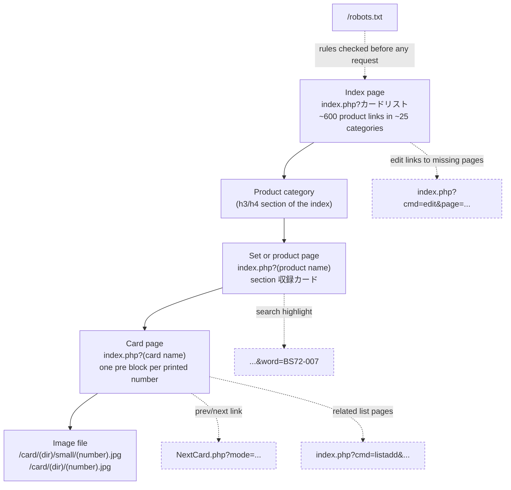

# Source catalogue: batspi.com

Catalogue of [batspi.com](https://batspi.com/) (バトルスピリッツ wiki), the primary source of card data for the Japanese Battle Spirits database. It records what the site is, how it is laid out, what a crawler may and may not request, and how the pages are structured. It is evidence for the source policy ([#53](https://github.com/AleFire99/BS_Database/issues/53)), the fixtures ([#54](https://github.com/AleFire99/BS_Database/issues/54)), the field inventory update ([#55](https://github.com/AleFire99/BS_Database/issues/55)) and the scraper rewrite ([#10](https://github.com/AleFire99/BS_Database/issues/10)). It makes no policy or modelling decisions. Terms are defined in the [glossary](../domain/glossary.md). The card fields per type are listed in the [field inventory](../data-model/field-inventory.md).

## How to read this document

- **Fetch date.** Every fact marked "live" was observed on **2026-11-14** with a plain `GET` and the user agent `Mozilla/5.0 (compatible; bs-database-research)`. The site changes daily, so counts and page contents are dated snapshots.
- **Fixture facts** come from the files in [tests/fixtures/html/](../../tests/fixtures/html/), whose URLs are in [fixtures.json](../../tests/fixtures/html/fixtures.json). The fixture `index.html` carries the stamp `Last-modified: 2026-02-05`.
- Japanese strings are quoted exactly as served. URLs are shown decoded where that helps reading; the raw form is always percent-encoded UTF-8.
- Pages that were not fetched are not described.

## 1. Site overview

| Item | Value |
| --- | --- |
| Software | PukiWiki with a MariaDB backend and custom plugins (footer: `PukiWiki +MariaDB`, `Powered by PHP 8.4.27`, live 2026-11-14) |
| Language | Japanese only (`バトルスピリッツ wiki`) |
| Content | Card pages, set (product) pages, category pages, errata and official Q&A, deck and rules pages |
| Editing | Open wiki: each page has edit, backup and attachment links. Pages that do not exist yet are linked with `cmd=edit` |
| Card images | Hosted on the same site under `/card/` |
| Page size | 90 to 160 KB per card or set page, up to about 450 KB for the promo list (live 2026-11-14), mostly navigation and ad markup |

### Robots policy

`https://batspi.com/robots.txt`, fetched live on 2026-11-14:

```text
User-agent: *
Disallow: /index.php?%E3%82%AB%E3%83%BC%E3%83%89%E6%83%85%E5%A0%B1%E7%B5%9E%E8%BE%BC%E3%81%BF&
Disallow: /?
Disallow: /index.php/

User-agent: bingbot
User-agent: Sogou web spider
User-agent: SemrushBot
User-agent: Baiduspider

Disallow: /

Sitemap: https://batspi.com/index.php?cmd=rss&ver=2.0
```

Reading of the rules:

- The first group applies to every other client, including this project. The percent-encoded path decodes to `/index.php?カード情報絞込み&`: the card-filter search page with any query parameters is disallowed.
- `/?` disallows any URL of the form `https://batspi.com/?…`.
- `/index.php/` disallows path-style URLs (`/index.php/<something>`). The normal pattern `/index.php?<name>` has a `?` after `php`, so it is not matched.
- Four named crawlers are disallowed from the whole site. This project is not one of them, but it should not send their user agent strings.
- The `Sitemap` line points to the PukiWiki RSS feed of recent changes (`cmd=rss`). It is not a full sitemap.
- The file sets no `Crawl-delay`.

### Licence and terms (risk, not a decision)

The footer of every page (live 2026-11-14, and in the fixtures) says:

> ※当サイト上で使用しているカード、パッケージなどの画像およびテキストなどの著作権および商標権、その他知的財産権は、販売メーカー元に帰属します。

In English: copyright, trademark and other intellectual property rights of the card, package images and text used on the site belong to the maker. The same footer says `Copyright © 2001-2006 PukiWiki Developers Team. License is GPL.`: that licence covers the PukiWiki software only, not the wiki content.

No content licence, terms-of-service page or statement about reuse of wiki text was found on the pages sampled. A link to a "利用規約" or "ライセンス" page was not seen on any of them. The consequence for redistributing card text and images in the release artefact is open and is handed to [#53](https://github.com/AleFire99/BS_Database/issues/53).

## 2. Site map

The crawl path from the card list to an image. Dotted edges are links that exist on the pages but that the crawler should not follow.



## 3. URL patterns

Every page is `https://batspi.com/index.php?<name>` where `<name>` is the page name, percent-encoded UTF-8. A card page is named after the card's Japanese name, a set page after the product's Japanese name (examples: `index.php?ゴラドン`, `index.php?契約編：環 第4章：英雄傑集`). Spaces are encoded as `%20` and the full-width colon `：` as `%EF%BC%9A`. Set page names contain no `BS\d{2}` code, so the set code must be taken from the card numbers listed on the page.

| Pattern | Purpose | Crawl |
| --- | --- | --- |
| `index.php?カードリスト` | Index of all products, grouped in sections | yes, entry point |
| `index.php?<product name>` | Set or product page | yes |
| `index.php?<card name>` | Card page | yes |
| `index.php?<category>` (for example `アルティメット`, `赤`, `プロモーションカード`) | Rules, attribute and list pages | only the promo list is a known target |
| `/card/<dir>/small/<file>.jpg`, `/card/<dir>/<file>.jpg` | Card images | no: image files are not downloaded by this catalogue |
| `index.php?<name>&word=<number>` | Same page with a search term highlighted | no: duplicate of the plain page |
| `index.php?cmd=edit&page=<name>` | Edit form. Also the link target for pages that do not exist yet | **do not crawl** |
| `index.php?cmd=backup&page=<name>`, `plugin=attach…`, `plugin=related…` | Wiki maintenance tools | **do not crawl** |
| `index.php?cmd=rss&ver=…` | Recent-changes feed, named as the sitemap in robots.txt | do not crawl for card data; only a future change-detection design may use it |
| `index.php?cmd=listadd&tree=…&rowid=…&pcnt1=…` | Ajax fragment that fills the "related cards" list at the bottom of a card page, 50 rows per page | **do not crawl** |
| `NextCard.php?mode=<0 or 1>&no=<number>&card=<name>` | Previous and next card links | no: the set page already gives the order |
| `/index.php?カード情報絞込み&…` | Card filter search | **disallowed by robots.txt** |
| `/?…`, `/index.php/…` | Alternative URL forms | **disallowed by robots.txt** |
| `bbs/index.php?…` | Bulletin board (for example the "カード画像の提供" link) | do not crawl |

The page name is not a stable key. Two cards can share a name (a card reprinted in different sets with the same name shares one page), and a name can change on the wiki. The card number is the stable identifier; it is printed in `<span class="cardno">` and in the `<h3>` headings of the card page.
