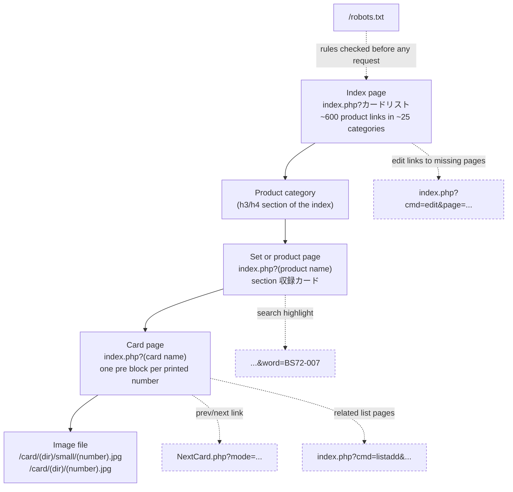

# Source catalogue: batspi.com

Catalogue of [batspi.com](https://batspi.com/) (バトルスピリッツ wiki), the primary source of card data for the Japanese Battle Spirits database. It records what the site is, how it is laid out, what a crawler may and may not request, and how the pages are structured. It is evidence for the source policy ([#53](https://github.com/AleFire99/BS_Database/issues/53)), the fixtures ([#54](https://github.com/AleFire99/BS_Database/issues/54)), the field inventory update ([#55](https://github.com/AleFire99/BS_Database/issues/55)) and the scraper rewrite ([#10](https://github.com/AleFire99/BS_Database/issues/10)). It makes no policy or modelling decisions. Terms are defined in the [glossary](../domain/glossary.md). The card fields per type are listed in the [field inventory](../data-model/field-inventory.md).

## How to read this document

- **Fetch date.** Every fact marked "live" was observed on **2026-11-14** with a plain `GET` and the user agent `Mozilla/5.0 (compatible; bs-database-research)`. The site changes daily, so counts and page contents are dated snapshots.
- **Fixture facts** come from the files in [tests/fixtures/html/](../../tests/fixtures/html/), whose URLs are in [fixtures.json](../../tests/fixtures/html/fixtures.json). The fixture `index.html` carries the stamp `Last-modified: 2026-02-05`.
- Japanese strings are quoted exactly as served. URLs are shown decoded where that helps reading; the raw form is always percent-encoded UTF-8.
- Pages that were not fetched are not described.

## 1. Site overview

| Item | Value |
| --- | --- |
| Software | PukiWiki with a MariaDB backend and custom plugins (footer: `PukiWiki +MariaDB`, `Powered by PHP 8.4.27`, live 2026-11-14) |
| Language | Japanese only (`バトルスピリッツ wiki`) |
| Content | Card pages, set (product) pages, category pages, errata and official Q&A, deck and rules pages |
| Editing | Open wiki: each page has edit, backup and attachment links. Pages that do not exist yet are linked with `cmd=edit` |
| Card images | Hosted on the same site under `/card/` |
| Page size | 90 to 160 KB per card or set page, up to about 450 KB for the promo list (live 2026-11-14), mostly navigation and ad markup |

### Robots policy

`https://batspi.com/robots.txt`, fetched live on 2026-11-14:

```text
User-agent: *
Disallow: /index.php?%E3%82%AB%E3%83%BC%E3%83%89%E6%83%85%E5%A0%B1%E7%B5%9E%E8%BE%BC%E3%81%BF&
Disallow: /?
Disallow: /index.php/

User-agent: bingbot
User-agent: Sogou web spider
User-agent: SemrushBot
User-agent: Baiduspider

Disallow: /

Sitemap: https://batspi.com/index.php?cmd=rss&ver=2.0
```

Reading of the rules:

- The first group applies to every other client, including this project. The percent-encoded path decodes to `/index.php?カード情報絞込み&`: the card-filter search page with any query parameters is disallowed.
- `/?` disallows any URL of the form `https://batspi.com/?…`.
- `/index.php/` disallows path-style URLs (`/index.php/<something>`). The normal pattern `/index.php?<name>` has a `?` after `php`, so it is not matched.
- Four named crawlers are disallowed from the whole site. This project is not one of them, but it should not send their user agent strings.
- The `Sitemap` line points to the PukiWiki RSS feed of recent changes (`cmd=rss`). It is not a full sitemap.
- The file sets no `Crawl-delay`.

### Licence and terms (risk, not a decision)

The footer of every page (live 2026-11-14, and in the fixtures) says:

> ※当サイト上で使用しているカード、パッケージなどの画像およびテキストなどの著作権および商標権、その他知的財産権は、販売メーカー元に帰属します。

In English: copyright, trademark and other intellectual property rights of the card, package images and text used on the site belong to the maker. The same footer says `Copyright © 2001-2006 PukiWiki Developers Team. License is GPL.`: that licence covers the PukiWiki software only, not the wiki content.

No content licence, terms-of-service page or statement about reuse of wiki text was found on the pages sampled. A link to a "利用規約" or "ライセンス" page was not seen on any of them. The consequence for redistributing card text and images in the release artefact is open and is handed to [#53](https://github.com/AleFire99/BS_Database/issues/53).

## 2. Site map

The crawl path from the card list to an image. Dotted edges are links that exist on the pages but that the crawler should not follow.



## 3. URL patterns

Every page is `https://batspi.com/index.php?<name>` where `<name>` is the page name, percent-encoded UTF-8. A card page is named after the card's Japanese name, a set page after the product's Japanese name (examples: `index.php?ゴラドン`, `index.php?契約編：環 第4章：英雄傑集`). Spaces are encoded as `%20` and the full-width colon `：` as `%EF%BC%9A`. Set page names contain no `BS\d{2}` code, so the set code must be taken from the card numbers listed on the page.

| Pattern | Purpose | Crawl |
| --- | --- | --- |
| `index.php?カードリスト` | Index of all products, grouped in sections | yes, entry point |
| `index.php?<product name>` | Set or product page | yes |
| `index.php?<card name>` | Card page | yes |
| `index.php?<category>` (for example `アルティメット`, `赤`, `プロモーションカード`) | Rules, attribute and list pages | only the promo list is a known target |
| `/card/<dir>/small/<file>.jpg`, `/card/<dir>/<file>.jpg` | Card images | no: image files are not downloaded by this catalogue |
| `index.php?<name>&word=<number>` | Same page with a search term highlighted | no: duplicate of the plain page |
| `index.php?cmd=edit&page=<name>` | Edit form. Also the link target for pages that do not exist yet | **do not crawl** |
| `index.php?cmd=backup&page=<name>`, `plugin=attach…`, `plugin=related…` | Wiki maintenance tools | **do not crawl** |
| `index.php?cmd=rss&ver=…` | Recent-changes feed, named as the sitemap in robots.txt | do not crawl for card data; only a future change-detection design may use it |
| `index.php?cmd=listadd&tree=…&rowid=…&pcnt1=…` | Ajax fragment that fills the "related cards" list at the bottom of a card page, 50 rows per page | **do not crawl** |
| `NextCard.php?mode=<0 or 1>&no=<number>&card=<name>` | Previous and next card links | no: the set page already gives the order |
| `/index.php?カード情報絞込み&…` | Card filter search | **disallowed by robots.txt** |
| `/?…`, `/index.php/…` | Alternative URL forms | **disallowed by robots.txt** |
| `bbs/index.php?…` | Bulletin board (for example the "カード画像の提供" link) | do not crawl |

The page name is not a stable key. Two cards can share a name (a card reprinted in different sets with the same name shares one page), and a name can change on the wiki. The card number is the stable identifier; it is printed in `<span class="cardno">` and in the `<h3>` headings of the card page.

## 4. Product categories and set pages

### Index page

The index `index.php?カードリスト` is one HTML page with no pagination: all links come in a single response, and the page has no paging elements. The fixture [index.html](../../tests/fixtures/html/index.html) (`Last-modified: 2026-02-05`) has **577 product links** in the sections below (counted by section heading, links to wiki tools excluded). Seven further links use `cmd=edit&page=…` and point to pages that do not exist yet; they must be skipped:

`BATTLE SPIRITS スペシャルスタッフトークショー 2025`, `バトスピフェスタ2008`, `ガンダムカップ2024`, `バトルスピリッツ 覇者の咆哮`, `バトルスピリッツ デジタルスターター`, `バトルスピリッツ ヒーローズソウル`, `バトルスピリッツ 輝石の覇者`.

The structure is `h2 カードリスト` → `h3` category → optional `h4` subcategory → links. A page can appear under more than one heading (for example `プロモーションカード`).

| Category (heading) | Links | Examples (as linked) | Number prefix seen |
| --- | --- | --- | --- |
| `ブースターパック` (h3) | 76 | `契約編：環 第4章：英雄傑集`, `星座編 第一弾：八星龍降臨`, `第一弾`, `アルティメットバトル01` | `BS##` |
| `構築済みデッキ` (h3) | 79 | `メガデッキ【豪炎の創世主】`, `バトスピスタートデッキ【煌臨スル龍皇】`, `コラボスターター【ガンダム ～OPERATION UC～】` | `SD##` |
| `テーマパック/再録パック` (h3) | 51 | `GREATEST RECORD 2020`, `ディーバブースター【メモリアルレコード】`, `Xレアパック 【龍皇ジークフリード】` | `BSC##`, plus reprint numbers of other sets |
| `コラボブースター` (h3) | 34 | `コラボブースター【仮面ライダー ～善悪の選択～】` | `CB##` |
| `コラボブースターEX` (h3) | 1 | `コラボブースターEX【ガンダム ～運命と自由～】` | not sampled |
| `プレミアムカードセット` (h3) | 12 | `バトスピプレミアムカードセット 新世紀エヴァンゲリオン` | not sampled |
| `ウエハース` (h4 under `食玩`) | 38 | `バトルスピリッツ ウエハース ～蛇皇襲来～` | reprint numbers of other sets |
| `フィギュアコレクション` (h4 under `食玩`) | 3 | `バトルスピリッツ覇王フィギュアコレクション` | not sampled |
| `食玩その他` (h4 under `食玩`) | 1 | `バトルスピリッツスペシャルスターターセット` | not sampled |
| `プレミアムバンダイ` (h4 under `限定商品`) | 64 | `バトルスピリッツ プレミアムフルールBOX`, `コラボスターター【仮面ライダー 時刻の特異点】` | not sampled (the promo list has `PB##` numbers) |
| `リミテッドパック` (h4 under `限定商品`) | 28 | `リミテッドパック2026 契約編：環 Vol.2`, `リミテッドパック2018` | `LM##` |
| `DVD-BOX/Blu-ray BOX` (h4) | 10 | `バトルスピリッツ サーガブレイヴ コレクターズBOX` | not sampled |
| `最強ジャンプ応募者全員サービス` (h4) | 4 | `戦極最強パック` | not sampled |
| `限定品その他` (h4) | 12 | `プレミアムカードコレクション 三賢神` | not sampled |
| `配布品・付録` (h3) | 36 | `プロモーションカード`, `キャンペーンカード`, `バトスピ部` | see the promo list in the next section |
| `書籍特典` (h4 under `配布品・付録`) | 33 | links named after the cards, for example `ジークヴルム・シックスファクター` | not sampled |
| `バトルスキー イベント` (h4) | 6 | `バトルスキー`, `バトルスキー トレジャーパック2019 vol.1` | not sampled |
| `バトスピショップバトル ・ バトスピフレンドリーバトル` (h4) | 17 | `バトスピ トレジャーパック2023` | not sampled |
| `大会・イベント` (h3) and its h4 `オンライン` (3), `アニメイベント` (5), `大会` (39), `ショップバトル` (19) | 4 + 66 | `バトスピチャンピオンシップ2023` | prize cards, not sampled |
| `ゲーム` (h3) | 2 | `バトルスピリッツ クロスオーバー` | video games, no cards sampled |

The heading text in the page carries a trailing `†` (PukiWiki anchor) and some spaces; the table gives the text as normalized. Counts are links, not distinct products: a product can be linked twice.

For card data, the categories sampled for this catalogue are boosters, ready-made decks (starters), theme and reprint packs, collab boosters, limited packs, wafers and the promo list. The remaining categories are listed for completeness only; which of them are in scope is a decision for the source policy ([#53](https://github.com/AleFire99/BS_Database/issues/53)) and the scraper design.

### Set naming

A set page is named after the product, not after a code. Sampled pairs of page name and card-number prefix (live 2026-11-14, from the card numbers on each page):

| Page name | Prefix | Note |
| --- | --- | --- |
| `第一弾` | `BS01` | first booster; the page title is only `第一弾` |
| `星座編 第一弾：八星龍降臨` | `BS10` | seen through the card `砲凰竜フェニック・キャノン` (`BS10-062`) |
| `烈火伝 第1章` | `BS31` | seen through `BS31-XX02` |
| `神煌臨編 第1章：創界神の鼓動` | `BS44` | release 2018-04-21 |
| `転醒編 第1章：輪廻転生` | `BS52` | release 2020-04-25 |
| `契約編：環 第1章：廻帰再醒` | `BS72` | release 2025-05-17 |
| `契約編：環 第4章：英雄傑集` | `BS75` | `Last-modified: 2026-03-16` |
| `コラボブースター【仮面ライダー ～善悪の選択～】` | `CB34` | collab prefix `CB##` |
| `コラボスターター【ガンダム ～OPERATION UC～】` | `SD54` | collab starters use the starter prefix |
| `リミテッドパック2018` | `LM18` | plus two reprints `BS46-RV007`, `BS46-RV008` |
| `バトスピスタートデッキ(烈火伝)` | `SD29` | starter; cards from `SD19`, `SD03`, `SD10`, `BS01` are reused |
| `GREATEST RECORD 2020` | none of its own | 87 reprints, all with the original sets' numbers |
| `バトルスピリッツ ウエハース ～蛇皇襲来～` | none of its own | 25 reprints with the original numbers |

Observations:

- Names are Japanese product names and contain full-width characters (`：`, `～`, `【】`) and spaces. Some are page names without the product line (`第一弾`); the era is in the set's own number and the `Before:` / `After:` navigation at the top of the page (for example `Before：超煌臨編 第4章：神攻勢力` / `After：転醒編 第2章：神出鬼没`).
- A set page therefore does not tell the set code. The code is the common prefix of the card numbers in the main sections; reprints of other sets in the same list carry their original prefix (the `契約編：環 第1章` list holds `BS44-086`, `BSC42-082` and `BS49-RV012`).
- A set page lists only what its product contains. It does not list every printing of a card.

### Set page layout

Seen on the sampled set pages (live 2026-11-14):

1. Title `<h2>` with the product name, then a header block: `Before:` / `After:` links, the release date (`2020年4月25日発売`), the price and pack size (`ブースターパック 1パック9枚:270円+税`), the totals (`全99種+11種(自販機ブースター：全99種+17種)`) and a rarity breakdown (`コモン(C)：45　レア(R)：15　マスターレア(M)：12`).
2. `h2 収録カード`, an inline link `[リスト解析表示]`, then colour `h3` (`赤`, `紫`, `緑`, `白`, `黄`, `青`, `6色`) and card-type `h4` (`スピリット`, `ブレイヴ`, `ネクサス`, `マジック`). Then special sections as `h3`: `Xレア`, `XXレア`, `AXレア`, `契約Xレア`, `転醒Xレア`, `10thXレア`, `キャンペーンカード`, `BOX購入特典キャンペーンカード`.
3. Each entry is plain text: the card number, a space, the card name as a link to the card page, then an optional rarity and a note. Example (BS01): `BS01-001 ゴラドン` followed by `<br />`. With rarity: `BS72-005 サンダー・Z・チュウレオン R`. Special: `BS44-X01 太陽神星龍アポロヴルム X (パラレルあり)`.
4. Starter pages (`SD29`, `SD54`) have type headings without colours (or `－赤－` lines inside them) and a copy count in brackets after the name: `SD54-001 ロト (3)`, `SD54-010 バナージ・リンクス R (2)`. A section `差し替えカード` lists a card swapped in from another product (`SD06-016 絶甲氷盾 (3)`).
5. Wafer and reprint pages have the colour `h3` only and notes such as `（※ブロックアイコン<5>）(新規CGイラスト)` after the rarity: `SD43-RV001 ブレイドラ（※ブロックアイコン<5>）(新規CGイラスト)`.
6. `h2 リンク`, `h2 外部リンク` end the page.

Sampled entry counts (card numbers in the list, live 2026-11-14 unless noted): `第一弾` 116 (`Last-modified: 2025-06-22`), `転醒編 第1章` 116, `神煌臨編 第1章` 122, `契約編：環 第1章` 108 (fixture), `第4章` 114, `GREATEST RECORD 2020` 87, `コラボブースター【仮面ライダー ～善悪の選択～】` 93, `コラボスターター【ガンダム ～OPERATION UC～】` 19, `バトスピスタートデッキ(烈火伝)` 15, `リミテッドパック2018` 12, wafer 25. No list was incomplete in a way that could be told from the page, but a gap in the numbering cannot be told from a missing wiki entry: `第一弾` has no entry for `BS01-002`, for example.

### Pagination

- The index and all sampled set pages are single HTML responses. No paging elements (`paging_numbers`, `PageTitle`) appear on them, including the largest page, the promo list `プロモーションカード` (about 450 KB, about 1,400 numbered entries, `Last-modified: 2026-10-30`).
- The only paginated element found is the "related cards" list at the bottom of a card page: `該当:70枚(1～50枚) Page:1/2`, 50 rows per page, loaded through `index.php?cmd=listadd&…`. It repeats other cards' data and is not needed to read a card (marked do not crawl above).

## 5. Card numbers

The card number is the identity key on batspi.com: it is the text in front of the card link on set pages, `<span class="cardno">` and the `<h3>` heading suffix `<BS01-001>` on card pages, and part of the image file name.

| Scheme | Meaning | Example (live 2026-11-14 unless noted) |
| --- | --- | --- |
| `BS##-###` | Booster card | `BS01-001`, `BS72-007` |
| `BS##-X##` | X rare | `BS01-X01`, `BS44-X07` |
| `BS##-XX##` | XX rare | `BS31-XX02` |
| `BS##-CP##` | Campaign card of the set | `BS52-CP14` |
| `BS##-RV###` | Revival (reprint) with a new number | `BS38-RV022`, `BS49-RV012` |
| `BS##-AX##`, `BS##-CX##`, `BS##-TX##`, `BS##-TCP##`, `BS##-10thX##` | Special rarities of the contract and awakening eras | `BS72-AX03`, `BS52-TX01`, `BS73-TCP01(A)` |
| `BS##-<number>(A)`, `(B)` | The two faces of a flip (転醒) card | `BS52-TX01(A)`, `BS52-TX01(B)` |
| `SD##-###`, `SD##-X##`, `SD##-CP##`, `SD##-RV###` | Starter, deck and collab-starter cards | `SD29-001`, `SD19-X01`, `SD67-CP01`, `SD43-RV001` |
| `BSC##-###` | Theme and reprint pack card | `BSC22-001`, `BSC42-082` |
| `CB##-###`, `CB##-RV###`, `CB##-X##`, `CB##-CP##`, `CB##-CX##`, `CB##-XX##` | Collab booster | `CB34-001` (set `CB34` also reuses `CB17-X06`) |
| `LM##-##`, `LM##-U##`, `LM##-G##`, `LM##-D##` | Limited pack | `LM18-01` |
| `P###`, `P##-##`, `P##-X##`, `P##-G##` | Promo | `P001`, `P25-06`, `P20-19` |
| `26RBS##-…`, `26RSD##-…` | Cards of a 2026 "26R" series, seen in the related-card list | `26RBS02-CP01`, `26RSD01-013` |

Promo prefixes: the page `プロモーションカード` is organised by number family. Its section headings (live 2026-11-14) are: `Pナンバー`, `CPナンバー`, `RVナンバー`, `PBナンバー`, `PXナンバー`, `Xナンバー`, `EXナンバー`, `BS-SPナンバー`, `LMナンバー`, `SJナンバー`, `KAナンバー`, `KFナンバー`, `GXナンバー`, `BSCOナンバー`, `BSHナンバー`, `EXGナンバー`, `ナンバーなし`. The sub-headings include numbers by campaign year (`P13ナンバー`, `P14ナンバー<1>`, … `P25ナンバー<12>`, `RP26ナンバー<A>`) and variants such as `BS-CPナンバー<2>`, `BSC-CPナンバー<2>`, `CB-CPナンバー<4>`, `SD-CPナンバー<9>`, `RBS-CPナンバー<A>`. Entry formats seen in the list: `P001`, `P20-19`, `PB18-…`, `PX14-…`, `SJ12-…`, `LM13-…`, `KA12-01`, `KF-01`, `BSCO-001`, `BSH-001`, `EXG2-001`, `EX001`, `X009`. The section `ナンバーなし` is for cards without a number (not sampled in detail).

A card name is not unique across numbers, and one card page serves several numbers (next section). The number prefix does not always match the set: a `BS##-RV###` or `BSC##` card appears in the lists of unrelated products.
