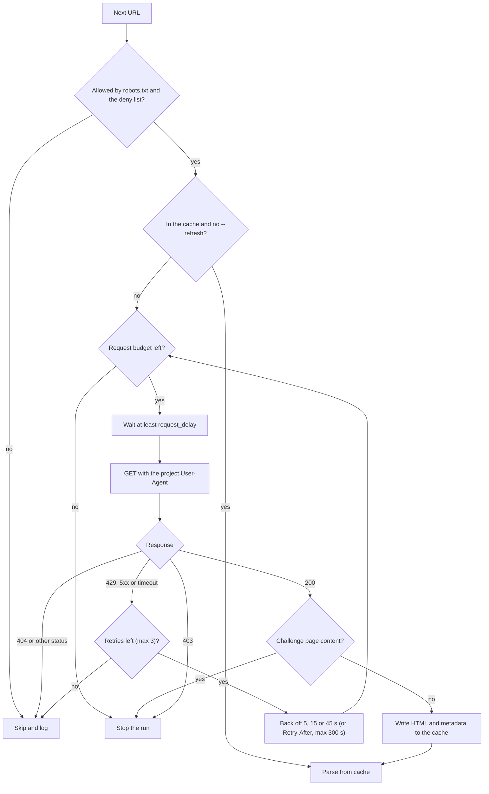

# Scraping and redistribution policy

This is the normative policy for fetching card data and publishing what the pipeline builds. The scraper rewrite ([#10](https://github.com/AleFire99/BS_Database/issues/10)) must implement it, and every later change to the pipeline must keep to it. The redistribution decision is recorded in [ADR 0006](../adr/0006-scraping-and-redistribution-policy.md) (Status: Accepted). Evidence comes from the source dossiers: [batspi.md](batspi.md), [official.md](official.md) and [fandom.md](fandom.md), all surveyed on 2026-11-14. Policy task: [#53](https://github.com/AleFire99/BS_Database/issues/53).

The words **must**, **must not** and **may** are binding.

## 1. Sources in scope

| Source | Fetched by the pipeline? | Reason |
| --- | --- | --- |
| `batspi.com` | **Yes**, the only automated source | Authoritative for card data; robots.txt allows card and set pages ([batspi.md §1](batspi.md#robots-policy)) |
| `battle-spirits.fandom.com` | **No** | Dropped for v1: pages and images return a Cloudflare challenge ([fandom.md §1](fandom.md#1-access-evidence-2026-11-14)) |
| `www.battlespirits.com` (official) | **No** | Survey only; the site asks visitors not to reuse its text or images ([official.md §2](official.md#2-reuse-note)) |

Adding a source requires a new dossier in `docs/sources/` and an update to this page.

## 2. Request flow



Before the first URL of a run, robots.txt is fetched. If that fails (any status other than 200 or 404), the run stops.

## 3. Rules

### 3.1 robots.txt and deny list

- The scraper **must** fetch `https://batspi.com/robots.txt` once per run and check every URL against it with `urllib.robotparser`.
  - The rules in force on 2026-11-14 disallow `/?`, `/index.php/` and `/index.php?カード情報絞込み&…`.
  - On Python 3.12, `urllib.robotparser` normalises `Disallow: /?` to `/`, which would block the whole site. A rule that ends in `?` **must** therefore be checked as a plain prefix of the path and query, outside the parser. See `split_robots` in [ingest/policy.py](../../src/bs_database/ingest/policy.py), which [test_ingest_policy.py](../../tests/test_ingest_policy.py) covers.
- In addition, the scraper **must not** request:
  - PukiWiki action pages: any URL with `cmd=` or `plugin=`, for example `cmd=edit`, `cmd=listadd` or `cmd=rss`.
  - Search URLs with `word=`.
  - `NextCard.php` (previous/next card links) and the bulletin board under `bbs/`.
  - In short, only `index.php?<page name>` URLs without further parameters are fetched.
  - These pages are not card data, and the index links to some of them ([batspi.md §3](batspi.md#3-url-patterns)).
- If robots.txt cannot be fetched (any status other than 200 or 404), the run **must** stop.

### 3.2 Rate and volume

- Requests are sequential, one at a time. No parallel connections.
- Delay between requests:
  - Setting `request_delay`, **default `3.0` seconds**. The default is the recommended value; the setting may be lowered to a hard floor of `1.0` and **must not** accept anything below it.
  - Backoff waits (§3.5) come on top of the delay.
  - The surveys of #51 and #52 used 3 to 5 s.
- Request budget:
  - At most **1,000 network requests per run** by default (setting `max_requests`). Cache hits do not count; retries do.
  - When the budget is used up, the run stops cleanly; the next run resumes from the cache.
- At the default rate, a full first crawl of about 6,500 card pages takes about 5.5 hours, split over several runs. Later runs are fast because of the cache.

### 3.3 User-Agent

- Every request **must** send exactly one User-Agent, set in one place (setting `user_agent`):

  ```text
  bs-database/<version> (+https://github.com/AleFire99/BS_Database)
  ```

  `<version>` is the package version.
- The string **must not** contain personal data, such as an e-mail address or name.
- The scraper **must not** imitate a browser or a named crawler.

### 3.4 Cache

- Every fetched page **must** be stored before it is parsed:
  - The page goes to `data/cache/html/<source>/<sha256 of the URL>.html`.
  - A sidecar file `<same name>.json` holds `url`, `fetched_at` (UTC, ISO 8601), `status` and `etag` / `last_modified` if present.
- Parsers **must** read only from the cache, never from the network.
- A cached page is re-fetched only with an explicit `--refresh` flag, or when it is older than a `--max-age` given on the command line. There is no automatic expiry.
- The cache is local working data. It **must** be git-ignored and **must not** be published or attached to a release.

### 3.5 Errors

| Response | Action |
| --- | --- |
| 200 | Cache and parse |
| 404 | Log and skip; do not retry within the run |
| 429, 500, 502, 503, 504, timeout | Retry at most 3 times with backoff of 5, 15 and 45 s. If a `Retry-After` header is present and longer, use it instead, capped at 300 s; a longer `Retry-After` stops the run. After the last failure, log and skip |
| 403, a Cloudflare or other challenge page, a CAPTCHA | **Stop the run.** No retry, no change of client, no bypass of any kind |
| Any other status | Log and skip |

A challenge page is detected by its content, such as the title `Just a moment...` or a `challenges.cloudflare.com` script, even when the status is 200.

### 3.6 Images

- The pipeline **must not** download card images by default, and images **must not** be committed or redistributed.
- Image URLs ([batspi.md §7](batspi.md#7-images)) may be stored in the database.
- Any future local image download is opt-in, uses the same rules, and its output stays local.

## 4. Redistribution and attribution

Decision (owner, 2026-11-14; [ADR 0006](../adr/0006-scraping-and-redistribution-policy.md)): the public repository and release artefact **may** contain card data and card text compiled from batspi.com. This covers names, numbers, gameplay values, and the Japanese effect and flavor text with their English translations. **Images are excluded.**

Conditions:

- **Attribution.** The README, every release note and the database's metadata table **must** carry this text:

  ```text
  Card data compiled from batspi.com (https://batspi.com/), a Japanese Battle Spirits fan wiki.
  Battle Spirits and all card names, texts and artwork are © BANDAI / SUNRISE and their respective rights holders.
  This is an unofficial fan project, not affiliated with or endorsed by BANDAI.
  English text is machine-translated unless marked otherwise.
  ```

- **Takedown.** A rights holder can ask for removal by opening an issue at <https://github.com/AleFire99/BS_Database/issues>. The project removes the requested content from the next release and stops publishing it.
- **No source HTML.** Raw pages from the cache are never published. Test fixtures under `tests/fixtures/html/` are the exception: a small, size-limited set of pages, documented in their README ([#54](https://github.com/AleFire99/BS_Database/issues/54)). The takedown route covers them too.
- **Fandom text** is CC-BY-SA ([fandom.md §3](fandom.md#3-licence)). It is not used in v1. If it is ever used, the share-alike terms apply to the derived text.
- **Official-site content** is not fetched or redistributed ([official.md §2](official.md#2-reuse-note)).

This is the project's position, not legal advice.

## 5. Requirements for the scraper rewrite (#10)

| # | Requirement | Setting or behaviour |
| --- | --- | --- |
| R1 | One shared HTTP client used by every scraper, with no direct `requests.get` calls. Today there are 7 such calls in 5 modules of `src/bs_database/scrapers/` | `http` module |
| R2 | robots.txt check per run, plus the deny list | §3.1 |
| R3 | `request_delay` default `3.0`, minimum `1.0`; `max_requests` default `1000` | [settings.py](../../src/bs_database/settings.py) |
| R4 | `user_agent` setting with the fixed format | §3.3 |
| R5 | Raw-HTML cache with metadata sidecars and `cache_dir` setting (default `data/cache/html`); `--refresh` and `--max-age` CLI options; `data/cache/` in `.gitignore` | §3.4 |
| R6 | Retry, backoff and challenge detection, with the run stopping on 403 or a challenge | §3.5 |
| R7 | No image download by default | §3.6 |
| R8 | Attribution text in the README, release notes and a DB metadata table | §4 |
| R9 | Fandom and official scrapers removed or disabled for v1 | §1 |
| R10 | [configuration.md](../configuration.md) updated for the new settings | — |
